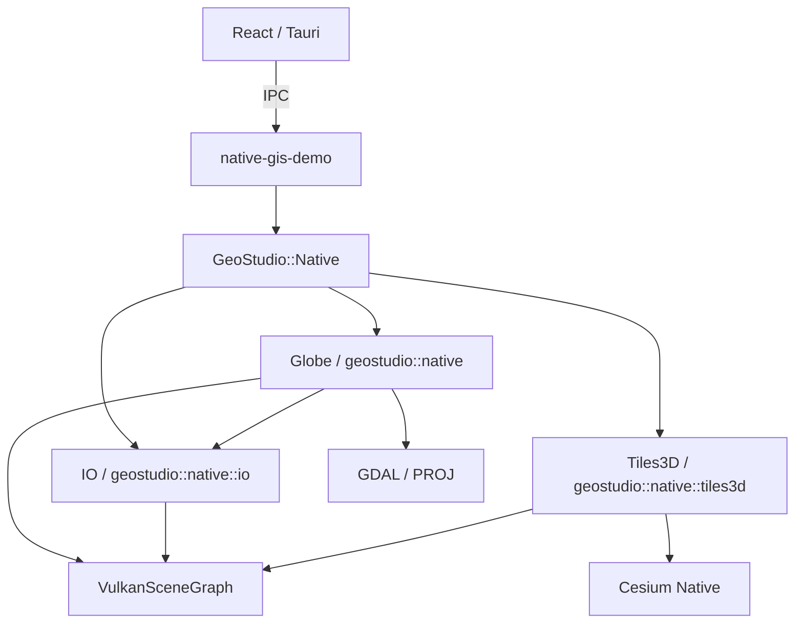

# SDK 架构与迁移

当前 GeoStudioNative 0.2.0，主任务为 [NativeSDK-002](任务/002-Namespace与模块重组.md)。此前 P0 的行为与验证保留在 [NativeSDK-001](任务/001-NativeSDK整合P0.md)，不以旧验收覆盖新 ABI。

## 模块关系

src/globe、src/io、src/tiles3d 分别构建。公开 header 在 include/geostudio/native 下；Tiles3D runtime header 在 src/tiles3d/include，只用于私有构建。examples／tests／resources 独立，不把外部依赖源码并入自有 namespace。

## API 与 ABI

Rocky 的实际 C++ namespace 为 geostudio::native，I/O 为 geostudio::native::io，TilesetAdapter 和 runtime 为 geostudio::native::tiles3d。没有旧 C++ namespace alias。第 2 轮进一步移除 ROCKY_NAMESPACE／ROCKY_VSG_NAMESPACE 宏，源码直接使用 geostudio::native；原始版权与许可注释保持。底层 feature macros 和 Shader 文件名保留来源前缀，避免无关资源协议重命名。

GeoStudio::Globe 是 static library，GeoStudio::IO 和 GeoStudio::Tiles3D 是 shared library。Globe ABI 标识递增至 61；I/O SO 标识递增至 4；SDK package 0.2 采用 SameMinorVersion，不接受旧 0.1 consumer。新安装目录为 out/install-modules，旧安装目录和旧运行包保留。外部工具链、CRT 与依赖组合必须一致。

VSG 类型注册采用新 fully qualified name。I/O ObjectFactory 同时保留旧 vsgXchange Reader 类型字符串读取映射；新对象写出新名字。这是序列化名称兼容，不是 C++ namespace alias。Map／Layer JSON 配置键和 3D Tiles 数据协议没有改名；不宣称任意旧自定义 VSG scene snapshot 都兼容。

## 生命周期与资源

沿用已验证 Adapter 行为：Device 创建前配置双方能力，绑定宿主 Viewer／View／Camera，在 render thread 每帧 pump 和 update。移除时 close，继续 pump 至 retired，GPU idle 后释放；最后主动 shutdown runtime，避免 DLL detach 才销毁 Vulkan 对象。

Cesium Native 保持 private linkage，其 GLM_FORCE_XYZW_ONLY 和 C++20 不进入公共 consumer。Globe 与宿主共享 ImGui context。没有增加第二套 Viewer，也没有新增 Demo UI 功能。

资源从 resources/globe、resources/tiles3d 安装到 share/GeoStudioNative/resources；GEOSTUDIO_NATIVE_FILE_PATH 指向 globe，VSG_FILE_PATH 指向 tiles3d。GLSL/C++ 共用 defines 从资源源文件生成 include 副本，不能手改生成 header。

## 来源与兼容迁移

模块清单、完整原件差异与旧路径映射见 [provenance](../../provenance/README.md)。原示例源码保留并同步 namespace，见[示例索引](../../examples/README.md)。仅清理被新构建取代的入口及未使用的上游 CI／依赖编排，不移除用户文档或 Git 历史。

Demo build/native-modules 只消费新安装包；新运行包 out/desktop-native-modules。修改 SDK 后先构建 SDK，再构建／stage／打包 Demo。环境及完整命令见[安装构建与使用](安装构建与使用.md)。
