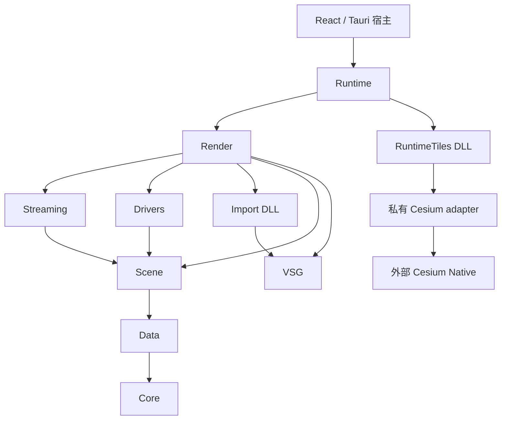

# SDK 架构与迁移

当前 GeoStudioNative 0.3.0，主任务 [NativeSDK-003](SDK架构与迁移.md)。头源同目录、按能力组织，来源以 provenance 映射保留；没有保留 globe／io／tiles3d 三个顶层源码组件。

## 依赖与职责



`src/core` 包含 base／geo／math／async／cache／io；`src/data` 包含 vector／raster／elevation；`src/scene` 定义 Map、Layer、Entity 和 Viewpoint；`src/drivers` 按数据源分组；`src/streaming` 负责 Terrain 数据组装；`src/render` 负责 VSG 表达、分页和渲染算法；`src/runtime` 只负责装配、运行和生命周期。

VSG 的分类职责和 osgEarth 的 Drivers 边界用于指导结构，具体分层以本工程的真实 include 和链接依赖为准。此轮抽离 Terrain Picking 到 render/view，使 DisplayManager／MapManipulator 无需反向包含 Application。Core/Data 的公开链接不依赖 VSG，Core 仍因现有 Context 实现使用 GDAL、PROJ、CURL；完全独立的微型 Core package 不是本轮交付。

原 vsgXchange 中把输入转换为 VSG Object 的 Reader 放在 render/import；GIS 原始数据访问在 drivers，不把两者混为一个 data 层。原 vsgCs 的 HTTP、异步、坐标、模型和资源代码分散到对应能力的 cesium 子目录；为隔离 C++20、GLM 与 Cesium 对象布局，这些实现由一个私有 target 编译，不能链接进公开 C++17 能力库。

## 文件、公开接口和 ABI

头文件与实现放在同一职责目录。`cmake/capability-sources.cmake` 显式列出公共能力源文件；`cmake/capability-headers.json` 记录每个 header 的源位置、include 名和 public 标志。构建时生成 include 视图，不移动原文件、不维护第二份手写 header。

消费者示例：

```cpp
#include <geostudio/native/core/geo/SRS.h>
#include <geostudio/native/drivers/gdal/GDALImageLayer.h>
#include <geostudio/native/runtime/engine/Application.h>
#include <geostudio/native/runtime/engine/TilesetAdapter.h>
```

旧 include 路径不继续安装；CMake 的 Globe／IO／Tiles3D target alias 暂时映射到 Runtime／Import／RuntimeTiles，方便已有消费方按次序迁移，不表示保留旧组件。namespace 保持 `geostudio::native`、`geostudio::native::io`、`geostudio::native::tiles3d`。VSG Reader 的旧序列化类型字符串继续保留读取映射，Map／Layer JSON 和 3D Tiles 数据协议不改名。

SDK package 升至 0.3.0，ABI 标识 62；安装路径 `out/install-capabilities`。七个能力库为 static，Import／RuntimeTiles 为 DLL。默认 consumer 为 C++17，Cesium 私有实现为 C++20。不同 package、CRT 或 GLM 配置不能混用。

## ImGui 由宿主管理

SDK 的 Application、View、VSGContext 与 ECSNode 不持有 ImGui context，不自动安装 GUI，也不绘制 Widget。纯 Label 状态属于 Scene；GUI 绘制及事件翻译由需要它的宿主适配。SDK package 不查找 imgui，bootstrap 默认不编译它；原宿主适配来源仍保留在 Demo native/ui，但当前 Tauri 产品不编译或消费该目录。

当前 Demo 以 Tauri＋React 为唯一产品入口，ng-viewer.exe 为内部原生引擎，采用独立进程和 Native Window 边界。Viewer、View、Camera 的共享关系及 TilesetAdapter 的 close／pump／retired／shutdown 生命周期保持；没有新增通用 JS 绑定或跨线程渲染 API。

## 宏、资源和可选能力

自有活动源码、CMake、测试、示例和 GLSL 的 ROCKY_* 改为 GEOSTUDIO_NATIVE_*。公共 static API 使用 GEOSTUDIO_NATIVE_API，RuntimeTiles DLL 使用 GEOSTUDIO_NATIVE_EXPORT，避免导出宏冲突。版本比较宏补上正确括号并加编译断言。资源文件名和数据协议保留原名；外部 VSG／Cesium／第三方宏不强制重命名。

Slughorn 的实际 Adapter 和 SlugSystem 保留源码，默认不编译；其纯算法回归继续执行。MBTiles、Azure、Bing 等仍受原 feature guard 控制，不因文件归类宣称启用新格式。实验能力保持原 feature guard；已移除的上游示例通过 provenance 的完整差异与固定来源恢复。

## 检查与来源

[代码测试](../../tests/README.md)覆盖基础算法、现有渲染相关 CPU 逻辑、Reader、局部资源协议和小型 fixture。架构检查拒绝反向 include、UI 泄漏、私有 header 安装和旧宏。独立 package consumer 检查公开 header、类型注册、Core/Data 单独链接和 GLM 隔离。

[capability-migration.json](../../provenance/capability-migration.json)记录旧路径到新路径；每个来源的 005-capabilities.patch 是对固定原件的完整差异，旧 patches 保留历史。版权和许可内容不改。当前不做 GPU、性能、渲染回归或人工验收，不能将 CPU 通过扩展为这些结论。

## 当前验证边界与后续工作

能力分层、公开头文件、独立安装 consumer 和 CPU 代码回归已有验证。历史 Globe 完整套件的一个 Vertical Datum case 因缺少 PROJ grid 未通过；不能将局部重验解释为完整套件通过。新机器 bootstrap、Debug、跨平台、真实 GPU／窗口、性能与人工验收尚未完成。

宿主适配迁移、发行来源筛选及 SDK examples／tools 的明确删除已完成。源码恢复依据为 provenance 中的固定版本、完整 patch、module-files、迁移映射及 removed-upstream-files.json；不把任务快照或哈希清单当成原件。旧 staging 与安装产物保持原位。GeoJSON 渲染专项、进一步布局、统一构建及存量注释整理按各自实际范围另行评审。
