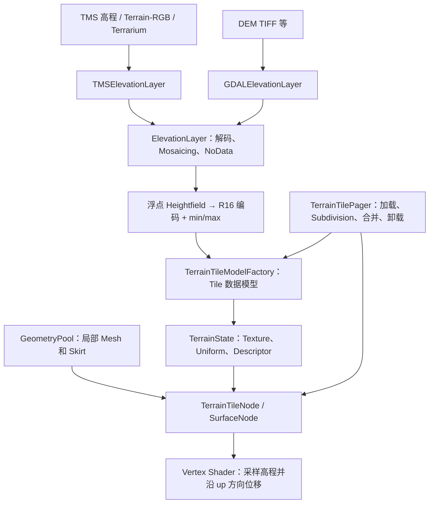
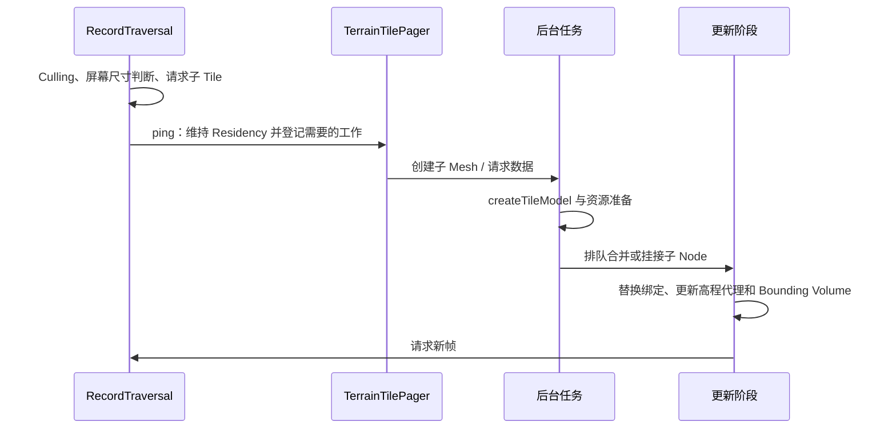

# 三维地形：高程数据、Mesh 与 Paging

术语用法见[术语表](../术语.md)；本篇保留英文底层术语，中文用于解释。

## 目标、版本与基本区别

本篇同时说明高程数据源和地形渲染器。基线为 `a4d8b141ec478e8440526928b344c6eb93810631`；H 编号对应文末证据。实现流程已经静态核对，接口片段与运行用例本轮未执行。

`TMSElevationLayer` 负责获取按 Tile 组织的高程，`GDALElevationLayer` 负责读取本地 DEM 等数据，`ElevationLayer` 负责统一数据表示及范围处理，`vsg/terrain` 中的模块负责 Mesh、Refinement、Texture 和 GPU 显示。打开高程源不是直接打开了完整地形渲染器。

## 数据链路与关键对象



| 对象 | 主要作用 |
| --- | --- |
| `TMSElevationLayer` | 使用 TMS Driver 取得单个输入 Tile 及地理范围 |
| `GDALElevationLayer` | 由每线程 GDAL Driver 按请求范围生成高程数据 |
| `Heightfield` | 对浮点/编码高度图提供米值读取和编码能力 |
| `ElevationSampler` / `ElevationSession` | 从指定高程层采样，支持批量与局部复用 |
| `TerrainTileModelFactory` | 为 TileKey 收集颜色和高程数据 |
| `TerrainTileFactory` | 创建 Mesh、表面、状态组和 Parent Inheritance 关系 |
| `TerrainTilePager` | 按需调度子 Node 创建、数据读取、更新阶段合并和过期卸载 |
| `SurfaceNode` | Local Frame、与高度对应的 Proxy Geometry 和 Bounding Volume |

## TMSElevationLayer 的公开用法

Layer 继承 ElevationLayer，并复用 TMS::Options 和 Driver。打开时建立 Profile/范围；请求时把图像和 TileKey 的范围封装为 GeoImage，后续交给 ElevationLayer 统一处理。（H1）

| 属性 | JSON 键 | 含义 |
| --- | --- | --- |
| `uri` | `uri` | TMS Metadata 或模板路径 |
| `profile` | `profile` | 通用 XYZ 模板需明确 Profile |
| `invertY` | `invertY` | 在驱动默认方向上翻转，区别于影像 JSON 的 invert_y |
| `encoding` | `encoding` | `singleChannel`、`mapbox`、`terrarium` |
| `noDataValue` | `noDataValue` | 输入没有定义时的无数据约定 |
| `minValidValue/maxValidValue` | 同名 | 高程有效值范围 |
| `offset` | `offset` | 存在该配置字段；不能据此推断已经实现多个高程 Layer 的偏移叠加 |

TileLayer 的 tileSize 默认 256，ElevationLayer 构造时将默认设为 257。TMS 实际图片尺寸仍取决于输入；257 个边到边样点与 256 个像元覆盖的概念不同。Profile、Y 方向和 Metadata 分支详见[栅格](../栅格/README.md)及[Layer 与 Tile](../图层与瓦片/README.md)。

MapboxRGB 请求会由 TMS Driver 添加 `mapbox=true` 查询标记。网络服务是否接受、路径/图像读取服务如何处理，应按实际来源验证，不能把它概括为仅替换文件后缀。

## 三种输入表示与两种内部格式

| 输入表示 | 意义 | CPU 解码 |
| --- | --- | --- |
| 单通道浮点高程 | 像素是高度值 | 已是 R32_SFLOAT 时可直接使用 |
| Mapbox Terrain-RGB | 用 RGB 整数编码高度 | `h=-10000+(R×65536+G×256+B)×0.1` |
| Terrarium RGB | 另一种 RGB 高程编码 | `h=R×256+G+B/256-32768` |

R/G/B 在公式中是 0～255 的通道值。实现先通过 `Image::viewAs` 按对应 UNORM Pixel Format 解释 sRGB 输入，避免读取时执行颜色空间转换，再按编码解码。这里是 CPU Image 的共享数据视角，不是 Camera View 或 Vulkan ImageView。Mapbox 分支还对归一化值恢复整数时取整。（H2）

RGB 输入和 GPU 内部编码需要严格区分：

```text
PNG RGB 输入
  → decodeRGB：CPU 得到 R32_SFLOAT Heightfield
  → 跨 Profile 采样 / NoData 归一化
  → computeAndSetMinMax
  → Heightfield::encode：R16_UNORM + 最小/最大高度
  → Texture 与 Uniform 上传
  → GPU 采样后恢复实际高度
```

本提交不是把原始 Terrain-RGB PNG 不经处理直接当作地形高度 Texture。`createTile` 的最终返回仍为 GeoImage，但 image 可以是 GPU 编码后的 R16，读取红通道的归一化值不能直接当米。（H2、H3）

Heightfield 的可写格式为 R32_SFLOAT，内部无数据为负的最大 float；编码格式为 R16_UNORM，最大编码值保留给 NoData，实际高度结合 min/max 恢复。该量化表示不是原始 DEM 的无损编辑格式。

RGB 解码实现还将小于 -9999 或大于 999999 的结果视作无数据；这是本版约束，不是所有高程编码规范的统一合法范围。有效范围和源 NoData 应逐项核实。

## GDALElevationLayer 怎样读取 DEM

该类使用 GDAL_detail::Driver，但请求优先调用 `createHeightfield`，失败时再尝试 `createImage`。每线程驱动、SRS、源 Profile 和采样 Dataset 的建立方式与影像路线有关，见[栅格](../栅格/README.md)。（H4）

高程读取与普通影像的关键差异：

- 默认 Interpolation 在没有显式设置时改为 Nearest。
- 默认读取首个 Band，将目标 Heightfield 初始化为 NoData。
- 使用 `tileSize-1` 计算边到边采样步长，照顾相邻 Tile 共享边界。
- 在当前 GDAL 版本条件下，有逐点 InterpolateAtPoint 的精确路径，以及批量 RasterIO 后精确重采边缘的路径。
- 对源单位、NoData 和有效值作相应处理，避免把无效像元当巨大山峰。

能够读出一个 TIFF 并不表示正确理解了它的 Band、单位和 Vertical Datum。多 Band 遥感影像与单 Band DEM 应由用户或数据元信息区分。

## 多高程 Layer 的组合边界

ElevationLayer 在请求 Profile 不同时进行高程采样 Mosaicing，保留 NoData 并处理相关垂直偏移。源分辨率、Pixel Center 和边界样点的差异会影响结果。（H2）

但 `TerrainTileModelFactory::addElevation` 当前获取已打开 ElevationLayer 集合后直接使用 `layers.front()`。不能因为 Map 允许加入多个高程层，或有 offset 字段，就宣称地形已支持多 DEM 自动融合、无数据填洞和偏移层叠加。（H5）

现阶段先验证一个明确的高程来源。多高程数据源融合属于需进一步核对或扩展的能力，不能作为调用当前接口即可得到的结果。

## 地形 Mesh 与 GPU 位移

`GeometryPool` 根据 TileKey 和 Mesh 设置建立或复用共享 Geometry。CPU 以 Tile 中心建立 Local Frame，转换基础表面点，并生成 Vertex、up 方向、UV 和索引；必要时添加 Skirt。`SurfaceNode` 保存从 Local Frame 到 World Coordinates 的变换。（H6）

Vertex Shader 采样 R16 高程，结合 minHeight/maxHeight 恢复高度，用 `in_vertex_ts + in_up_ts * height` 形成位移后位置，再进入 View 和 Projection Transform。CPU 同时用 Heightfield 更新 Proxy Geometry 及 Bounding Volume，以服务 Culling 和 Intersection；不能把 CPU Proxy Mesh 与最终 GPU 绘制完全等同。

Skirt 是沿边缘向下延伸的 Geometry，用于掩盖相邻 LOD 的裂缝，不会增加源数据真实精度。当前 TerrainTileFactory 创建 Geometry 时传入 `morphing=false`，因此不能把代码中存在 morphing 字段当成当前路径启用了 Geomorphing。

## Paging、Refinement 与父级交接



TerrainTileNode 按 Bounding Sphere 的屏幕尺度及 `tilePixelSize + pixelError` 判断是否需要 Refinement，即转向更细的 Child Tile，受 maxLevel 限制。这里的 pixelError 名称不意味着它直接读取了某个外部地形 Dataset 的逐 Tile Geometric Error。（H7）

在子 Node 不存在或未达到切换条件时继续画父级。新子 Mesh 先继承父级渲染模型，并调整 Texture scale/bias，独立数据读取完成后再合并。当前 pager 采用渐进加载：父级完成后才安排相应子级工作。（H7）

数据合并通过 `scheduleMeteredUpdate` 安排，替换绑定、更新 SurfaceNode 高程代理和 LOD/Culling Bounding Sphere；过期 Node 经 tracker 清理并由上下文处置资源。数据 Residency、图像 Cache 和 GeometryPool 是不同的管理层。

### 常用地形参数

| 参数 | 本提交默认 | 理解方式 |
| --- | --- | --- |
| TerrainSettings.tileSize | 17 | 每边 Mesh Vertex Count，不是影像 Tile 像素数 |
| tilePixelSize | 256 | 屏幕尺度判断相关影像分辨率参数 |
| pixelError | 128 | 当前 Refinement 阈值的一部分 |
| minLevel / maxLevel | 0 / 23 | 地形开始和最大 Refinement Level |
| skirtRatio | 0.05 | Skirt 相关比例；0 关闭 Skirt |
| concurrency | 6 | 地形数据加载线程配置 |
| tileCacheSize | 0 | 过期地形 Tile Cache 设置，非所有内存/Texture 的总预算 |

这些是源码默认值，不是针对 GeoStudio 数据的推荐性能参数；参数改变需结合正确性和实际运行观察。（H8）

## 高程查询：源数据与已加载表面

| 路线 | 入口 | 结果受什么影响 |
| --- | --- | --- |
| 源数据采样 | `ElevationSampler::sample` / `session` | 所选高程层、Level/分辨率、可读数据和源 Cache |
| 当前表面 Intersection | `TerrainNode::intersect` | 当前 Resident Terrain Mesh，球面使用径向射线 |
| 大地垂直 Intersection | `TerrainNode::intersectVertical` | 当前 Resident Mesh，但使用大地垂直/投影地图恒定 XY 查询 |

径向与大地垂直在椭球上一般不同。源采样也不等于磁盘中的原始最高精度像元，仍受到请求 Level、Interpolation 及当前高度图表示影响。（H9）

ElevationSession 可复用邻近点的变换和 Tile，输入点必须共享正确的 srs，可选择 level 或 resolution。它内部借用 Sampler 和 IOOptions，应用应保持它们存活，不让临时 session 跨过被借用对象生命周期；同一个带可变 Cache 的 session 也不应被任意线程并发复用。

## 最小接口片段

假设 Application 和数据已经准备；下面的两个来源是替代示例，不建议直接同时加入并假定高程融合。片段本轮未编译执行。

```cpp
auto terrain = rocky::TMSElevationLayer::create();
terrain->uri = "data/terrain-rgb/{z}/{x}/{y}.png";
terrain->profile = rocky::Profile("spherical-mercator");
terrain->encoding = rocky::ElevationLayer::Encoding::MapboxRGB;
terrain->maxLevel = 14u;
if (terrain->open(app.io()).ok())
{
    app.mapNode->map->add(terrain);
}

#ifdef ROCKY_HAS_GDAL
auto dem = rocky::GDALElevationLayer::create();
dem->uri = "data/dem.tif";
auto status = dem->open(app.io());
#endif
```

采样已经打开的一个高程层：

```cpp
rocky::ElevationSampler sampler;
sampler.layer = terrain;
auto result = sampler.sample(
    rocky::GeoPoint(rocky::SRS::WGS84, 120.0, 30.0), app.io());
if (result.ok())
{
    float heightMeters = result.value().height;
}
```

## 能力边界和验证入口

| 场景/能力 | 当前可用路线或边界 | 验证状态 |
| --- | --- | --- |
| 本地/网络高程 Tile | TMSElevationLayer + 正确 encoding/Profile | 源码接口已核对，未运行 |
| 原始 DEM TIFF | GDALElevationLayer + GDAL 驱动 | 源码路径已核对，未运行 |
| Terrain-RGB / Terrarium | CPU 解码、内部 R16 编码和 GPU 还原 | 源码已核对，未运行 |
| 高程/普通模型 Clamping | Sampler、地形 Intersection 和地形锚点等不同路线 | 已有 tests_terrain_anchor 入口，未执行 |
| 多高程融合 | 当前工厂仅用首个打开高程层 | 不能宣称已实现融合 |
| quantized-mesh | 本文的图像高程读取路线未提供该协议解析 | 需单独外部路线评估 |
| 悬垂、隧道、任意三维表面 | 单值 Heightfield 表达受限 | 需模型/Mesh 等其他表示 |

后续用例应覆盖 NoData、海拔负值、Tile 边缘、不同 Level 交接、Camera 移动、缺 Tile、切换来源和查询精度。出现“平地”先查输入编码/首个高程层；“尖峰”查 NoData；“裂缝”查边界采样、Level 与 Skirt；“查询与画面不一致”先明确两者是否使用同一 Level 及表示。

## 源码证据与导航

| 编号  | 文件与稳定入口                                                                                                                                                                                                                                                           | 核对内容                  |
| --- | ----------------------------------------------------------------------------------------------------------------------------------------------------------------------------------------------------------------------------------------------------------------- | --------------------- |
| H1  | [TMSElevationLayer.cpp](../../../src/rocky/TMSElevationLayer.cpp)、[TMS.cpp](../../../src/rocky/TMS.cpp)：`open/read`                                                                                                                                               | 高程源、JSON 与请求          |
| H2  | [ElevationLayer.cpp](../../../src/rocky/ElevationLayer.cpp)：`construct`、`decodeRGB`、`assembleTile`、`createTileInKeyProfile`                                                                                                                                       | 默认采样、解码、Mosaicing 和 NoData    |
| H3  | [Heightfield.h](../../../src/rocky/Heightfield.h)：格式常量、`encode`、`heightAt`；[rocky.terrain.vert](../../../src/rocky/vsg/shaders/rocky.terrain.vert)：`computePointTs`                                                                                               | CPU 浮点、R16 编码与 GPU 还原 |
| H4  | [GDALElevationLayer.cpp](../../../src/rocky/GDALElevationLayer.cpp)、[GDAL.cpp](../../../src/rocky/GDAL.cpp)：`createHeightfield`                                                                                                                                   | DEM 读取和边界采样           |
| H5  | [TerrainTileModelFactory.cpp](../../../src/rocky/TerrainTileModelFactory.cpp)：`addElevation`，约 212–247 行                                                                                                                                                          | 当前只用首个打开高程层           |
| H6  | [GeometryPool.cpp](../../../src/rocky/vsg/terrain/GeometryPool.cpp)：`createGeometry`；[SurfaceNode.cpp](../../../src/rocky/vsg/terrain/SurfaceNode.cpp)：`recomputeBound`；[TerrainTileFactory.cpp](../../../src/rocky/vsg/terrain/TerrainTileFactory.cpp)           | Mesh、Localization、代理与 Skirt          |
| H7  | [TerrainTileNode.cpp](../../../src/rocky/vsg/terrain/TerrainTileNode.cpp)：`accept`/`inheritFrom`；[TerrainTilePager.cpp](../../../src/rocky/vsg/terrain/TerrainTilePager.cpp)                                                                                      | Refinement、继承、加载与合并           |
| H8  | [TerrainSettings.h](../../../src/rocky/vsg/terrain/TerrainSettings.h)、[TerrainState.cpp](../../../src/rocky/vsg/terrain/TerrainState.cpp)                                                                                                                         | 参数、Texture 和 Uniform        |
| H9  | [ElevationSampler.h](../../../src/rocky/ElevationSampler.h)、[ElevationSampler.cpp](../../../src/rocky/ElevationSampler.cpp)、[TerrainNode.h](../../../src/rocky/vsg/terrain/TerrainNode.h)、[tests_terrain_anchor.cpp](../../../src/tests/tests_terrain_anchor.cpp) | 源采样、借用生命周期与表面查询       |

编码背景：[Mapbox Terrain-RGB](https://docs.mapbox.com/data/tilesets/reference/mapbox-terrain-rgb-v1/)。其他导航：[坐标系统](../坐标系统/README.md)、[Layer 与 Tile](../图层与瓦片/README.md)、[矢量](../矢量/README.md)、[当前说明](../README.md)。
