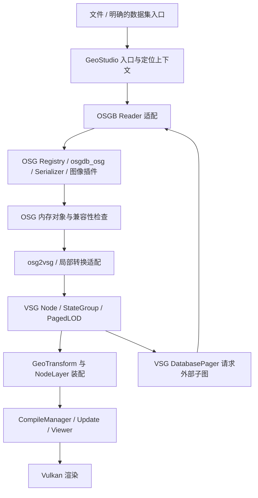

# VSG 原生 OSGB 加载与渲染方案

方案版本 v1.7；用户已确认上一版近景 LOD 恢复正确，但放大后平移不补齐新瓦片、移除后资源未释放，整体仍未通过验收。本版落实 P0-1～P0-4 的容器生命周期、请求恢复、覆盖优先调度和回归诊断，保留已恢复的源 LOD 选择与颜色处理。CPU 回归与打包验证不能代替画面和长期内存验收；尚无同条件提速倍数结论。底层继续位于 `GeoStudio-Native`，Demo 验收前不集成 GeoStudio-Client。

**推荐路线：以 OSG 3.6.5 解析原始 OSGB，优先复用 osg2vsg 将其转换为 VSG Scene Graph，再由 VSG DatabasePager、CompileManager 和 Viewer 完成分页与渲染。** GeoStudio 增加受控的 Reader/数据集适配，补足入口组织、路径、空间定位和已知转换限制。osgVerse 作为数据处理参考，详见 [工程调研](../../调研分析/OSG-Verse/README.md)。

## 需求文档

### 目标与“原生”含义

用户可以直接选择原始 `.osgb` 文件、有明确目录约定和元数据的数据集、兼容 SHP 索引，或显式构建的 `.osgbset` 概览入口，在 GeoStudio-Native 的 VSG 场景中显示、缩放、分页和卸载。原始数据路线不要求预先转成 3D Tiles、glTF 或 VSGB，也不改写源数据。

“原生加载”在本方案中指**原始 OSGB 作为输入、运行时按需解析与内存转换、最终由 VSG/Vulkan 绘制**。这仍包含 OSG 解码依赖；如果要求完全不依赖 OSG，则属于另一条自行实现二进制 Reader 的路线，成本和兼容责任显著增加。

### 输入与输出范围

| 阶段 | 输入 | 输出与行为 |
| --- | --- | --- |
| P0 | 单个静态 OSGB；含常规 Geometry、纹理、Transform；以及受控的两区间 PagedLOD 小树 | 有效 VSG Node；粗模先显示，按需加载细模；失败可定位 |
| P1 | 已核实目录规则的多根倾斜摄影数据、metadata.xml 或显式定位参数 | 数据集图层、完整引用上下文、空间定位与资源管理 |
| P2 | 顶层数量或转换耗时已被证实成为瓶颈的数据 | 可选派生索引、VSGB 缓存、顶层重建与模型优化 |

`.osgb` 不是只能存储三角网的容器；它可以序列化 OSG 对象、层级、状态和外部引用。首期不承诺动画、任意 osg::Program、Callback、自定义 Serializer、第三方压缩对象、特效或全部 OSG 节点的视觉等价。

单个 OSGB 不保证自带 CRS；`metadata.xml`、`Data/<名称>/<名称>.osgb` 等属于常见生产工具的数据集约定，不能推导为所有 OSGB 的统一目录标准。

### 验收原则

- 成功必须包含实际可绘制 Geometry/Draw Command、有效 Bounds 和所需纹理，不能以“返回非空 Group”判定完成。
- 用连续两级或三级最小树证明 Paging，不能只看首个文件显示。
- 引用失败时保留已有有效粗模，并报告对应父文件、子引用与失败阶段；无粗模的输入明确报告局限。
- 地理数据与控制点对齐；缺少定位信息时允许明确的局部模型预览，不猜测 EPSG 或把局部坐标当 ECEF。
- 图层关闭后不再把迟到请求挂回活动场景，资源经安全退休释放；人工画面与性能验收由用户完成。

## 技术文档

### 当前工程事实与消费身份

repoId 为 `geostudio-native`，实际 Git 根为 `sdk/GeoStudio-Native`；检查基线 HEAD 为 `b5fcf769c40e566b3c046ce3c1cdbdced6a3fb53`，工作树含既有未提交文档变更，不能把 HEAD 单独视为当前全部内容身份。同一授权轮次追加 OSGB 实现、依赖与 Demo 消费；保留原有文档修改。

| 对象 | 当前事实 | 对实施的影响 |
| --- | --- | --- |
| SDK | GeoStudioNative 0.3.0，ABI 62；公开 C++17，Import 为 DLL | OSG 类型不进入 Core/Data/Scene 的公开边界 |
| VSG | `dependencies.lock.json` 固定 `e4718bf078a26930e0b6f5932d2537b689fa3969`；对应 CMake 1.1.16 | 继续使用固定依赖，不因本方案升级 |
| 模型 Import | 新增 `GEOSTUDIO_NATIVE_OSGB`，默认 ON；宽泛的 `vsgXchange_OSG` 保持 OFF | 私有固定转换库与专用 Reader，避免误接入其他 OSG 格式 |
| Reader 注册 | `all` 和 ObjectFactory 注册 `geostudio::native::io::OSGB` | 图层使用独立 Reader，实现关闭和诊断隔离 |
| 构建完整性 | `osgb/OSGB.cpp` 为实际构建源；可选关闭时编译 fallback | Header 显式导出，OSG 类型不进入公开接口 |
| OSG 环境 | 工作区 `packages/osg/manifest.json` 固定 3.6.5，commit `a827840baf0786d72e11ac16d5338a4ee25779db` | 原生解码基础可复用，保持工具链和 CRT 一致 |
| 本地 OSG 组件 | osg、osgDB、osgUtil、osgTerrain、OpenThreads 与 OSGB/Serializer/PNG/JPEG 插件 | `packages/osg` 显式构建，SDK 安装和 Demo 部署携带许可证及来源身份 |
| osg2vsg 固定依赖 | `8494fc6cb25d8d74cc41a8737f77e8a639ea39fb`，0.4.0 | 已加入 SDK 与 Demo 同步锁；原件 SHA-256 `d236a2dfb78bfb14a0173c985c6c286cab755187aec30b7ea92004082c4e8fa4` |
| osg2vsg 构建 | `cmake/OSGB.cmake` 显式编译固定原件的转换库源文件 | 不使用上游 Viewer/示例工程；原件不修改，配置时逐文件校验 |

本机依赖缓存可按现有规则复用 `demo/native-gis-demo/.deps`，但 SDK 的依赖权威仍是自己的锁，源码权威是本仓库及 provenance。Demo 独立仓库基线为 `479531a6a719ade9a481c64ca3b317aa4eadb87c`，消费 SDK 安装目录；本轮修改其 OSGB 入口与装配，并更新根工作区 `packages/osg` 构建配置。知识库只读检索，Client 未修改。[L1–L6、U1–U3]

### 路线比较与选择

| 路线 | 保持原始 OSGB 直读 | 主要收益 | 成本与限制 | 建议 |
| --- | --- | --- | --- | --- |
| OSG + osg2vsg + GeoStudio 适配 + VSG | 是 | 复用序列化、Geometry/纹理转换和 VSG Paging | 需处理转换器边界、插件和构建依赖 | **首选，P0** |
| OSG 解析 + 自有 VSG Converter | 是 | 可针对倾斜摄影控制节点、材质与性能 | 自担 StateSet、几何、纹理、LOD 映射和持续维护 | **P1 按已证实缺口局部替换** |
| osgVerse 整体集成或 ANGLE 路线 | 可读 OSGB，但不是现成 VSG Scene Graph 路线 | OSG 生态能力丰富 | 双对象体系、渲染与依赖耦合，不直接解决 VSG 接入 | 不作为主线 |
| OSGB 离线转 VSGB | 首次需要派生处理 | 后续减少 OSG 解析和转换成本 | 必须保留分页引用、材质和缓存失效契约 | P2 可选加速 |
| OSGB 离线转 3D Tiles/GLB | 否 | 复用现有 TilesetAdapter 或 glTF Reader，适合发布 | 多一步数据生产，需处理空间与 LOD 语义 | 独立发布需求时采用 |
| 完全自研 OSGB 二进制 Reader | 是，且可去除 OSG | 依赖和数据结构可完全控制 | 对象版本、Serializer、压缩、共享引用与扩展兼容成本高 | 暂不排期 |

OSG 仅用于 CPU 解析不要求本方案创建 OSG Viewer 或 OpenGL 渲染上下文；这不等于链接和部署时完全没有 OpenGL 相关依赖，所选 osg2vsg 的 CMake 就会查找 OpenGL。DLL 闭包应按实际构建核验。

### 推荐数据链

1. 从完整文件路径或已确认的数据集入口创建请求上下文。模型资源定位和 Shader 搜索路径分开管理。
2. Reader 调用 OSG 反序列化，检查节点类型、Range、外部文件和纹理，形成可解释的失败信息。
3. Converter 创建 VSG 对象；每个 PagedLOD 保留继续读取 OSGB 所需的 Reader、路径和配置。
4. 后台完成解析与 CPU 场景转换。GPU Compile 交给宿主已有 CompileManager；场景挂接在受控 Update 阶段进行。
5. 接近模型时 VSG 请求更细子图，仍进入相同 Reader；无需把所有磁盘后代提前读入。
6. 离开区域或关闭图层时由 Pager 和宿主共同处理请求失效、子图退休与资源释放，不在工作线程直接修改活动 Scene Graph。

`osg2vsg::OSG::read` 的源码实际调用 `osgDB::Registry::readObject`，对 Node 调用 `osg2vsg::convert`；它并非新的 OSGB 二进制解析器。该 Reader 的特性枚举标记文件读取，首期应使用 filename 路线，不能假设 Stream/Memory 输入自然拥有完整外部引用上下文。[U2]

### 已确认的转换边界

以下结论针对所选 osg2vsg 默认 `ConvertToVsg` 路线；`original_converter` 是另一条历史转换分支，未作为本方案兼容依据。[U3、U4]

| 问题 | 源码观察 | GeoStudio 的处理方案 |
| --- | --- | --- |
| PagedLOD 的区间数 | 先按屏幕阈值排序，只有 `children.size() == 2` 时才设置两个 Child 和外部 filename | P0 只接受核实过的双区间模式；其他模式明确拒绝或告警，不能静默返回空分页节点 |
| 外部细节文件 | PagedLOD 保留原始 OSGB filename；复制 BuildOptions 中的 Options，并追加 DatabasePath | 子请求必须仍持有 OSGB Reader；以请求文件所在目录解析相对引用，测试同名子文件冲突 |
| ProxyNode | 默认转换器头文件和实现没有专门处理 ProxyNode 外部文件的分支 | 当前明确拒绝，阻止同步展开外部文件；后续按真实输入决定是否归一化 |
| RangeMode | 默认转换器像素模式使用 `1/1080`，距离参考角度对应 60° FOV 假设 | 当前保存源分界，按宿主实际视口与投影参数更新；复杂相机语义仍需单独验证 |
| Range 区间与重叠 | VSG LOD/PagedLOD 按阈值选择，无法据此完整表达所有 OSG 多区间、重叠和多外部文件组合 | 先分类，再用 Group/LOD/多 PagedLOD 或自有选择节点表达；不能简单截取前两个 Child |
| 材质与 Shader | Converter 根据支持的 State/Geometry Mask 建立 Pipeline 与 Descriptor | 常规纹理模型优先；自定义 GLSL、Callback 和未映射状态显式列为不支持 |
| 图像 | ImageUtils 有像素格式、Mip Level、Origin 和部分压缩格式映射 | 检查具体格式与 Vulkan 设备支持；有枚举不等于所有压缩格式均已实现 |
| 元数据 | osgVerse 的 OSGB metadata 入口仅保存 SRS/SRSOrigin UserValue | GeoStudio 自己解析并保持定位上下文，不指望转换器自动生成 GeoTransform |

尤其要区分“两种细节表示”和“四个空间子瓦片”：VSG PagedLOD 的两个槽位用于高、低细节，并不是只能有两个空间子块。四个子瓦片可以由高细节槽位返回的 Group 承载；关键是对应范围与替换语义正确。

P0 必须在 Reader 适配处识别超出白名单的情况。若最小真实样本就触发多区间或 ProxyNode 缺口，将相应适配提前为 P0 阻断项；不能为了保持阶段划分而错误显示。

### 模块落点与后续扩展

当前实现集中在 Import 和 Demo Scene；表中 Drivers/Runtime 的独立数据集抽象仍是后续扩展方向，未为了首版提前建立。

| 位置 | 拟承担职责 | 边界 |
| --- | --- | --- |
| `src/render/import/osgb/` | OSGB Reader、节点兼容检查、转换选项、OSG 错误到 SDK 诊断的映射 | 私有 OSG/osg2vsg 依赖；公开返回现有 VSG 类型或 SDK 结果 |
| `src/render/import/CMakeLists.txt`、`all/all.cpp` | 显式可选构建、依赖链接与 Reader 注册 | 同时验证 enabled/disabled 配置；避免重复注册宽泛 OSG Reader |
| `src/drivers/` 中后续的 OSGB 数据集适配 | metadata、根清单、路径和数据集描述 | 只组织数据，不让 Drivers 反向依赖 Render；相关 DTO 按已有 Data/Scene 边界放置 |
| `src/render/model/`、`render/paging/` | 数据集描述到 VSG 子图、必要的 LOD 归一化 | 首期优先复用 VSG Pager，不再创建另一套通用调度框架 |
| `src/render/vsg/VSGContext.cpp`、`NodeLayer`、`GeoTransform` | 复用 Reader 上下文、地理装配和 Compile/Update | 原始模型变换与地理定位分别处理 |
| `src/runtime/engine/` | 打开/关闭状态、异步请求身份、宿主装配 | 复用现有生命周期模式，不将 OSGB 伪装为 Cesium Tileset |
| 依赖锁、构建/安装清单、provenance、tests | 固定 osg2vsg、部署插件、记录来源、验证独立 consumer | 不手改生成头、不绕过来源检查、不隐式安装 |
| `packages/osg` 与 Demo | 按批准范围补组件；最小真实显示的 consumer | 分别核对工作区管理和 Demo 仓库边界，不自动升级依赖 |

首个 P0 可以先使用现有 `NodeLayer` 挂接模型，不预先引入复杂公共 Dataset API。需要公开新类型时再同步 header 清单、API/ABI 版本与 consumer；仅私有接入也要重建受影响 Import 和宿主。

### 路径、插件与线程

**路径。** 每个请求保存源文件规范路径、当前目录、数据集根和转换配置。解析嵌套相对引用时使用当前文件和 OSG DatabasePath 的明确优先级，不使用进程当前工作目录。两个根目录内同名瓦片不得共享错误缓存。中文、空格、`../` 合法相对引用和跨目录纹理均需要样本；目录越界策略由明确的数据集配置决定，不擅自改写路径。

**插件。** `osgdb_osg` 负责 OSG 原生格式入口，Serializer Wrapper 和图像插件按实际对象及图像编码部署。已有 PNG/JPEG 目标不证明 DDS、其他图像编码或第三方对象可读。初始化时核查插件注册和动态库加载，把“缺插件”和“文件损坏”分开报告。

**线程。** 先在初始化阶段准备 OSG Registry 和已选插件；每个请求持有独立读取 Options 与转换状态。全局 Registry、插件内部缓存、SharedObjects 和 Pipeline 缓存是否可并发须分别验证，不能从 Reader 的 const 接口推导线程安全。P0 采用受限并发，P1 再按测量调优。

**生命周期。** 每次打开赋予 generation/request 身份。关闭后禁止旧结果重新挂接，停止该数据集后续请求；进行中的读取可以结束，但结果需丢弃并经现有资源退休路径回收。普通 NodeLayer 的 close 不自动证明所有 Pager 请求都已取消，必须测试。

### 空间定位和大坐标

1. 显式区分模型局部 Transform、数据集 SRS、SRSOrigin、轴向、长度单位和垂直基准；未知项不自动补成 WGS84。
2. 若源坐标是投影坐标加局部偏移，先按数据生产约定恢复源坐标，再通过现有 SRS/PROJ 能力转换。`SRSOrigin` 的含义必须由输入约定确定。
3. 小范围已知 ENU 模型可以采用局部顶点加双精度地理 Transform。投影平面到地球的映射通常不能对任意大测区用一个平移矩阵精确表达；需要按块重投影或评估局部近似误差。
4. 优先保留小量级局部顶点和双精度定位，避免直接把大 ECEF 数值写入 float 顶点；Bounds 和法线也须按相同变换更新。
5. 垂直转换依赖的 PROJ grid 缺失时报告实际原因；不通过忽略高程基准来宣称贴地准确。[L5]

为满足 HL 样本的直接试验需求，首版提前实现了常见米制投影 metadata 与多根目录；更通用的 CRS、Transform 和垂直基准仍属 P1。全局渲染中的深度、地形遮挡和坐标精度属于人工 GPU 验收范围。

### 大数据、缓存与顶层重建

P1 首先解决数据集根清单、异步发现、Bounds 和分页预算。不要递归读取全部 OSGB 作为首次加载的必要条件，也不要默认每个目录的第一个文件就是 Root。优先使用生产端入口；缺少入口时再按已确认命名与引用关系构建受限索引。

已有全部顶层瓦片直接挂入一个 Group 可以验证正确性，但不自动形成远景粗模。空间索引只减少发现、查询和调度成本；若需要低成本的全域远景画面，仍可能需要带实际几何和纹理的顶层模型。是否重建以测量为依据。

| 优化 | 解决什么问题 | 进入条件与约束 |
| --- | --- | --- |
| CPU 解码/转换缓存 | 重复打开或同源请求的重复工作 | 内容键包含源身份、外部依赖、Converter 版本、材质及坐标配置；不无限保存 OSG 与 VSG 双份对象 |
| VSG 资源共享与预算 | 重复纹理/Pipeline、CPU/GPU Residency | 区分对象共享、Pager 保留和文件缓存；本版 `targetMaxNumPagedLODWithHighResSubgraphs` 控制高细节子图目标数量，不能当作精确字节预算 |
| 派生 VSGB 缓存 | 减少以后打开时的 OSG 解码和转换 | 必须转换或正确保留全部外部引用；只把根文件另存为 VSGB 不代表后代脱离 OSG |
| osgVerse 顶层重建 | 顶层过多、远景粗模缺失 | 审核 ProxyNode、编号、扩展类型、输出引用和误差；不覆盖源目录 |
| Geometry Merge/简化/纹理处理 | Draw Call、面数、纹理压力 | 以瓶颈和视觉误差为准；不为“优化”默认改变质量 |

建议记录 root 可见时间、请求数、I/O/解码/转换/Compile 分段耗时、CPU/GPU 占用和固定相机路线的帧时间。硬件、样本、分辨率和预算未确定前，不承诺固定 FPS 或容量。失败重试、快速往返视点和低内存场景也应测量。

CPU 测试的小型 fixture 与派生制品位于 `.build/capabilities-r1/tests/capabilities/osgb-fixtures` 的固定受管子目录，用于重复验证；构建与安装继续复用 `.build/capabilities-r1`、`out/install-capabilities`。运行缓存与显式概览输出的用途和位置见下节，不进入输入目录，不复制全量模型；批量清理由用户手动处理。

### 性能与色彩优化实现

以下 P0/P1/P2 是本轮优化的优先级，与首版分页初始化关卡分别记录。本版已落地核心实现；表内剩余项和人工验收未完成，不能把接口响应时间或 CPU 测试写成首屏性能。

| 优先级 | v1.4 已实现 | 解决的问题 | 仍需验证或后续工作 |
| --- | --- | --- | --- |
| **P0-A：颜色与计时** | 颜色纹理按 sRGB/Linear 语义隔离；同步 Data/Image/ImageView 格式；阶段计时 | 输入漏解码导致的发白机制；区分读取、转换和编译工作 | 同视点、同 LOD 色卡与 HL 瓦片人工对照，GPU 实际格式与颜色确认 |
| **P0-B：跨页资源复用** | 每 Reader 复用不可变 Pipeline、Layout、Sampler、Shader；GLSL 在 CPU 阶段编译并复用 SPIR-V | 相同材质跨页重复生成与编译 | 真实 Vulkan 创建/上传耗时和显存占用；不声称已完成 GPU Pipeline 持久缓存 |
| **P0-C：分页公平性** | 根请求有限优先级；根/细节分类队列、去重、代次取消、粗模保留 | 零阈值产生无穷分值，精模被根请求挤压 | 固定相机路线下的覆盖与细化尾延迟；近远往返与移除重载 |
| **P1-A：索引与异步入口** | SHP 只读导入，目录清单与真实 bounds sidecar，Demo 后台打开；路径、CRS、原点和内容身份校验 | 为建入口重复解码全部根、阻塞界面 | 无完整 Z 的 SHP 首轮不能精确三维剔除；可进一步持久补齐从实际根获得的范围 |
| **P1-B：有界处理** | 文件 I/O 有限在途，兼容解码锁外读文件；线程内 PROJ 复用；实际视口/FOV 的 LOD 调整 | I/O 与解码互相串行、重复投影准备、固定视口阈值 | OSG 兼容解码仍串行；全并行解码和近似坐标转换未启用 |
| **P1-C：预算与诊断** | 待编译/待挂接数量和 Data 字节估算、每帧挂接预算、近期非活动页保留、增量统计 | 在途资源积压、主线程反复遍历和往返重载 | Data 估算不是 GPU/RSS 硬上限；单个大页和 GPU 编译仍可能形成长帧 |
| **P2-A：按页派生缓存** | 源页首次转换后存 VSGB，后续强校验命中跳过解码/Prepare；重绑当前路径与 Reader Options | 同页重开与返回时的重复 CPU 工作 | 首次生成有成本；缓存故障退回原始 OSGB，深层后代仍按需读取 |
| **P2-B：区域概览** | SDK 离线 builder：空间分组、根级几何简化、纹理降采样、完整根组、清单最后发布 | 远景只靠逐根加载，缺少低成本真实粗层 | HL 根级构建和最终画面待验证；简化比例不等于视觉误差承诺 |

#### 诊断依据与当前修正

改造前，目录入口为提取包围球先同步解码全部根，实际进入视域后又解码根内容；转换器为每页创建独立 PipelineCache；根的零 LOD 阈值在普通请求公式中产生无穷大优先级。颜色链为“照片字节 → UNORM → 无光照输出 → sRGB attachment”，如果照片本身是 sRGB 编码便缺少输入解码。编码值 0.5 被误当线性值输出会变成约 0.735；这仅解释机制，不是截图的像素测量。[O1–O3]

当前保留 sRGB 输出，在 OSGB 适配层只将颜色贴图映射为 sRGB。Alpha 和数值贴图不作该变换；同一图像的不同语义使用独立对象。可通过 `colorTexturesSRGB=false` 显式选择 Linear。地理参考照片模型维持 Unlit，不使用降低全局曝光来抵消输入错误。实际色彩仍需固定相机、LOD、Mip 与显示条件验证。

根的零阈值保留其原始覆盖含义，`OSGBRoot` 单独计算有限优先级；不会简单改成极小正阈值。SDK 自有 Pager 维护根与细节队列，保留粗模直到细页可用，共享原有单 CompileManager。固定 VSG 的资源回收补丁由源码补丁和校验清单管理，不升级上游版本。默认每类队列最多 256 项、根/细节在途上限 2/4、就绪队列最多 64 页且 Data 估算目标 128 MiB、每帧最多挂接 8 页/软预算 2 ms；非活动页目标 512 MiB，保留期限 30 秒、数量上限 128。它们是调度和估算目标，不是硬显存上限；可见粗模不为满足目标而被强制移除。

VSG 本身没有“每帧只能挂接一个瓦片”的限制。剩余瓶颈应结合累计 CPU 阶段、队列和固定相机呈现时间定位；CPU Compile 耗时包含等待及 Vulkan 调用，不能当作纯 GPU 时间。

#### 内存与 LOD 修正 v1.6

XML 浏览近 32 GiB、移除图层后进程占用不回落及近景细节退化均来自用户反馈；没有该现场的堆快照，不能给出各项占用比例。此前去掉后代 `ResourceHints`、上传后释放静态数组与默认关闭页缓存仍保留。本轮同时修正错误的全局 LOD 降级、分配池空块引用、孤儿上传与关闭后的回收链。

- 每个原始转换页及缓存读回页在资源整理阶段去掉推测性的 `ResourceHints`，由 VSG 按当前实际子图收集描述符需求。不可变 Pipeline、Shader、Layout、Sampler 的有界复用继续保留。
- `OSGBMemoryLimits` 默认驻留基准 1024 MiB，读取工作预留 512 MiB，每个未知读取预留 256 MiB；`maxPageBytes=128 MiB` 改为读取前未知页的保守载荷估值，不再永久拒绝更大的合法页。解码后用实际载荷替换预留；超出可容纳预算的页只保留轻量需求记录，等待资源退休或预算配置改变，不反复解码、不使用无限重试截止帧。
- `OSGBResidencyLimits` 提供 256 MiB 父子共存过渡余量和 128 MiB 分类余量，分别不超过驻留基准的 1/4、1/8。v1.7 调整分类余量方向：历史字段 `detailReserveBytes` 改为细化让出的覆盖空间，根请求可使用过渡余量，细化上限相应减去分类余量。读、解码、编译、就绪、驻留和延迟退休分别统计；淘汰非活动页时重新计算缺口，达到目标即停止。可见工作集超过能力时明确显示预算等待，不能保证任意场景都在固定预算内达到全部细节。
- 内存压力不再修改任何源 LOD 条件，兼容诊断 `lodScale` 恒为 1。专用 Record 节点按源 `PIXEL_SIZE_ON_SCREEN` 或 `DISTANCE_FROM_EYE_POINT`、当前 viewport/projection/modelview 选择细节；像素计算对照固定 OSG `CullingSet`，距离使用局部视点的欧式距离。地理转换保留源米制半径与投影后中心，另用保守包围球裁剪，不将包围盒角点余量混入 LOD。此局部米制近似不证明任意投影区域与任意 OSG 相机完全等价。
- `releaseUploadedData(deviceID)` 仅由单 Device 宿主在 Update 调用。确认静态 BufferInfo/ImageInfo 已复制到上传暂存区后解除 CPU 数组引用，保留 GPU 资源与分页范围；动态、未上传数据不释放。已释放的几何不能直接供 CPU 拾取、导出或第二 Device 编译，需要重新读取原页。Demo 的逐帧 Update/Record 串行满足该约束，其他宿主必须显式接入。
- 默认关闭运行页 VSGB 缓存，只保留小型索引。显式开启时写入只序列化一次；保留依赖与载荷哈希、读回图校验及独立往返回归测试。索引、源模型与显式概览不被删除或重建。
- 移除图层先关闭令牌、丢弃排队/解码/编译的晚到结果，再摘除驻留子图；移除仍在读取的图层不会重新挂回。更新阶段每秒维护资源：传输 fence 完成后清除孤儿条目及空闲 staging；取得全部空闲编译上下文后回收无活跃引用的设备内存和描述符池；编译失败后的上下文重置同时清除待上传图片，避免未进入 Record 的纹理滞留；CPU allocator 同时清除查找表和快捷缓存中的空块引用并加锁。释放以引用与 fence 为准，不通过结束进程或清空其他图层资源实现。

上述字节是 Data 载荷估算和读取预留，**不是进程内存硬上限，也不是 GPU 显存上限**。驱动、描述符池、上传暂存、分配器与第三方解码临时数据另有占用；单页大小在解码后检查，不能保证恶意或异常压缩页的解码峰值。单文件初始驻留内容和显式概览的初始粗层不属于分页驻留预算。预算不能替代真实进程测量。

Demo 独立面板报告 `processMemory.privateBytes/workingSetBytes`、全局 `osgbPaging` 与 `resourcePools`，最后一个图层移除后仍可查看。分页数据包括各阶段载荷、当前预算等待和退休数量；池统计区分 CPU、设备、编译暂存与传输暂存，并显示忙碌和待完成 fence。`cpuBytesReleased` 是累计解除引用载荷估算；池累计归还可以重复计入同一轮次重用内存，不能与进程内存相加减。最近维护完成、队列为空或驻留为零均不单独证明进程内存已回到基线。

CPU 回归覆盖实际 OSG/VSG 的 LOD 选择比较、多级带纹理分页、两图层重复关闭、编译中取消、超大页预算恢复、allocator 空块实际析构和无后续上传时的孤儿清理；不创建 Device。人工复测使用原 XML、固定窗口/相机与参考画面，连续浏览同一路线 15 分钟并近远往返；同一进程重复加载、浏览、移除 5～10 轮，确认细节正确、峰值趋稳且移除后的稳态不逐轮抬升。另测读取中移除，以及保留图层 B 时移除 A。实际内存阈值和 GPU 安全性以新包验收为准，Client 继续后置。

#### 平移覆盖与完整卸载 v1.7

前一版清理只枚举 `children[0]` 非空且在自有驻留表中的分页节点。但 Record 在精模未完成时也会向原生容器登记节点，容器会强持其粗模、纹理和 Options。精模被阻塞或取消后，这些引用可能在移除图层时遗漏；只观察父 Group 析构也不能证明它的后代资源已释放。

| 优先级 | 实现范围 | 验证重点 |
| --- | --- | --- |
| P0-1 | 在 Update 清理关闭令牌的全部容器条目，覆盖空精模、在途和驻留状态；载荷退休时连带解除所属后代的分页容器引用 | 未完成精化即关闭、父 Group 包含分页子节点、原生容器自行淘汰、多层隔离及关键 Data 实际析构 |
| P0-2 | 自有 Pager 以 `requestStatus` CAS 唯一准入；Record 不再由旧 `requestCount` 阻止重试，完成和统计转移序列化 | 残留计数快照可恢复；后台读取由门闩控制，离开视野取消后重入能够重新加载；重复 Record 不重复入队 |
| P0-3 | 当前视域缺根覆盖时优先补齐根，暂停新增细化；先清非活动页，必要时由有粗模保障的低贡献精模让位并短暂延后重试 | A 部分仍可见时 B 根持续补齐；往返 A→B→A；覆盖完成后再细化；不提高源 LOD 阈值 |
| P0-4 | 增加真实 Record→Pager→Update 的 CPU 回归和全局所有权诊断，退休观察同时覆盖节点与载荷对象 | 关闭令牌容器残留、孤立后代、退休对象、覆盖等待和让位计数；最后一个图层移除后仍可查询 |

退休观察使用 Auxiliary 的断开标记，不为诊断强持 Node、Data 或上传对象。载荷仍被其他所有者保留时继续计入退休预算，不能直接清零数字制造释放完成。第三方读取不能强制中断，关闭后的晚到结果必须丢弃；在途请求结束前仍可能短暂占用内存。GPU 对象继续经原有 DeleteQueue、传输 fence 和空闲池维护回收。

根和细节的预算比较使用同一占用口径；细化不能继续压住待加载根。过渡余量仍有上限，细节让位保留当前可用粗模并设重试间隔，避免每帧来回装卸。若当前视域仅最小根覆盖就超过可容纳预算，会明确等待，不能承诺任意数据在固定内存下完整显示。根覆盖、精细程度与长期内存需要一起验收，不能只凭某一项计数下降判定通过。

后续 P1 再处理“粗覆盖已齐，但同时可见精模超过预算”的细节间替换：以当前投影贡献和滞回比较，让中心高贡献细节替换边缘低贡献细节。当前主动让位服务于缺根覆盖；没有缺根时，不会互相驱逐仍活动的精模。该限制不改变源 LOD 判定，但预算满时部分细节仍可能等待，不能将本轮结果表述为任意视角的全部精模即时就绪。

新增 `OSGBPagingOwnershipMetrics` / `ownershipMetrics()`，不扩展既有公开结构体布局。容器页数与空精模槽位统计实际 OSGB 容器引用；关闭残留与孤立后代是当前值，让位和子树退休是累计值。退休存活对象只用于定位所有权，不等于进程对象总数。原始 XML、SHP 与目录入口共用此修正，无需生成额外概览或全量页缓存。

Demo 使用连续渲染，移除最后图层后 Update 与帧号仍推进。后续按需渲染宿主接入前，必须另行验证退场帧推进：仅调用 Update 而不推进 FrameStamp，可能使按帧保留的 DeleteQueue 无法到期。Client 集成需同时覆盖这一边界，不能只复用 Demo 的人工验收结论。

#### SHP 索引与三维范围

只读检查 `D:/data/3d/osgb/HL/index/index-data.shp` 及配套文件得到 925 个不同根入口，文件均存在；索引五文件合计 1,119,728 bytes，根文件合计 188,997,810 bytes。索引小并不代表同等大小即可绘制完整测区，也不能据大小比值推导速度倍数。

| 输入内容 | SDK 处理 |
| --- | --- |
| EPSG:4545、原点 `(607429,3938520,0)` | 与数据集 metadata 和每条定位字段校验；索引绝对投影坐标不重复加原点 |
| `SJY`、`GWMC` | 校验后转成 sourceRoot 内相对根路径；不任意跟随 DBF 绝对路径 |
| CPG 的 GBK/GB2312 | 在固定 Windows GDAL 中以本次打开的 CP936 选项读取，不改原文件或全局配置 |
| 二维 Polygon 范围 | 只用作平面范围/排序线索；缺 Z 时不据估计球进行三维剔除 |
| 单值 `GCFGQJ` | 不是完整 zMin/zMax 契约，不据此构造保证无遗漏的三维球 |
| 真实 local-ECEF sphere | 只接受实际解码取得的范围或源强校验命中的 sidecar；读入实际根后于 Update 补正运行时范围 |

SHP 从索引旁有限父级中的约定 OSGB 目录寻找唯一数据集；迁移后可显式传 `sourceRoot`。目录仍采用 `metadata.xml + Data/<名称>/<名称>.osgb`（兼容小写 data）。无缓存目录首次需要逐根获得范围，此工作在 Demo 后台完成；有效 sidecar 复用时核对 metadata、坐标策略、大小/mtime 和源 SHA-256。SHP 仅建立 925 条入口时不为无 sphere 记录提前散列或解码全部根。已有一次 CPU 入口探测约 665 ms，**仅证明识别了 925 个根，不是首屏时间**。

当前没有额外承诺数据库级 R-tree 查询，也没有把二维索引伪装成可靠三维裁剪。参考机制中的远景隐藏与视窗限制不作为性能收益口径。索引记录、空间组织和实际概览是三个不同层次；给根套树不会自动生成真实远景模型。

#### 运行缓存和显式构建

Demo 默认缓存位于 `%LOCALAPPDATA%/GeoStudio/NativeGisDemo/osgb-cache`，宿主将路径传给 SDK；SDK 不硬编码应用目录。JSON 配置可用 `cacheDirectory` 指定独立目录，空字符串表示禁用落盘。默认只启用目录 bounds 索引缓存，逐页 VSGB 缓存关闭；SDK 在首次读取前调用 `enablePageCache(true)`、Demo 配置 `pageCache=true` 才开启页缓存。显式启用时单数据集磁盘预算 2 GiB、单项 128 MiB；达到预算保留有效项并回源，不自动删除。既有缓存保留，XML 不会隐式加载概览。

页缓存身份覆盖源内容、外部纹理、转换器/SDK 策略、坐标与颜色设置。磁盘命中加载独立 VSG 图，分页路径按当前 sourceRoot 重绑，Options 绑定当前 Reader；关闭旧 Reader 不会污染新实例。缓存仅保存当前页，不代表全部后代已转换。外部图片依赖和元数据变化导致失效，错误缓存软失败回退；目录锁、暂存写入与最后发布避免将半成品作为有效项。可重建页缓存保留哈希校验与原子替换，不逐页强制刷盘、不承诺断电持久；索引与显式概览继续使用持久写入。

v1.6 使用新的源 LOD 元数据与转换身份。旧运行页缓存失效后回源；旧版本显式 `.osgbset` 无法据膨胀后的剔除球恢复原始 LOD 球，因此明确报告转换版本不匹配，需显式重新构建或直接打开原始 `metadata.xml`。不会自动重建概览，也不会修改或删除旧制品。

显式概览构建入口为 `OSGB::buildDataset`，Demo 的 `native/ng-osgb-build.exe` 只是命令行宿主，解码、简化、分组和制品发布均在 SDK。输入为数据集目录或兼容 SHP，输出必须是独立目录，不能位于源内部或包含源目录。默认每区 16 根、纹理最长边 256、三角目标比例 0.25、区域切换屏幕高度比 0.5；工作集估算预算 512 MiB、输出预算 2 GiB。预算不是进程 RSS 保证，比例也不是严格达到值或屏幕误差界限。

构建只读取根级驻留几何与所需纹理，不递归解码精模后代。准备坐标后的根在内部深拷贝，保护几何边界点，移除概览中的外部分页，颜色纹理以线性光、预乘 Alpha 区域滤波后恢复非预乘 Alpha；支持固定 OSG 可安全读取的 RGB/BGR/RGBA/BGRA 和 BC1/BC2/BC3。未知待缩小格式明确失败，不用白图代替；固定 OSG 不识别存储大小的 sRGB BC 枚举在深拷贝前拒绝，正常 BC 字节仍按颜色配置进行 sRGB 处理。

HL 首次根级构建的三角形统计为 **1,925,824 → 1,925,291**，几乎未减少；`triangleRatio=0.25` 只是目标，不能描述成已经压缩至 25%。只读检查的真实根存在大量同位置、不同 UV 的分裂顶点，拓扑边界保护使其无法折叠；单纯提高最大误差或只按位置焊接会绕过既定接缝保护。当前收益主要来自纹理降采样、区域组织和直接读取派生内容。跨 UV 接缝的重网格与纹理重烘焙留待独立设计及画面验证。

输出 `dataset.osgbset` 首先加载区域真实概览；放大后请求 `.osgbregion`，其高细节侧含该区全部原始根的驻留粗模，再沿原 OSGB 子引用细化，避免切换时只剩空占位。完整根和概览 VSGB、区域入口及内容身份由清单关联；相同身份重复构建复用有效制品。清单最后发布，失败保留已有有效制品和受管未完成内容，不能自动清空目录或覆盖陌生文件。

HL 根级输出位于 Demo `out/osgb/HL-overview`，范围为 925 根，不是全量后代转换。HL 显式选择纹理最长边 128，在同一输出目录重建；工具默认仍为 256。当前清单引用 58 个区域，概览合计 181414139 bytes（约 173 MiB），完整根组合计 696155344 bytes，当前清单全部引用内容合计 877913749 bytes。输出目录连同保留的 58 个旧概览文件共 1211895696 bytes，均计入 2 GiB 预算，不自动删除。输出保留供人工验收及重复消费，输入和构建配置是重建入口；运行缓存不是正式验收证据。恢复失败须先检查诊断及受管未完成文件，批量清理由用户处理。Client 尚未集成。

#### 验证方法与下一优先级

| 指标/用例 | 固定条件与判定 |
| --- | --- |
| 首屏 | 分开记录入口完成、首个 Draw 挂接、首次呈现与目标区域粗模覆盖；925 个空页不算首屏 |
| 粗到精 | 同一相机移动、视口和目标 LOD，测停止缩放到稳定细节的时间及尾部请求，不用降低质量换速度 |
| 冷/热 | 区分应用近期页、派生磁盘缓存和系统文件缓存；重启程序不等于操作系统冷缓存 |
| 性能 | 分段 CPU、队列、缓存命中与帧时间结合；保持硬件、电源、原件、范围和清晰度一致，无 GPU 时间戳不宣称纯 GPU 耗时 |
| 色彩 | 色卡和同一街区瓦片，固定相机/LOD/Mip；Alpha 与数值贴图保持语义；截图差异不等于已定位全部原因 |
| 完整性 | 925 根路径、GBK 字段、迁移、无 Z 范围、源变更、预算拒绝、取消、关闭重开及细模引用逐项覆盖 |

先完成小样本 CPU 回归及新包构建，再对 HL 明确的根级输出和固定街区做人工验收。当前不自动启动 GUI/GPU，不写已测倍率。验收后优先处理真实瓶颈：若精模等待仍集中于串行解码，进一步审查插件并行安全；若主要在编译上传，优化单页规模和资源创建；若概览质量不足，调整区域/纹理/几何参数并复核接缝。多编译 Context、强 GPU 字节预算、全并行 OSG 解码及 Client 集成仍需独立设计验证。

#### 证据与开源参考

方案分析以固定消费源码和当时工作副本为依据；v1.4 行为以当前 `OSGB`、`OSGBPaging`、`OSGBResources`、`OSGBDecode`、`OSGBIndex`、`OSGBArtifacts`、`OSGBDataset`、`OSGBOverview` 及 Demo 消费代码为准。Git HEAD 不替代未提交的实际内容，以下开源引用用于解释机制，不作为当前制品构建或人工验收证明。

| 编号 | 来源 | 采用内容与边界 |
| --- | --- | --- |
| O1 | [osg2vsg ImageUtils](https://github.com/vsg-dev/osg2vsg/blob/8494fc6cb25d8d74cc41a8737f77e8a639ea39fb/src/osg2vsg/ImageUtils.cpp)、[fbxshader](https://github.com/vsg-dev/osg2vsg/blob/8494fc6cb25d8d74cc41a8737f77e8a639ea39fb/src/osg2vsg/shaders/fbxshader_frag.cpp)、[convert](https://github.com/vsg-dev/osg2vsg/blob/8494fc6cb25d8d74cc41a8737f77e8a639ea39fb/src/osg2vsg/convert.cpp) | 固定消费源码的纹理格式、无光照输出与逐页PipelineCache |
| O2 | [Vulkan Image Reads](https://docs.vulkan.org/spec/latest/chapters/images.html#images-reads)、[Vulkan Framebuffer](https://docs.vulkan.org/spec/latest/chapters/framebuffer.html) | sRGB输入解码、输出编码与Alpha线性语义；不替代实际GPU格式确认 |
| O3 | [VSG RecordTraversal](https://github.com/vsg-dev/VulkanSceneGraph/blob/e4718bf078a26930e0b6f5932d2537b689fa3969/src/vsg/app/RecordTraversal.cpp)、[CompileManager](https://github.com/vsg-dev/VulkanSceneGraph/blob/e4718bf078a26930e0b6f5932d2537b689fa3969/src/vsg/app/CompileManager.cpp)、[ShaderCompiler](https://github.com/vsg-dev/VulkanSceneGraph/blob/e4718bf078a26930e0b6f5932d2537b689fa3969/src/vsg/utils/ShaderCompiler.cpp) | 请求分值、编译遍历器与Shader编译路径；不修改固定依赖缓存 |
| O4 | [osgVerse TileOptimizer](https://github.com/xarray/osgverse/blob/f3dd52d47489fb2ac162cbd21dfb645f4e786a66/readerwriter/OsgbTileOptimizer.h)及[既有调研](../../调研分析/OSG-Verse/README.md) | 相邻聚合、粗层生成；仅参考数据生产算法，不整体接入其运行时 |
| O5 | [VSG 分页示例](https://github.com/vsg-dev/vsgExamples/blob/46a82943ac27024bd9540be495c5b83eda96d0fa/examples/nodes/vsgpagedlod/TileReader.cpp) | 驻留粗层＋外部细层、初始化共享Layout/Sampler；示例阈值不是本数据的最优参数 |
| O6 | [osgEarth FeatureModelGraph](https://github.com/gwaldron/osgearth/blob/865205168b43d2fbdc702e07dcce2413137bfb56/src/osgEarth/FeatureModelGraph.cpp) | 按extent/TileKey查询、节点缓存和状态复用；开源机制参考，不是现有VSG中的可直接替换组件 |

知识库本轮再次以 OSGB、PagedLOD 检索 docs/internal，阅读协议、顶层重建及相关切片边界资料。OSGB 原文命中仍属尚未治理资料，只采用“索引与真实粗模不同”“原生分页保留父子引用”等原理；未采用材料中的固定数量、简化比例或性能宣称作为验收目标。没有导入、改写或发布知识库内容。

### 首版实施顺序与关卡

| 顺序 | 范围 | 必须交付的结果 | 失败时的决策 |
| --- | --- | --- | --- |
| **P0-A：依赖与 CPU 读取** | 固定 osg2vsg 候选、补齐 OSG 组件、显式构建开关；小型纹理 OSGB | 原始 OSGB → 非空且含实际几何的 VSG 图；插件错误可区分；无窗口 consumer 可加载 | 先解决构建和格式缺口，不先写二进制解析器 |
| **P0-B：最小分页** | 两区间 PagedLOD、相对路径、粗模 fallback、范围检查 | 两级或三级小树可按子文件继续读取；CPU 验证引用、Bounds 和节点内容 | 超出转换器能力则补最小适配，禁止静默丢节点 |
| **P0-C：VSG 画面验收** | 现有宿主/NodeLayer、Compile/Update、纹理及缩放 | 用户看到首帧与粗细切换；确认最终为 VSG 绘制 | 分别定位解析、转换、空间、Compile 与相机问题 |
| **P1：数据集可用** | 多根入口、metadata、ProxyNode、多 Range、实际视口、空间定位、关闭与部署 | 指定真实数据集可定位、可分页、可关闭；内存和错误行为受控 | 缺口按样本提升优先级，必要时局部自有 Converter |
| **P2：规模与性能** | 热点优化、VSGB 缓存、顶层重建、合批和纹理策略 | 在固定样本与路线下有可复现收益、质量与资源成本 | 无明确收益则保留直接读取路线 |

P0-A → P0-B → P0-C → P1 → P2 为推荐顺序。P0-C 与后续真实 GPU/窗口测试由用户操作，或在后续明确授权下开展；现有局部规则不允许本轮自动启动软件。只有通过对应阶段的检查与人工验收，才将其写成当前能力。

### 来源、知识检索与证据边界

知识库 lookup 在 `docs` 与 `internal` 默认范围检索了 OSGB、PagedLOD；复合查询无命中后使用独立词项。命中协议解析、顶层重建及 3D Tiles 相关材料；没有将命中数视为支持度。

- [OSGB 协议解析原文](../../../../../../apps/GeoStudio-Knowledge-Base/docs/空间数据格式/三维模型/OSGB/标准协议解析/原文.md)及[来源说明](../../../../../../apps/GeoStudio-Knowledge-Base/docs/空间数据格式/三维模型/OSGB/标准协议解析/来源与整理说明.md)：来源 `SRC-ZOTERO-55AP8EWK`，整理稿记录协议版本 161 和 OSG 3.6.5。阅读相关启动文件、Range/FileName/DatabasePath 描述，仅作序列化与数据组织线索；工具标为尚未治理，不作为本工程运行证据。
- [顶层重建方案原文](../../../../../../apps/GeoStudio-Knowledge-Base/docs/空间数据格式/三维模型/OSGB/顶层重建-02/原文.md)及[来源说明](../../../../../../apps/GeoStudio-Knowledge-Base/docs/空间数据格式/三维模型/OSGB/顶层重建-02/来源与整理说明.md)：来源 `SRC-ZOTERO-JYZMYFC9`，用于解释顶层过多与新增粗模层的关系。原件作者与正式版本未明确，正文含疑似公式文本问题，不采用其中固定阈值和数值作为性能目标。

上述两份原文当前 SHA-256 分别为 `7352578BC2DCEDFA2B65FFB2BD8950A80A2C6140475C2B979147DE2EE8AF4DF2`、`8111B8F330D6B017532F63800A4CDB957200BDE1AFA8DEC2C8FDF4399723FE20`。知识库保持只读，不重新解析 PDF 或向外部服务上传资料。

| 编号 | 证据入口 | 支撑结论 |
| --- | --- | --- |
| L1 | [Import CMake](../../../../src/render/import/CMakeLists.txt)、[all.cpp](../../../../src/render/import/all/all.cpp) | OSG 未启用、注册点和实际编译范围 |
| L2 | [SDK 架构](../../../design/SDK架构与迁移.md)、[Render](../../../../src/render/README.md)、[Runtime](../../../../src/runtime/README.md) | 分层、SDK/ABI 与消费边界 |
| L3 | [dependencies.lock.json](../../../../dependencies.lock.json)、[provenance](../../../../provenance/manifest.json) | VSG 固定消费与自有 Import 来源 |
| L4 | [OSG manifest](../../../../../../packages/osg/manifest.json)、[OSG 环境](../../../../../../packages/osg/README.md) | OSG 固定版本与现有构建目标 |
| L5 | [VSGContext.cpp](../../../../src/render/vsg/VSGContext.cpp)、[NodeLayer.h](../../../../src/render/vsg/NodeLayer.h)、[GeoTransform.h](../../../../src/render/vsg/GeoTransform.h)、[坐标系统](../../坐标系统/README.md) | 注册、场景装配与空间能力入口 |
| L6 | [安装构建与使用](../../../design/安装构建与使用.md)、[测试说明](../../../../tests/README.md) | 既有构建、输出与人工验收边界 |
| U1 | [osg2vsg 根 CMake](https://github.com/vsg-dev/osg2vsg/blob/8494fc6cb25d8d74cc41a8737f77e8a639ea39fb/CMakeLists.txt)、[库 CMake](https://github.com/vsg-dev/osg2vsg/blob/8494fc6cb25d8d74cc41a8737f77e8a639ea39fb/src/osg2vsg/CMakeLists.txt) | 0.4.0、C++17、VSG 与 OSG 依赖要求 |
| U2 | [OSG.cpp](https://github.com/vsg-dev/osg2vsg/blob/8494fc6cb25d8d74cc41a8737f77e8a639ea39fb/src/osg2vsg/OSG.cpp) | Registry 读取、路径传递、Node 转换 |
| U3 | [convert.cpp](https://github.com/vsg-dev/osg2vsg/blob/8494fc6cb25d8d74cc41a8737f77e8a639ea39fb/src/osg2vsg/convert.cpp) | 默认和 original_converter 的分流 |
| U4 | [ConvertToVsg.cpp](https://github.com/vsg-dev/osg2vsg/blob/8494fc6cb25d8d74cc41a8737f77e8a639ea39fb/src/osg2vsg/ConvertToVsg.cpp)、[头文件](https://github.com/vsg-dev/osg2vsg/blob/8494fc6cb25d8d74cc41a8737f77e8a639ea39fb/src/osg2vsg/ConvertToVsg.h) | PagedLOD 双区间、LOD 阈值、ProxyNode 与状态映射边界 |
| U5 | [ImageUtils.cpp](https://github.com/vsg-dev/osg2vsg/blob/8494fc6cb25d8d74cc41a8737f77e8a639ea39fb/src/osg2vsg/ImageUtils.cpp) | 像素、Mip Level 与 Origin 转换 |
| U6 | [VSG PagedLOD.h](https://github.com/vsg-dev/VulkanSceneGraph/blob/e4718bf078a26930e0b6f5932d2537b689fa3969/include/vsg/nodes/PagedLOD.h)、[DatabasePager.h](https://github.com/vsg-dev/VulkanSceneGraph/blob/e4718bf078a26930e0b6f5932d2537b689fa3969/include/vsg/io/DatabasePager.h)、[DatabasePager.cpp](https://github.com/vsg-dev/VulkanSceneGraph/blob/e4718bf078a26930e0b6f5932d2537b689fa3969/src/vsg/io/DatabasePager.cpp) | 高低细节、后台 Read/Compile、Update 合并与数量控制 |
| U7 | [osgVerse 固定来源表](../../调研分析/OSG-Verse/README.md#固定来源与阅读顺序) | 顶层重建、metadata、ANGLE 与依赖边界 |

L1 两个文件当前 SHA-256 分别为 `5122BBA27F27D68642A85B5C42A680164F094610308DE6DC423F767E3F3899B2`、`506B3300260122E1AFE91D8A973356E8DCB5A61F639E29CB5DD180776E674084`。后续源码或依赖版本改变时重新复核本页限制，不能只沿用本次静态结论。

## 测试用例

以下是完整验收设计，不代表每项都已执行；首版的实际覆盖在“首版实现与验证边界”中单列。先用最小有效样本，真实数据路径、大小和硬件在进入运行验证前明确；不默认扫描或复制完整测区。

| 编号 | 阶段与样本 | 检查内容 | 通过条件 |
| --- | --- | --- | --- |
| T01 | P0-A；一个三角网、PNG/JPEG 纹理和局部 Transform | CPU Reader、顶点/索引/UV、有效 Bounds、纹理尺寸 | 与已知 fixture 一致；不是空壳 Node |
| T02 | P0-A；缺插件、损坏文件、缺图像、未知对象类型 | 错误路径和兼容检查 | 明确失败阶段与文件；不将部分加载默认为完整成功 |
| T03 | P0-B；一个粗模和一个外部细模，扩展为三级树 | RangeMode、filename、Options、子图转换 | 正确保留各级引用和 fallback；未预读全树 |
| T04 | P0-B/P1；两个目录下同名子文件、中文与空格路径 | 路径优先级、缓存键、嵌套相对引用 | 各自读取正确数据，与工作目录无关 |
| T05 | P0-B；单区间、三及以上区间、空 filename、缺失细模 | 转换边界与降级 | 支持的语义正确；不支持的明确报告；有效粗模不被误删 |
| T06 | P0-C；T01/T03 的人工 VSG 运行 | 纹理方向、颜色、透明、相机、Compile、近远切换 | 显示和切换正确；以实际画面为准 |
| T07 | P1；ProxyNode、多根目录和已知 metadata | 根发现、外部引用、CRS、原点、高程 | 无遗漏/重复；控制点误差满足所选样本约定 |
| T08 | P1；不同分辨率、FOV、正交/透视、窗口 resize | LOD 阈值语义 | 行为符合配置，参考分辨率不被误当运行分辨率 |
| T09 | P1；连续打开/关闭、快速移动、缺失子块 | 请求失效、线程、粗模 fallback、资源退休 | 无迟到挂接、崩溃或持续无界资源增长 |
| T10 | P1；独立安装 consumer 和关闭 OSG 功能的构建 | DLL/插件/资源闭包、C++17、依赖隔离 | enabled 可读样本，disabled 不残留强制 OSG 依赖 |
| T11 | P2；明确规模与预算的数据子集及固定相机路线 | 冷/热加载、CPU/GPU、I/O/转换/Compile、帧时间 | 与基线对比可复现；无画质和完整性回退 |
| T12 | P2；派生 VSGB 或顶层重建最小输出 | 引用完整性、输入变更失效、ProxyNode、压缩扩展 | 源数据未修改，缓存可解释失效，派生内容可重新生成 |

后续代码验证按既有 `build.ps1 -WithTests`、受影响 CTest 和 `verify-package.ps1` 入口选择最小范围；新 fixture 与检查需加入真实构建清单，不能把本文的测试编号当作已经实现的测试。GPU、人机交互与大规模性能不由 CPU 检查代替。

## 代办

### TODO

- 完成本版新包的首屏覆盖、粗到精速度、颜色、坐标、隐藏恢复及移除重载人工验收，再推进 Client。
- 完成 HL 的 925 根概览构建与同相机对比，记录质量与性能的实际取舍；不递归转换全部后代。
- 按真实瓶颈评估进一步的解码并行、GPU 创建/上传和单页规模；不未经验证放开线程或移除预算。
- 扩展复杂状态/投影组合与多区间分页前，先建立明确兼容契约和样本。

### FIXME

- 无缓存目录首次仍需后台读取全部根范围；二维 SHP 无 Z 时不能可靠三维剔除，根页首轮候选可能偏多。
- 实际视口阈值已接入；多区间 PagedLOD、ProxyNode 和带地理元数据的非恒等 Transform 仍明确不支持。
- OSG 自定义 Serializer、未知对象和全部 StateSet 的视觉等价没有完整覆盖；不能将常规 Geometry 样本通过推广为所有 OSGB 可用。

## 首版实现与验证边界

### 动态分页初始化与诊断

目录入口只有空 PagedLOD，初始没有 Draw。固定 VSG 的 `CompileResult::requiresViewerUpdate` 不检查 `containsPagedLOD`；旧宿主据此跳过 `updateViewer`，在尚无 DatabasePager 时无法触发根瓦片请求，单文件则仍可显示自身粗模。宿主现在只对成功的 CompileResult，在 `containsPagedLOD` 或 `requiresViewerUpdate(viewer)` 成立时于 Update 阶段更新 Viewer；RenderGraph 动态编译使用同一条件。这项初始化修复位于宿主；v1.6 的资源回收则通过固定 VSG 完整补丁接入，保持上游版本不变。

`OSGB::status(root, frameCount)` 返回每 Reader 的读取请求、完成、失败、取消与进行中数量，以及已挂接场景中的排队、读取、编译、待 Merge、延后页和驻留 Draw 数。读取统计包含目录入口请求；挂接数量含根页及后代，不能除以 rootCount 当作全量进度。传 root 的快照只允许在宿主 Update 阶段执行，不读取工作线程 pending 子图，不触发 I/O 或 GPU 分配。延后可能来自读取／编译失败或请求过期，不能直接当作 GPU 错误；最多记录四个延后文件路径。

Demo 每次状态采样检查任务中的分页器是否存在、运行且关联当前 CompileManager，并报告 Viewer 全局编译失败数；该数不是单图层计数。`gpuCompiled` 仍只表示初始图编译成功，`resident` 只表示已挂接场景含 Draw，均不是像素或当前视域可见性证明。

CPU 回归覆盖空多根入口的 Viewer 更新决策、真实 DatabasePager 工作线程读取与 Merge、继续读取细模、失败粗模保留、关闭拒绝及新 Reader 重开。测试使用空 GPU Compile Context，显式模拟视点请求；不覆盖视锥触发、真实 Vulkan Pipeline、GPU 资源上传或画面。用户已确认首版 Demo 可以显示 HL 整目录模型；v1.4 已增加有限根优先级、异步索引、预算及派生内容，须针对新包重新验收近远质量、隐藏恢复、移除与重载。

### Reader 与数据边界

公开入口为 [OSGB.h](../../../../src/render/import/osgb/OSGB.h)，实现为 [OSGB.cpp](../../../../src/render/import/osgb/OSGB.cpp)。每图层独立 Reader，`read` 返回 VSG Node、失败返回空并保留 `error()`；`readAsync` 在后台执行相同 CPU 读取；`close()` 幂等，关闭实例不能重开且不影响其他 Reader。`configure` 必须在首次读取前调用，`buildDataset` 为显式离线入口。文件 I/O 有限在途，OSG 兼容解码仍由锁保护；每次转换使用独立图、线程内投影操作。分页 Options 绑定该 Reader、GLSL/SPIR-V/VSG Reader 与图层令牌，禁用跨图层节点 SharedObjects，磁盘缓存命中也重新绑定当前实例。

当前接受静态 Geometry、常规 Texture2D、单个驻留粗模＋一个外部细模的双区间 PagedLOD；像素区间要求从零连续分割，距离区间要求近处细模和远处粗模，分界必须为正且最外区间上界使用不小于 1e30 的无穷远哨兵（HL 为 1e30，也接受 FLT_MAX）；有实际意义的有限外上界暂时拒绝以避免静默改变可见范围。保留源 split 与 LOD 球元数据，专用 Record 节点按当前视口和相机矩阵计算源范围选择；兼容字段中的屏幕高度阈值不决定该节点的细化，不宣称任意 OSG 相机完全等价。ProxyNode 的同步外部加载被拦截并报告不支持；自定义 Program、Callback、缺失纹理及不连续分页区间明确失败。

目录结构限定为 `metadata.xml`＋`Data/<名称>/<名称>.osgb`（兼容小写 data），可由 SHP 或强校验 sidecar 直接建立入口；无缓存目录在后台逐根取得包围球。当前清单最多 65536 根，单源 OSGB 不超过 64 MiB、metadata 不超过 1 MiB、索引缓存读取不超过 32 MiB，投影根包围球半径不超过 10 km；不再沿用首版的根数/合计文件量限制。原始索引入口不预先驻留几何；显式 `.osgbset` 入口则自带真实概览，深层错误继续通过图层诊断显示。

米制投影 CRS 按 `源顶点＋SRSOrigin → EPSG:4978 → 减去 ECEF 锚点` 处理；图层外包双精度锚点平移。投影后使用纹理 Unlit，避免继续沿用源法线照明；包围球由源球外包盒角点重投影并留余量。带 metadata 的非恒等局部 Transform 暂时拒绝。单文件向上最多四级寻找 metadata；没有元数据时保留局部坐标，由 Demo 的显式 ENU 锚点放置。高程沿用源值，未验证垂直基准与地形控制点。

[CPU 用例](../../../../tests/capabilities/test_osgb.cpp) 使用可重建的小型三角形＋2×2 纹理，包含中文空格路径、连续外部页、距离/像素阈值、损坏输入、缺失细模、ProxyNode、关闭后拒绝读取和 metadata 坐标。固定 EPSG:4545 原点与独立 gdaltransform ECEF 控制值按毫米比较。fixture 仅保留在既有 build 下，用于重跑测试，不进入产品。CPU Shader 编译检查不创建 Device，也不能代替实际 Vulkan Pipeline/像素验收。

真实输入为用户指定的 `D:/data/3d/osgb/HL/OSGB`，metadata 为 EPSG:4545，原点 `(607429,3938520,0)`。目录有 925 个根文件，合计 188997810 bytes；原件只读，根级概览独立生成于 Demo `out/osgb/HL-overview`，不复制或递归转换全部后代。纹理上限 128 的构建约 31.6 秒，再次执行约 1.89 秒并返回 reused，核对所有文件大小/写入时间未变化。这是本机离线构建路径墙钟耗时，不是 GPU 渲染或冷盘基准。

v1.4 对应 Demo `out/packages/tauri/run-0008/native-gis-demo.exe`，SDK 4 组 CTest 通过，其中 CPU 用例共 190 项；独立安装 consumer、Demo 原生测试、6 项前端测试及正式构建通过。发行包内 CPU 构建工具在只保留 Windows 系统 PATH、清除开发用 GDAL/PROJ/OSG 环境变量后成功构建上述 HL 产物。按便携布局核对了来源文件集合、许可证、运行资源及构建工具哈希；SDK 安装目录校验器不直接适用于便携目录的许可证/资源位置。

当前 `dataset.osgbset` SHA-256 为 `3933e9866009a10eec2548ca5adcc3798d943cf19f7f047d06c5847faeb2ba84`。CPU 读取入口约 1.12 秒，取得 1269 个实际 Draw/纹理及 58 个区域页，随后成功读入一个完整区域的 16 根及其第一个原始精模后代；没有遍历全部后代。单页缓存读回验证命中后解码、准备、转换与 Shader 编译耗时为零。以上均未创建窗口/Device，不证明实际首屏、粗细切换或色彩已通过人工验收。

首版代码侧结果包括 SDK 离线 CTest、独立安装 consumer、Demo 构建及可选关闭配置；HL 少量相邻根各读取两级后代取得几何与纹理，目录取得 925 个入口。历史约 2.3 秒根扫描及本版约 665 ms SHP 入口均为本机 CPU 功能探测，条件不同，不能相除当作提速倍数。v1.4 新增资源/颜色、调度/预算、GBK 索引、缓存失效、概览滤波以及 `.osgbset → region → 原始细模` 的 CPU 回归；最终构建结果另以实际输出确认。用户完整后代、性能与视觉等价验收仍未完成。

首版发行装配曾核对 provenance 精确文件集合、SDK/OSG DLL 哈希与许可证，并将 CPU 探测进程的 DLL 搜索路径限制到对应 Demo 包和 Windows 系统目录，成功读取 HL 根及两级后代。旧 SDK 增量安装目录的历史 provenance 残留曾导致严格“无额外文件”检查失败，未自动清理；Demo 包按来源筛选装配。v1.4 的当前构建核对结果见上文，旧包证据不代替新制品验收。
