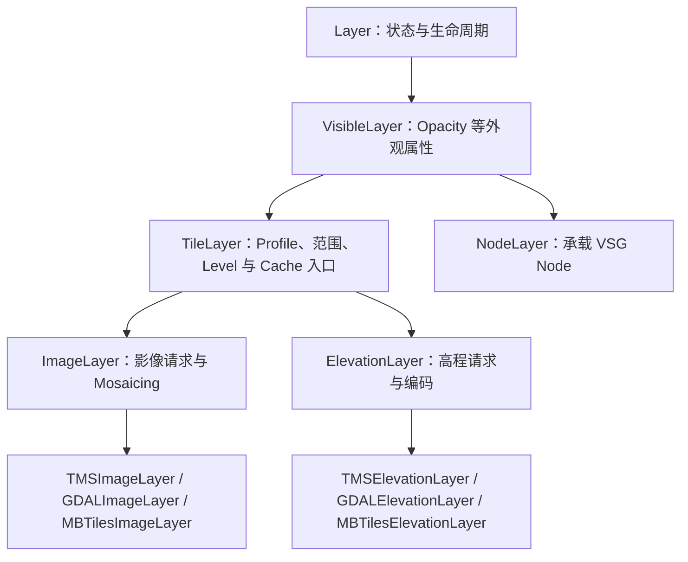
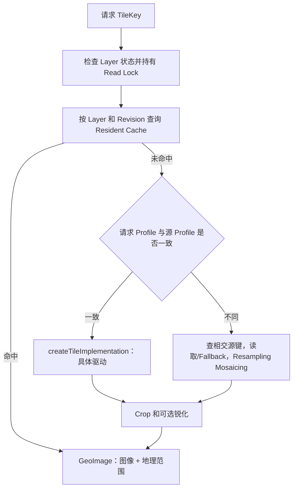

# Layer 与 Tile：公共数据请求机制

术语用法见[术语表](../术语.md)；本篇保留英文底层术语，中文用于解释。

## 目标与版本

本篇是影像和高程章节共同依赖的机制说明。基线为 `a4d8b141ec478e8440526928b344c6eb93810631`；T 编号对应文末源码。定义、调用链及已有测试已作静态核对，本文不表示进行了运行验证。

地图中的 Layer 是一个数据/状态单元，TileKey 则是一次局部地图请求的地址。理解它们可以解释“文件明明存在却请求不到”“Level 相同却对不上位置”“打开成功却仍显示粗数据”等现象。

## Layer 层次



图示表达主要继承职责。`GDALFeatureSource` 不在这条继承链中；它读取 Feature 后需要另一条 Geometry/ECS 接入路线。`NodeLayer` 也不通过 ImageLayer 的 createTile 生成像素。（T1）

## Layer 生命周期与 Map Revision

| 入口 | 主要行为 | 接入含义 |
| --- | --- | --- |
| `Map::add` | 加入集合、增加 Map Revision、触发变化通知 | 本身不等同于数据打开 |
| `Layer::open(io)` | 状态锁内执行派生 openImplementation，保存成功/失败 | 可以向 UI 返回确定的打开结果 |
| `Layer::close()` | 执行派生关闭，将状态置为关闭 | 后续请求应失败，不继续使用已关闭驱动 |
| `Layer::dirty()` | 增加 Layer Revision | 使以 revision 为组成部分的 Cache 身份发生变化 |
| `MapNode::update` | 首次打开自动 Layer、驱动地形更新 | 动态新增 Layer 应显式核对打开结果 |

Map Revision 用于 Layer 集合变化，Layer Revision 用于具体内容变化，不能把它们当成同一个版本号。UID 在运行时生成，也不是跨进程稳定的数据源标识。（T1）

TileLayer 关闭时会清除运行中的 Profile 和范围状态。若应用需要反复关闭/打开，必须核对该 Layer 的配置恢复路径，不假定临时给运行字段赋值就等同于完整持久配置。

## Profile 定义 Tile Grid

Profile 不只是一个 EPSG 代码，还包括 Extent、Root Level 的 Tile 列数/行数以及可选 Subprofile。相同 SRS 可以采用不同范围或 Root Layout，所得 z/x/y 含义也会不同。这里的 Tile Grid 是空间布局，区别于送入渲染器的 Mesh。

| 内置 Profile | SRS 与布局 | 使用提示 |
| --- | --- | --- |
| `global-geodetic` | WGS84 地理参考，全球范围，Root Level 2 列×1 行 | 与 Web Mercator 的同一 z 不具有相同地面分辨率 |
| `spherical-mercator` | Web Mercator 的定义域，Root Level 1×1 | 常见 XYZ 栅格/MVT 服务的 Tiling 方式 |
| `global-qsc` | 多个 QSC 子 Profile 组成的全球布局 | 地图显示可用于极区等场景，数据源不必本身采用 QSC |
| 自定义 Profile | SRS、范围、根行列数 | 用于特定区域或投影，不应猜测为全球 XYZ |

`numTiles(level)` 在根行列数上乘以 `2^level`；`tileDimensions(level)` 按相同因子缩小范围。等价性还涉及范围和水平 SRS，不能仅比较 profile 的 hash 或字符串名称。（T2）

## TileKey 的寻址与父子关系

TileKey 包含 `level`、`x`、`y`、`profile`。Rocky 的内部 y 从上往下增加：`extent()` 先取全范围的 ymax，再按 y 减去 Tile 高度。因此底层文件若采用从下往上的行号，需要在协议适配层处理。（T3）

```text
父 Tile (z, x, y)
  0：西北 (z+1, 2x,   2y)
  1：东北 (z+1, 2x+1, 2y)
  2：西南 (z+1, 2x,   2y+1)
  3：东南 (z+1, 2x+1, 2y+1)

Parent TileKey： (z-1, floor(x/2), floor(y/2))
```

Root Level 没有 Parent TileKey。`intersectingKeys(otherProfile)` 用于把一块请求范围映射到另一个 Profile；可能返回多个键，不是换一组 EPSG 后继续复用原 x/y。

TMS 行号通常为 `numRows - 1 - internalY`。`numRows` 由 Profile 决定，不对所有自定义布局都直接等于 `2^z`。TMS/XYZ 驱动的具体默认翻转规则见[栅格](../栅格/README.md)。

## Level 和分辨率参数

| 参数 | TileLayer 头文件默认 | 作用 |
| --- | --- | --- |
| `minLevel` | 0 | 允许产生数据的最小 Level |
| `maxLevel` | 99 | 超过后不再让本层出现在对应请求中 |
| `maxDataLevel` | 99 | 数据的有效最高 Level 提示，超过后可由已有较粗数据上采样；驱动可据源分辨率更新数据范围 |
| `tileSize` | 256 | 数据 Tile 每边的采样数，不是地形 Mesh Vertex Count |
| `crop` | 未设置 | 地理 Crop 范围，仍带有 SRS |
| `profile` | 由配置/数据源建立 | 驱动自身的 Profile |

99 是类的默认上界，不意味着数据实际具有 99 级，也不意味着可以向位移计算等底层函数传入任意大 Level。实际应使用已有数据和地形允许的 Level。`maxLevel` 与 `maxDataLevel` 的区别尤其重要：前者限制本层显示参与，后者描述有效细节上限。（T4）

派生类可以覆盖默认值：`ElevationLayer::construct` 将 tileSize 的默认值改为 257。上表的 256 是 TileLayer 基类默认，不能据此认为高程层也必定使用 256 个采样。（T7）

影像像素采样通常以 Pixel Center 为基准；高程 Mesh 为了相邻 Tile 共边，常按边到边布点，步长使用 `size-1`。两者不能只因都用图像容器就互换采样方式。

## 覆盖范围与“最佳可用”

数据范围来自配置或驱动 Metadata，并以空间索引帮助判断一个请求是否可能有数据。

`bestAvailableTileKey` 的关键步骤是：将请求映射到本层 Profile → 检查 Level/Crop → 查数据覆盖范围及其 Level → 返回原键、Ancestor TileKey 或无效键。（T4）

这是基于 Metadata 的估计，不会通过调用该函数就下载每个文件。返回一个合法键不保证网络请求成功，也不证明对应磁盘文件存在。数据范围未提供时，它也不能自动知道本地目录实际覆盖哪一小片区域。

## ImageLayer 的请求流程



`ImageLayer::createTile` 通过 Shared State Lock 避免请求期间关闭 Layer；`createTileInKeyProfile` 处理范围、同 Profile 直读或跨 Profile 的 assembleTile。跨 Profile 路径为相交源 Tile 构建采样 Mosaicing，并在缺少源 Tile 时尝试祖先。（T5）

该路径还检查是否至少取得目标分辨率的源数据，不能描述为“任意情况下都会一路 Fallback 并产生新 Tile”。地形 Node 本身还会保留父级结果，两种 Fallback 发生在不同位置。

高程请求有类似外层流程，但还涉及 RGB 解码、NoData、垂直偏移和面向 GPU 的 R16 编码，不能套用普通影像的颜色 Interpolation 解释，见[三维地形](../三维地形/README.md)。

## Cache 身份、失效与取消

本提交 `getOrCreateTile` 在 IO 服务提供 `residentImageCache` 时使用以下身份：（T6）

```text
TileKey + layer UID + layer revision + source 标记
```

`source` 区分 Mosaicing 时使用的原始驱动 Tile 和对外返回的完成 Tile。Cache 同时保留图像及其真实范围，因此命中一个 Ancestor Fallback 结果时仍可识别其实际覆盖范围。

`dirty()` 改变 Revision 后，新请求不再命中旧 Revision 的 Cache Key；这不自动等于立即同步重建全部 Resident Terrain。修改源参数后需要按 Layer 及地图的实际更新路径重新打开、重置或请求帧。Cache 服务未安装时直接创建结果，不能从类中有 Cache 代码推导本机一定存在持久 Disk Cache。

Mosaicing 路径检查 `io.canceled()`；不同驱动和任务阶段的检查位置不同，不能把统一 IOOptions 参数理解为每个阻塞 I/O 都能瞬间取消。资源级取消和异步合并机制将在 P1 深入。

## 最小接口说明

下面是在 Layer 已配置并打开后，显式请求一块 Tile 的片段；请求范围和 Level 必须与真实数据相符。本轮未编译执行。

```cpp
auto opened = layer->open(app.io());
if (opened.ok() && layer->profile.valid())
{
    rocky::TileKey key(2, 3, 1, layer->profile);
    auto best = layer->bestAvailableTileKey(key);
    if (best.valid())
    {
        auto tile = layer->createTile(best, app.io());
        if (tile.ok())
        {
            auto image = tile.value().image();
            auto extent = tile.value().extent();
        }
    }
}
```

`layer` 在此表示 ImageLayer 或 ElevationLayer 的具体对象，不能对任意 `Layer` 使用 `createTile`。高程 image 可能是编码后的 Heightfield，不能按普通 Gray 值当米读取。

## 验证与故障定位

| 现象/用例 | 检查位置 | 本轮状态 |
| --- | --- | --- |
| z/x/y 合法却位于错误地区 | Profile、Root Layout、TileKey::extent | 已核对算法；未运行 |
| Y 颠倒 | 内部 y 与 TMS/XYZ 的驱动映射 | 已核对源码；未运行 |
| 放大后本层消失 | maxLevel、实际范围和合法 Level | 可操作用例，未运行 |
| 放大后只显示粗数据 | maxDataLevel、数据范围、Parent Inheritance/Fallback | 可操作用例，未运行 |
| 两次请求复用旧内容 | UID/revision/source、dirty 和地形更新 | 已核对 Cache Key；未运行 |
| 跨 Antimeridian 请求/Mosaicing | tests_antimeridian、GeoExtent 与 ImageLayer | 已有测试入口，未执行 |

## 源码证据与导航

| 编号 | 文件与稳定入口 | 本篇结论 |
| --- | --- | --- |
| T1 | [Layer.h](../../../src/rocky/Layer.h)、[Layer.cpp](../../../src/rocky/Layer.cpp)、[Map.cpp](../../../src/rocky/Map.cpp)、[NodeLayer.h](../../../src/rocky/vsg/NodeLayer.h) | 生命周期与 Layer 类型 |
| T2 | [Profile.cpp](../../../src/rocky/Profile.cpp)：`setup`、`equivalentTo`、`numTiles`、`tileDimensions` | Tiling、等价及内置布局 |
| T3 | [TileKey.cpp](../../../src/rocky/TileKey.cpp)：`extent`、`createChildKey`、`createParentKey` | 内部 y 和 Parent/Child TileKey |
| T4 | [TileLayer.h](../../../src/rocky/TileLayer.h)、[TileLayer.cpp](../../../src/rocky/TileLayer.cpp)：`bestAvailableTileKey` | 参数、范围及可用键判断 |
| T5 | [ImageLayer.cpp](../../../src/rocky/ImageLayer.cpp)：`createTile`、`createTileInKeyProfile`、`assembleTile` | 锁、驱动请求及 Mosaicing |
| T6 | [TileLayer.cpp](../../../src/rocky/TileLayer.cpp)：`getOrCreateTile`；[TileKey.h](../../../src/rocky/TileKey.h)：`TileLayerCacheKey` | Resident Cache 身份 |
| T7 | [ElevationLayer.cpp](../../../src/rocky/ElevationLayer.cpp)、[tests_antimeridian.cpp](../../../src/tests/tests_antimeridian.cpp) | 高程差异及边界测试入口 |

数据路线：[栅格](../栅格/README.md)、[三维地形](../三维地形/README.md)、[矢量](../矢量/README.md)。维护入口：[主任务](../任务/001-Rocky架构与技术实现梳理.md)。
