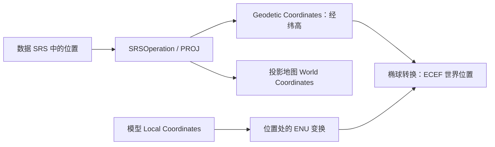

# 坐标系统：SRS、坐标操作与地理定位

术语用法见[术语表](../术语.md)；本篇保留英文底层术语，中文用于解释。

## 目标、基线与职责

本篇解释输入数据怎样获得空间含义，并转换到场景使用的坐标。源码基线为 `a4d8b141ec478e8440526928b344c6eb93810631`；C 编号对应文末证据。实现结论来自源码核对，示例和测试入口本轮未运行。

`SRS` 保存或解析坐标参考定义，`SRSOperation` 执行两种参考之间的转换，`GeoPoint` 将位置与 SRS 绑定，`GeoExtent` 将范围与 SRS 绑定，`Ellipsoid` 提供椭球参数及坐标计算，`GeoTransform` 将地理位置接入场景 Transform。不能只给出三个数字就省略这些约定。

## 四种常见坐标

| 表达 | 典型数值及单位 | 适用位置 |
| --- | --- | --- |
| Geodetic Coordinates | 经度、纬度为度，高程为相应垂直参考的距离 | 数据定位、用户输入、跨地图 View 的 Feature 表达 |
| Projected Coordinates | x/y 在指定 Projection 中，常见为米 | 平面地图、区域 GIS、栅格像素到地面的映射 |
| ECEF | x/y/z 为相对地心的三维距离 | 球面三维场景的世界位置 |
| ENU Local Coordinates | 某位置的东、北、天方向距离 | 模型定位、局部变换和数值 Localization |

模型文件还可能采用不同长度单位、轴向和原点，需先明确模型约定。把 OBJ 的三个坐标直接当经纬度或 ECEF 都不能建立正确定位。



箭头表示常见路线，不要求所有转换先经过调用方显式创建的经纬度中间数组；PROJ 可以建立直接操作。

## SRS 的创建和本版内置常量

`SRS` 接受 EPSG 定义、WKT、PROJ 定义和内置别名。默认构造为无效值；首次需要时通过 Thread-Local 工厂建立 PROJ 对象并 Cache 结果，失败也会保存错误。（C1）

| Rocky 常量/别名 | 本提交实际解析目标 | 说明 |
| --- | --- | --- |
| `SRS::WGS84` / `wgs84` / `global-geodetic` | `epsg:4979` | 三维 WGS84 地理 CRS；不要机械等同于二维 EPSG:4326 |
| `SRS::ECEF` / `geocentric` / `ecef` | `epsg:4978` | WGS84 地心 CRS |
| `SRS::SPHERICAL_MERCATOR` / `spherical-mercator` | `epsg:3857` | Web Mercator |
| `SRS::PLATE_CARREE` / `plate-carree` | `epsg:32663` | 本版等距圆柱投影别名 |
| `SRS::EMPTY` | 无定义 | 无效/未指定参考，不是 WGS84 的同义词 |

上游 README 将 WGS84 简述为 EPSG:4326，但固定提交中 `SRSFactory::get_or_create` 的别名实际映射到 EPSG:4979。本篇以实现为准，尤其在 Z 和 Compound CRS 转换时保留该区别。（C1）

属性接口包括 `valid`、`isGeodetic`、`isProjected`、`isGeocentric`、`isQSC`、`ellipsoid`、`bounds`、`geodeticBounds`、`geodeticSRS`、`geocentricSRS` 和等价性判断。

## 一次 SRSOperation 怎样建立

```text
from.to(to)
  → SRSOperation 保存源和目标 SRS
  → Thread-Local SRSFactory 查找 source->target Cache
  → 判断两端是 CRS 还是 PROJ 操作
  → 创建 CRS-to-CRS 或组合 pipeline
  → 适用时规范化为 GIS Axis Order
  → 保存 PJ 操作 Handle
  → transform / inverse / transformArray
```

CRS 到 CRS 的路径调用 `proj_create_crs_to_crs_from_pj`，随后适用时调用 `proj_normalize_for_visualization`。涉及投影操作的其他分支会构造 pipeline 并显式处理度/弧度转换，不能只凭某一种分支的规则推断全部情况。（C2）

`transform` 是正向，`inverse` 是逆向；数组方法用于批量变换，避免调用方逐点重复创建操作。`transformBounds` 对二维边界加密后调用 PROJ 的范围变换，当前加密参数为 21；它不是对任意三维模型精确求 Bounding Volume 的接口。（C3）

## Axis Order 和单位

Rocky 常见 GIS 接口使用 `x=longitude`、`y=latitude`。这既能从操作规范化分支看出，也能从 `GeoPoint` 的 JSON 序列化和椭球转换看出。EPSG 对 CRS 的权威 Axis Order 与应用采用的 GIS 输入顺序需分别理解，不要看到 EPSG:4326 就交换所有 x/y。（C2、C4）

使用约定：

- 普通地理位置输入经纬度的度数；`Ellipsoid` 内部计算时再转弧度。
- ECEF 和常见 ENU/米制投影以米组织场景位置。
- 高程必须确认单位和垂直参考，不能把任意像素值自动解释为米。
- 当前 `SRS::units()` 的实现是“地理 CRS 返回 DEGREES，其余返回 METERS”。它不是任意自定义 CRS 的完整单位 Metadata 查询器；英尺等投影不能仅靠这个方法得到完整单位判断。（C3）

PROJ 对 Axis Order 的背景解释见[官方 FAQ](https://proj.org/en/stable/faq.html#why-is-the-axis-ordering-in-proj-not-consistent)；本库实际输入规则仍以前述源码路径为准。

## GeoPoint、GeoExtent 与 Profile 的区别

| 类型 | 内容 | 典型操作 |
| --- | --- | --- |
| `GeoPoint` | double 三维位置和 SRS | `transform`、`transformInPlace`、地表距离 |
| `GeoExtent` | SRS 中的一片二维范围 | 转换、相交、包含、跨 Antimeridian 拆分 |
| `Profile` | SRS、Extent、Root Tile 布局及可选 Subprofile | 计算 Tile 范围与 Level 关系 |
| `TileKey` | Profile 加 level/x/y | 请求某块地图区域 |

`GeoPoint::transform` 成功时设置输出 SRS；失败返回无效位置。原地转换失败时会使位置的 SRS 无效。仅复制或重新标注 SRS 不会变换数值。（C4）

`GeoExtent` 对地理范围保留跨 Antimeridian 语义。例如从 170° 向东到 -170° 是跨线的窄范围，不能简单用两个经度做普通大小排序。它提供 `crossesAntimeridian`、拆分与范围变换路径。非线性投影中也不能仅变换矩形两个对角点就代替范围变换。（C5）

它仍是二维地理范围对象：`GeoExtent::transform` 收到地心目标 SRS 时，实际转到目标对应的地理 SRS，而不是生成 ECEF 三维 Bounding Box。需要模型或地形的三维 Bounding Volume 时，应使用相应场景 Geometry 的边界计算。（C5）

## 数据、Tiling、显示和 World Coordinates

加载流程中至少可能出现以下参考：

1. TIFF/SHP 数据声明的源 SRS。
2. 数据 Layer 的 Profile：决定驱动局部 Tile 的 Tiling 方式。
3. 请求 TileKey 的 Profile：地图可能请求另一个布局中的区域。
4. MapNode 的显示 Profile。
5. VSG 场景的世界 SRS 和对象 Local Coordinates。

这几个参考可以不同。`ImageLayer`/`ElevationLayer` 在 Profile 不同时 Mosaicing 和变换采样；`MapNode::srs()` 对地理或 QSC 显示 Profile 返回地心参考，对投影 Profile 返回其平面参考。因此“输入是 Web Mercator Tile”不表示最终只能绘制平面地图。（C6）

反过来，改变 `mapNode->profile` 是改变地图显示布局，不能代替给缺失 SRS 的数据正确配准。

## ECEF、ENU 与精度的实现位置

背景公式中，椭球长半轴为 a、第一偏心率平方为 e²，经度为 λ、大地纬度为 φ、椭球高为 h，卯酉圈曲率半径为 `N=a/sqrt(1-e² sin²φ)`：

```text
X = (N+h) cosφ cosλ
Y = (N+h) cosφ sinλ
Z = (N(1-e²)+h) sinφ
```

`Ellipsoid::geodeticToGeocentric` 使用此类双精度计算。ENU 变换以 ECEF 位置为平移，以东、北、天三个方向为基向量；`SRS::topocentricToWorldMatrix` 对 Geodetic Coordinates 先转 ECEF，对 Geocentric Coordinates 直接建立 Local Frame，对 Projected Coordinates 采用平移。（C7）

地理定位的 `GeoTransform` 与 ECS Transform 在遍历/系统中落实相应变换。矢量 Geometry 构建还可以用 `origin` 做 Localization，但必须配套恢复原点的 Transform，详见[矢量](../矢量/README.md)。仅将所有数组改成 double 不能解决错误的原点、单位或深度设置。

## 垂直参考和线程生命周期

`hasVerticalDatumShift`、Compound CRS 和 PROJ pipeline 为垂直转换提供入口；实际能否转换取决于两端定义、PROJ 数据库与格网。代码还对地理二维 CRS 转 Compound CRS 的 Z 被丢弃风险发出提示，不能假定所有二维 EPSG 操作都会保留高度语义。（C2）

SRSFactory、PROJ Context 和最近错误信息为 Thread-Local；操作 Handle 从当前线程的 Cache 取得，线程工厂析构时销毁。使用建议是把 SRS 定义传入工作线程，在该线程调用 `to` 建立操作；不要把当前实现的裸 PJ 操作 Handle 当成可跨线程共享的稳定资源。这个建议源于实现所有权，不是对 PROJ 任意版本线程模型的概括。（C1、C3）

`errorMessage()` 中的最近操作错误也受线程上下文影响。应及时读取失败结果，不把另一个线程的最近错误当成本次转换证据。

## 最小接口片段

下面展示有明确源/目标参考和结果检查的调用方式，未在本轮编译执行：

```cpp
#include <rocky/SRS.h>
#include <rocky/GeoPoint.h>

rocky::GeoPoint location(rocky::SRS::WGS84, 120.0, 30.0, 100.0);
auto world = location.transform(rocky::SRS::ECEF);
if (world.valid())
{
    auto restored = world.transform(rocky::SRS::WGS84);
}

auto operation = rocky::SRS::WGS84.to(rocky::SRS::SPHERICAL_MERCATOR);
double x = 120.0, y = 30.0;
if (operation.valid() && operation.transform(x, y))
{
    // x and y are now in the target CRS.
}
```

实际程序需要把失败信息返回调用方，并按目标 CRS 判断有效区域。不要依靠一个未检查有效性的默认 NOOP 操作判断转换成功。

## 验证入口与排查

| 场景 | 应观察的结果 | 状态 |
| --- | --- | --- |
| WGS84→ECEF→WGS84 | 经纬高往返在合适容差内一致 | 可操作用例，未运行 |
| WGS84→Web Mercator | Axis Order、单位和纬度有效区域正确 | 可操作用例，未运行 |
| 跨 Antimeridian 范围 | 窄范围保持跨线语义，包含两侧位置 | 对照已有 tests_antimeridian 源码，未执行 |
| 带 Vertical Datum 的操作 | 缺格网、二维/三维定义差异得到正确处理 | 依赖环境，未运行 |
| 多线程批量转换 | 各线程建立自己的操作并处理错误 | 使用建议，未运行 |

“偏到其他大陆”先查 Axis Order 和 SRS；“位置接近但有固定高度差”查 Vertical Datum、单位与模型原点；“某些投影无效”查定义、区域和 PROJ 数据；“抖动/闪烁”再区分位置精度与深度精度。

## 源码证据与导航

| 编号 | 文件与稳定入口 | 本篇结论 |
| --- | --- | --- |
| C1 | [SRS.cpp](../../../src/rocky/SRS.cpp)：`SRSFactory::get_or_create`、`g_srs_factory`，约 95–254、585–589 行 | 别名、定义建立和线程 Cache |
| C2 | [SRS.cpp](../../../src/rocky/SRS.cpp)：`get_or_create_operation`，约 445–581 行 | CRS/pipeline、Axis Order 规范化、垂直转换提示 |
| C3 | [SRS.cpp](../../../src/rocky/SRS.cpp)：`units`、`SRSOperation::forward`/`inverse`/`transformBounds`；[SRS.h](../../../src/rocky/SRS.h) | 单位简化、数组和错误接口 |
| C4 | [GeoPoint.cpp](../../../src/rocky/GeoPoint.cpp)：构造、`transform`、JSON 序列化 | 坐标与 SRS 绑定及 x/y 语义 |
| C5 | [GeoExtent.cpp](../../../src/rocky/GeoExtent.cpp)：`set`、`splitAcrossAntimeridian`、`transform`；[tests_antimeridian.cpp](../../../src/tests/tests_antimeridian.cpp) | 跨 Antimeridian 与范围处理 |
| C6 | [MapNode.cpp](../../../src/rocky/vsg/MapNode.cpp)：`srs`；[Profile.h](../../../src/rocky/Profile.h)；[ImageLayer.cpp](../../../src/rocky/ImageLayer.cpp) | 数据参考、Tiling 与世界参考 |
| C7 | [Ellipsoid.cpp](../../../src/rocky/Ellipsoid.cpp)：`geodeticToGeocentric`、`topocentricToGeocentricMatrix`；[SRS.cpp](../../../src/rocky/SRS.cpp)：`topocentricToWorldMatrix` | 双精度椭球转换与 ENU |

继续阅读：[Layer 与 Tile](../图层与瓦片/README.md)、[三维地形](../三维地形/README.md)、[矢量](../矢量/README.md)。维护入口：[主任务](../任务/001-Rocky架构与技术实现梳理.md)。
