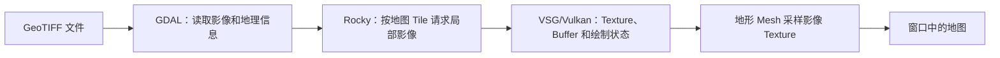
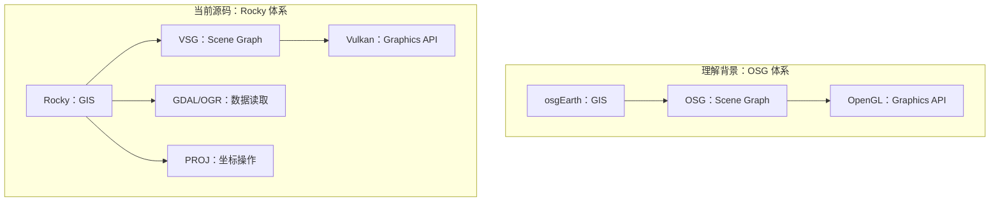
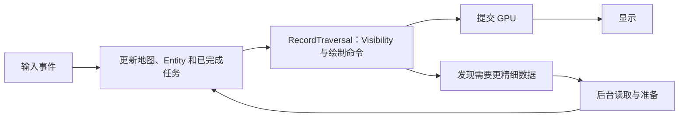

# 理解 Rocky 所需的基础知识

术语用法见[术语表](../术语.md)；本篇保留英文底层术语，中文用于解释。

## 目标与阅读方式

本篇解释三维 GIS 的主要概念，使没有 OSG、osgEarth、VSG 经验的读者也能继续阅读源码。术语解释属于背景原理；标注 B 编号的实现结论对应 Rocky 提交 `a4d8b141ec478e8440526928b344c6eb93810631`，定位见文末。本文是源码导读，未执行独立构建、GPU 实验或性能比较。

阅读顺序：[本篇](README.md) → [总体架构](../总体架构/README.md) → [坐标系统](../坐标系统/README.md) → [Layer 与 Tile](../图层与瓦片/README.md)，再选择栅格、地形或矢量。

## 从一个 GeoTIFF 到画面

“打开一幅影像”至少包含五类工作：读懂文件、知道它在地球上的位置、选择当前需要的部分、生成 GPU 可以使用的资源、执行绘制。GeoTIFF 文件本身不是一个可以直接塞进窗口的三维对象。

地形还需要高程；矢量还需要把点线面转换为 Geometry；模型还需要 Node、材质和定位。最终都进入渲染系统，但进入方式不同。Rocky 的 `GDALImageLayer`、`ElevationLayer`、`FeatureBuilder` 和 `NodeLayer` 正是几种不同责任的入口。（B1、B2、B3）

## OSG、osgEarth、VSG、Rocky 分别做什么

| 名称 | 核心责任 | 帮助理解 Rocky 的角度 |
| --- | --- | --- |
| OpenGL / Vulkan | Graphics API：创建资源、组织命令、同步并让 GPU 绘制 | 它们不会自动读懂 GIS 数据或管理地图 Tile |
| OSG（OpenSceneGraph） | 基于 OpenGL 的 Scene Graph 框架 | 理解 Node、变换、遍历、状态、Culling 和 Paging 等概念 |
| osgEarth | 基于 OSG 的地理空间 SDK | 在 Scene Graph 之上管理地图、数据源、坐标和地形 |
| VSG（VulkanSceneGraph） | 基于 Vulkan 的 Scene Graph 框架 | Rocky 的实际渲染基础，提供 Node、窗口、View 及资源 Compile 等设施 |
| Rocky | 地图和地球 SDK | 提供地理数据模型、坐标、数据 Layer、地形和地理 Entity |
| GDAL / OGR | 栅格/矢量格式及数据访问 | 提供 TIFF、SHP 等数据的读取接口；可用驱动取决于构建 |
| PROJ | SRS 和 Coordinate Operation | 支撑 Projection、基准及 Geodetic/Geocentric Coordinates 之间的转换 |

Rocky 借鉴 osgEarth 的地图数据模型，不表示它以 OSG 为运行基础，也不表示 OSG 的对象可以直接当作 VSG 对象。OSGB、glTF、3D Tiles 等文件或协议需要相应读取器；“使用 VSG”本身不能证明全部格式都可读。外部模型读取常涉及 `vsgXchange`，具体能力须按其版本和构建核查。

背景入口：[OSG 功能说明](https://openscenegraph.github.io/OpenSceneGraphDotComBackup/OpenSceneGraph/www.openscenegraph.com/index.php/about/features.html)、[osgEarth 官方文档](https://docs.osgearth.org/en/latest/)、[VSG 官方介绍](https://github.com/vsg-dev/VulkanSceneGraph)、[Rocky 说明](../../../README.md)。这些背景资料不代替本库固定版本的源码证据。

## Scene Graph：描述对象如何组织

Scene Graph 是一组可以被遍历的 Node 关系。例如一个 Transform Node 下挂一栋建筑，Transform 决定建筑的位置；一个 Group 下挂一批对象，遍历这个 Group 才能到达它们。Geometry 可以共享，因此实现上不必限定为严格的树。

常见对象包括：

- **Group**：组织子 Node。
- **Transform**：改变子对象坐标。
- **Geometry / Draw**：Vertex、索引及绘制命令。
- **StateGroup**：作用于子对象的绘制状态，例如 Graphics Pipeline 和资源绑定。
- **LOD / Pager**：按 View 选择细节或调入数据。
- **Bound**：Bounding Sphere/Bounding Box，用较低成本判断对象是否可能可见。

在 Rocky 中，`Map` 是地图的数据模型，`MapNode` 才是进入 VSG 场景的 Node。`MapNode` 组织地形，并在遍历时访问已打开的 `NodeLayer`；Layer 不会因为被加入 `Map` 就自动变成一个普通子 Node。（B1）

## 一帧与 CPU/GPU 的分工

背景上可以把一帧理解为事件处理、状态更新、Visibility 选择、绘制命令记录/提交和显示。VSG 的具体任务可能并行，不能把这张图理解为所有 GPU 工作都在 CPU 上同步完成。

Rocky 的 `Application::frame` 在渲染分支依次调用 `advanceToNextFrame`、`handleEvents`、`update`、`recordAndSubmit`、`present`。按需渲染的空闲分支仍处理事件并执行更新，后台数据完成时可请求新帧。（B4）

“数据已经读取”“GPU 资源 Compile 成功”“Camera 看见了它”是三个不同结果：读文件失败要查 Driver；资源 Compile 失败要查渲染环境；没有画面还需检查坐标、范围、Camera 和 Culling。这里的 Compile 指运行时资源准备，区别于 C++ 编译构建。

## Tile、LOD、按需读取

地图范围很大，屏幕像素有限。把数据划分为多 Level Tile 后，远处可以用粗数据，近处只加载当前需要的细数据。需要同时理解：

| 概念 | 含义 | 不能混同的事情 |
| --- | --- | --- |
| Tile 索引 | 确定某个 Level 中的一块区域 | z/x/y 必须结合 Profile 才有位置意义 |
| LOD | 按 View 选择适当细节的机制 | 不等同于文件压缩率 |
| Culling | 排除 View Frustum 外或被地平线挡住的对象 | 与读文件时的空间过滤不同 |
| Paging | 将需要的数据调入并卸载不再需要的数据 | 不等同于一次读完所有 Feature |
| Parent Fallback | 精细数据未就绪时继续使用已有粗数据 | 不等于精细数据已加载 |
| Cache | 保存可复用结果 | In-Memory Cache、GPU Residency 与 Disk Cache 不是一回事 |

预生成 Tile 由数据生产工具提前生成 Tile Pyramid；原始 TIFF 可以由 GDAL Layer 在运行时按 Tile 窗口读取。后者仍然需要 I/O、Resampling 和可能的 Reprojection，并不会因为采用 C++ 就消除全部成本。实际地形 Paging 流程见[三维地形](../三维地形/README.md)。（B2）

## 坐标与精度：位置不是三个无单位的数字

`(120, 30, 100)` 可以表示经度、纬度和高程，也可以被错误地解释为距离原点几百米的模型坐标。SRS 使这些数值具有空间含义。

- Geodetic Coordinates 通常以经纬度描述位置；地球椭球参与转换。
- Projected Coordinates 把地表映射到平面，适合特定制图和测量用途。
- ECEF 是以地心为原点的三维坐标，地表位置达到百万米量级。
- ENU 表示某处东、北、天三个方向构成的 Local Frame，适合定位普通模型。
- 模型 Local Coordinates 还涉及轴向、单位和缩放，需要宿主提供定位规则。

大数值直接转成单精度可能损失局部细节；Localization、双精度变换等处理位置精度，Depth Buffer 的近远范围则影响遮挡精度。两类问题需分别排查。Rocky 的 `SRS`、`GeoPoint`、`GeoTransform` 和地形 Geometry/Shader 分别参与这些环节。（B5）

知识背景参照库内“数字地球引擎知识总结”KB-VIRTUAL-GLOBE-ENGINE-001 的 C-01、C-03、C-04、C-06；其来源是书籍原理，不能据此认定 Rocky 实现了书中所有方案。

## ECS：另一种组织可绘制对象的方式

Entity 是标识，Component 是数据，System 处理带有相应 Component 的 Entity。例如一个点可以关联位置集合 `PointGeometry` 和外观 `PointStyle`，点系统负责把它们转成渲染内容。

Rocky 的 ECS 使用 EnTT，并用 `Registry` 包装 Read/Write Lock。创建/删除 Entity、添加 Component 需要 Write Lock；读取或修改现有 Component 需遵守实际 Registry 合同。ECS 与 Scene Graph 协同：`ECSNode` 管理系统，`EntityNode` 通过场景遍历维护 Entity 的逐 View Visibility；后者可以包进 `NodeLayer`。（B3、B6）

所有权也有两套常见形式：Rocky 数据类的 `Inherit` 使用 `std::shared_ptr`，VSG Node 使用 `vsg::ref_ptr`。两者都可能提供 `create()`，不能仅凭这个名字判断指针类型或手动释放策略。（B6）

## UI 与 Render Window

Qt 是 UI/窗口集成方式之一，ImGui 常用于原生 Render Window 内的调试界面，React/Tauri 可以提供桌面应用的前端与宿主。它们不会替代地图渲染器。

Rocky 提供默认 `Application`，也允许宿主管理 VSG 的窗口、View 和 Frame Loop。根 CMake 的 `ROCKY_SUPPORTS_QT` 默认关闭，Qt 不是运行三维球的强制条件。（B7）React 的 UI 复用与原生窗口嵌入是不同工作，具体接入留给 P1 工程集成。

## 现成能力与额外工作怎样判断

依次核对：公开 API 是否存在 → 依赖是否编入 → 数据是否读出 → 资源是否可绘制 → Camera/坐标/生命周期是否正确。只有前两步不能写成“已经支持任意真实数据”。

例如 Rocky 已有 `NodePager` 与 MVT 官方示例，可复用其 Paging 设施；这既不代表现有 GeoStudio Demo 已接入，也不代表已经具备完整 MapLibre style.json 兼容。三维模型、倾斜摄影和点云同样需要具体格式路线，不能从一个 `NodeLayer` 接口推导全部解析能力。

## 源码证据与继续阅读

| 编号 | 文件与稳定入口 | 本文采用的结论 |
| --- | --- | --- |
| B1 | [MapNode.cpp](../../../src/rocky/vsg/MapNode.cpp)：构造、`update`、`traverse`；[Map.h](../../../src/rocky/Map.h) | 数据模型与渲染 Node 分开，NodeLayer 经遍历接入 |
| B2 | [GDALImageLayer.cpp](../../../src/rocky/GDALImageLayer.cpp)：`createTileImplementation`；[TerrainTilePager.cpp](../../../src/rocky/vsg/terrain/TerrainTilePager.cpp) | 按 Tile 读取与地形 Paging |
| B3 | [FeatureBuilder.h](../../../src/rocky/vsg/ecs/FeatureBuilder.h)、[EntityNode.h](../../../src/rocky/vsg/ecs/EntityNode.h) | Geometry 构建和 ECS/Scene Graph 协作 |
| B4 | [Application.cpp](../../../src/rocky/vsg/Application.cpp)：`frame`，约 628–753 行 | 渲染与空闲两种帧流程 |
| B5 | [SRS.h](../../../src/rocky/SRS.h)、[GeoPoint.cpp](../../../src/rocky/GeoPoint.cpp) | SRS 与坐标转换入口 |
| B6 | [Registry.h](../../../src/rocky/ecs/Registry.h)、[Common.h](../../../src/rocky/Common.h) | 锁和共享所有权模式 |
| B7 | [CMakeLists.txt](../../../CMakeLists.txt)、[Application.h](../../../src/rocky/vsg/Application.h) | 可选 UI 与应用入口 |

验证状态：本轮已核对上述定义及相关实现；未运行这些接口。可通过[总体架构](../总体架构/README.md)的最小应用与三条数据链路继续学习。维护记录见[当前说明](../README.md)。
