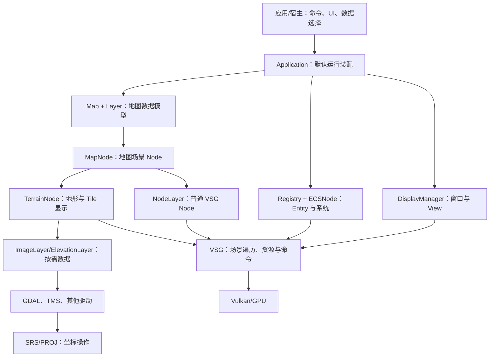
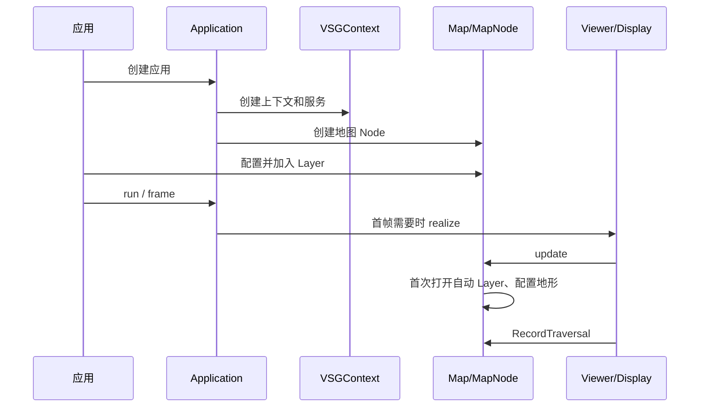

# Rocky 总体架构与运行流程

术语用法见[术语表](../术语.md)；本篇保留英文底层术语，中文用于解释。

## 目标与源码基线

本篇回答“从应用创建到地球显示，哪些对象分别做什么”。基线为 `a4d8b141ec478e8440526928b344c6eb93810631`，Rocky 1.1.0、ABI 60。A 编号对应文末源码证据；示例是公开接口的说明片段，本轮未独立编译运行。

先读[基础知识](../基础知识/README.md)。坐标、Tile 和各数据源的详细规则分别维护在相应模块，本文负责连接它们。

## 分层与依赖



这是一张职责图，箭头不全部代表继承关系。`Map` 不继承 VSG Node，`Layer` 也不全部包含可绘制 Node。数据读取层提供局部数据，地形/ECS/Node 路线再组织渲染。（A1、A2）

## 核心对象

| 对象 | 保存或管理什么 | 不应承担的额外解释 |
| --- | --- | --- |
| `Application` | Viewer、上下文、地图 Node、场景、显示、ECS 系统及运行循环 | 不是每个使用 Rocky 的宿主都必须采用完整默认装配 |
| `Map` | Layer 集合、Revision 和 Layer 变化通知 | `add` 不直接执行格式解码和 GPU 资源 Compile |
| `Layer` | 名称、状态、自动打开选项、Revision 及打开/关闭协议 | 状态 OK 不代表全部 Paging 内容已经读取 |
| `Context` / `IOOptions` | 通用服务、读取环境、任务和取消等上下文 | 与窗口 Camera、Vulkan 资源上下文不同 |
| `MapNode` | 地图到场景的连接、显示 Profile、地形 Node、逐 View 地平线信息 | 数据源 Profile 不等同于显示 Profile |
| `TerrainNode` | 地形状态、Profile Node、Tile 工厂与 Paging 生命周期 | 不直接承担 SHP 等 Feature 解析 |
| `VSGContext` | 对 Viewer、资源 Compile、更新队列、Upload 与延迟释放等服务的访问 | 当前别名为指针，不是任意宿主都可自行持有释放的值对象 |
| `Registry` / `ECSNode` | Entity/Component 及对应系统的更新和渲染 | Primitive Component 不会自动保存完整源数据编辑语义 |
| `DisplayManager` | 窗口、View 及增删事件 | UI 框架自身不提供地图格式读取 |

`Application` 内的上下文所有者与其对外 `vsgcontext` 指针要一起理解。自定义宿主必须保留实际上下文所有者，不能只复制裸指针后销毁工厂返回对象。（A3）

## 应用初始化

`Application::ctor` 的主要步骤是：建立 Viewer → 创建 VSGContext → 初始化 DisplayManager 并订阅窗口/View 事件 → 创建地图及场景分支 → 读取命令行地图配置 → 创建 ECS 系统。（A1）

默认系统包括普通图形 Entity 和变换等设施。源码还为地形锚点、投影摆放配置地形目标；在相应编译条件下安装覆盖绘制与计算分支。因此默认应用已经提供不少装配，直接使用 VSG Viewer 的宿主若需要相同功能，也要负责相应系统的安装。（A1）



## Map、Layer 和 MapNode 如何连接

### 加入不等于打开

`Map::add` 加锁加入 Layer、增加 Map Revision 并通知 `onLayersChanged`。`Map::openAllLayers` 才遍历允许自动打开且尚未打开的 Layer，调用它们的 `open`。（A2）

`MapNode::update` 在首次更新中调用 `openAllLayers`，并保证地形关联当前 Map/Profile。运行中新增 Layer 时，接入代码应明确处理 `layer->open(io)` 的结果；不能把 `Map::add` 当作隐含的同步打开接口。官方 MVT 示例也采用先打开 NodeLayer、成功后再加入 Map 的方式。

### Layer 状态

`Layer::open` 在状态锁内调用派生类 `openImplementation`，成功后状态 OK；失败保存 `Failure`。`close` 调用派生关闭逻辑，并将状态置为“Layer closed”。`dirty` 增加 Layer Revision，用于后续识别内容变化。（A2）

打开影像/高程 Layer 通常建立驱动和范围；具体 Tile 仍在请求时读取。矢量的 `GDALFeatureSource` 则不是 `Layer` 子类，拥有自己独立的打开和迭代协议，详见[矢量](../矢量/README.md)。

### 地图显示坐标

`MapNode` 默认使用 `global-geodetic`。其 `srs()` 在显示 Profile 为地理/QSC 时返回对应地心 SRS，否则返回 Profile 的投影 SRS；这决定场景实际用 ECEF 还是投影平面坐标。（A4）

不能将默认值理解为输入必须是经纬度数据。输入数据有自己的 SRS；请求、Mosaicing 和坐标变换负责把它们对齐。

## 三条主要数据链路

### 影像和高程

`Map` 中的 ImageLayer/ElevationLayer → `TerrainTileModelFactory` 收集当前 TileKey 数据 → 渲染模型和 Texture 资源 → `TerrainTileNode`/地形表面 → VSG 命令。

数据模型与 GPU 模型分开，是为异步读取、Parent Inheritance 和更新阶段合并提供空间。详细 Paging 机制见[三维地形](../三维地形/README.md)。（A5）

### GIS Feature

`GDALFeatureSource` → `Feature`/`Geometry` → `FeatureBuilder` 或对应 Geometry 准备 → Registry 中的 Geometry/样式/Primitive Component → ECS 系统。

需要控制一批 Entity 随地图 Layer Visibility 时，可使用 `EntityNode` 包进 `NodeLayer`。读取器不是渲染 Layer；Geometry 构建器也不是文件编辑器。（A6）

### 普通模型或自定义 Node

外部读取器创建 `vsg::Node` → 必要的地理定位/Transform → 资源 Compile → `NodeLayer` 或场景分支。

`NodeLayer` 的核心价值是让已有 Node 进入地图 Layer 管理；它本身不解析 OBJ、OSGB 或 3D Tiles。使用什么读取器、是否支持压缩扩展，需在外部库及构建中核查。（A6）

## Frame Loop 与安全更新

`Application::run` 循环调用 `frame`。正常渲染分支为：

```text
realize（首次需要时）
  → advanceToNextFrame
  → handleEvents
  → update
  → recordAndSubmit
  → present
```

无须绘制时仍执行 `pollEvents`、事件处理和 `update`。`VSGContext::requestFrame` 唤醒按需渲染；后台任务完成只改变内存而不请求新帧，可能让用户误以为内容没有更新。（A7）

`VSGContext` 提供 `onNextUpdate`、`compile`、`upload`、`dispose` 等公共服务。场景和 Vulkan 对象存在阶段与线程要求；可用这些入口交接工作，不能根据“某个方法是线程安全的”推断可以在任意线程同时修改整个场景。

## 所有权与资源生命周期

| 对象 | 通常的所有权 | 使用时需关注 |
| --- | --- | --- |
| Map、Layer、FeatureSource | Rocky `shared_ptr` 模式 | 数据源关闭、对象共享和并发请求的关系 |
| VSG Node、Viewer、Texture 状态 | `vsg::ref_ptr` | CPU 引用释放与 GPU 正在使用可能不是同一时刻 |
| VSGContext 对外 Handle | 当前为 `VSGContextImpl*` | 保持工厂/应用持有的上下文所有者存活 |
| GDAL/PROJ Handle | 由对应驱动/线程 Cache 管理 | 不能简单跨线程共享所有内部 Handle |
| EntityNode Entity 集合 | 默认析构时销毁其登记的 Entity | 不重复把同一个 Entity 交给多个自动销毁集合 |

`dispose` 用于延迟处置会被 GPU/编译流程使用的 VSG 对象；这与简单 `reset()` 的语义不同。当前正文只解释职责，具体队列与并发细节留给 P1。（A3、A6）

## 最小应用与自定义宿主

以下片段使用已存在的公开接口；需要库及运行资源已准备，未在本轮编译执行。URI 为说明输入，应替换为实际数据。

```cpp
#include <rocky/rocky.h>

int main(int argc, char** argv)
{
    rocky::Application app(argc, argv);
    auto layer = rocky::TMSImageLayer::create();
    layer->uri = "data/xyz/{z}/{x}/{y}.png";
    layer->profile = rocky::Profile("spherical-mercator");
    app.mapNode->map->add(layer);
    return app.run();
}
```

该例利用 MapNode 首次更新打开 Layer。若应用需要立即展示打开错误，可显式调用 `layer->open(app.io())` 并检查结果。Camera 定位、离线 Tile 覆盖范围和最大 Level 需另行配置，见[栅格](../栅格/README.md)。

自定义宿主可以直接创建 VSG Viewer、上下文和 MapNode，并驱动 Frame Loop。Qt 为可选路线；React/Tauri 的 UI 和原生视口之间仍需要窗口、尺寸、输入及生命周期连接。此处的架构能力不代表这些宿主已经在本 checkout 中集成或验证。

## 验证与边界

| 场景 | 静态入口 | 后续运行时应观察 |
| --- | --- | --- |
| 默认应用 | [rocky_simple](../../../src/apps/rocky_simple/rocky_simple.cpp) 的 `--simple` 模式 | 窗口、地图、默认 Camera 和退出；无参数仅显示选项 |
| 地图配置 | Application 的 `loadMapFile`、MapNode 的 `from_json` | 相对资源、错误配置和缺失依赖 |
| 动态挂载 Node | [Demo_MVTFeatures.h](../../../src/apps/rocky_demo/Demo_MVTFeatures.h) | 打开结果、Paging、Visibility、释放 |
| 地形状态变化 | [TerrainNode.cpp](../../../src/rocky/vsg/terrain/TerrainNode.cpp) | Layer 改变后地形重置与重新请求 |

本轮只完成源码核对，未运行表内场景。文档中出现的 C++ 示例不作为功能验收证据；主任务维护真实执行状态。

## 源码证据与导航

| 编号 | 文件与稳定入口 | 对应事实 |
| --- | --- | --- |
| A1 | [Application.cpp](../../../src/rocky/vsg/Application.cpp)：`ctor`，约 177–419 行 | 上下文、显示、地图和 ECS 装配 |
| A2 | [Map.cpp](../../../src/rocky/Map.cpp)：`add`/`openAllLayers`；[Layer.cpp](../../../src/rocky/Layer.cpp)：`open`/`close`/`dirty` | 数据模型及打开协议 |
| A3 | [VSGContext.h](../../../src/rocky/vsg/VSGContext.h)、[Application.h](../../../src/rocky/vsg/Application.h) | 上下文所有者、公开指针及资源服务 |
| A4 | [MapNode.cpp](../../../src/rocky/vsg/MapNode.cpp)：构造、`srs`、`update`、`traverse` | 显示 Profile、自动打开和 Node 遍历 |
| A5 | [TerrainTileModelFactory.cpp](../../../src/rocky/TerrainTileModelFactory.cpp)、[TerrainTilePager.cpp](../../../src/rocky/vsg/terrain/TerrainTilePager.cpp) | 数据准备和地形交接 |
| A6 | [FeatureBuilder.h](../../../src/rocky/vsg/ecs/FeatureBuilder.h)、[EntityNode.h](../../../src/rocky/vsg/ecs/EntityNode.h)、[NodeLayer.h](../../../src/rocky/vsg/NodeLayer.h) | Feature Geometry、Entity 集合和模型 Node 路线 |
| A7 | [Application.cpp](../../../src/rocky/vsg/Application.cpp)：`frame`；[VSGContext.h](../../../src/rocky/vsg/VSGContext.h)：`requestFrame` | Frame Loop、按需渲染和更新 |

继续阅读：[坐标系统](../坐标系统/README.md)、[Layer 与 Tile](../图层与瓦片/README.md)、[技术文档入口](../README.md)。后续深入范围见[方案](../梳理方案.md)及[主任务](../任务/001-Rocky架构与技术实现梳理.md)。
