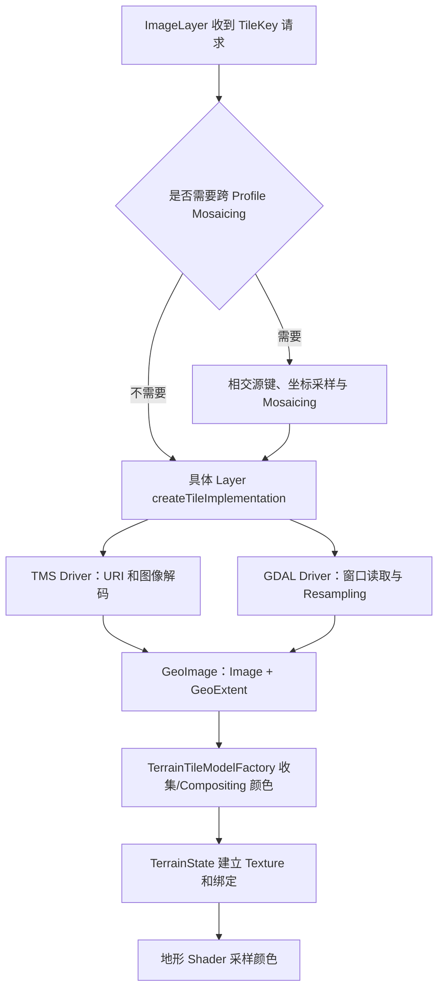

# 栅格影像：TMSImageLayer 与 GDALImageLayer

术语用法见[术语表](../术语.md)；本篇保留英文底层术语，中文用于解释。

## 目标、输入与职责

本篇说明预生成的 Tile 影像和原始影像怎样进入地图。基线为 `a4d8b141ec478e8440526928b344c6eb93810631`；R 编号对应源码证据。流程已作静态核对，本轮未构建或运行这些片段。

需要显示局部/全球影像时，两条主要公开路线为：

| 输入 | 首选入口 | 结果 |
| --- | --- | --- |
| TMS TileMap Metadata | `TMSImageLayer` | 建立 Profile 参数，按键读取 Tile 图像 |
| 本地/网络 XYZ 图像模板 | `TMSImageLayer`，显式 Profile | 使用模板生成 Tile URI |
| GeoTIFF 等有 SRS 的栅格 | `GDALImageLayer` | GDAL 按 Tile 范围生成局部图像 |
| 栅格 MBTiles | `MBTilesImageLayer` 或具备相应驱动的 GDAL 路线 | 取决于可选依赖，需分别验证 |
| DEM 或 RGB 编码高程 | [高程 Layer](../三维地形/README.md) | 作为地形高度处理，不能只当颜色影像加载 |

公共生命周期、TileKey、范围和 Cache 见[Layer 与 Tile](../图层与瓦片/README.md)。

## 总体数据链



Mosaicing 分支会反复调用源驱动，不是只调用一次驱动后再给它改标签。影像是否能定位到地球由 Profile/SRS/GeoExtent 决定；具体画面由地形链路提供。（R1、R5）

## TMSImageLayer：两种打开模式

`openImplementation` 先执行基类打开，然后调用 `TMS::Driver::open` 建立源 Profile、数据范围和 TileMap；`createTileImplementation` 请求具体图像并绑定请求键的地理范围。（R2）

驱动根据是否已经提供有效 Profile 选择两种模式：

1. **未提供 Profile**：读取 URI 指向的 TMS TileMap Metadata，从中建立 SRS、范围、Tile 格式及 Level 信息。
2. **已提供 Profile**：按通用模板/XYZ 数据源建立 TileMap，不再查询 TMS Metadata，并默认采用上原点方向。

这意味着仅给一个目录或模板字符串，不能保证驱动自动推断其投影、范围、行号和真实最大级别。无标准 Metadata 的离线目录应由应用提供这些信息。`XYZImage` JSON 工厂是复用 TMSImageLayer 的注册入口，会在没有 Profile 时补上 spherical-mercator，不是另一个渲染器。（R2、R3）

### 参数及 Y 方向

| C++ 属性 | 影像 JSON 键 | 默认/含义 |
| --- | --- | --- |
| `uri` | `uri` | TileMap Metadata 地址或图像模板 |
| `format` | `format` | 图像格式提示；可由 Metadata/模板确定 |
| `profile` | `profile` | 通用模板需要明确 Profile |
| `invertY` | `invert_y` | 默认 false，在驱动模式的默认方向上再次翻转 |
| `minLevel/maxLevel/maxDataLevel` | 同名 | 继承的 Level 参数，需与实际数据一致 |
| `crop` | `crop` | 继承的地理 Crop 范围 |

内部 TileKey 的 y 从上往下。`TileMap::getURI` 先构造 TMS 的 `numRows-1-y`，根据驱动模式与用户翻转选项选择最终方向。提供 Profile 的普通 XYZ 模式默认上原点；在这个模式设置 `invertY=true` 会再翻回 TMS 方向。（R3）

模板支持 `{z}/{x}/{y}`、`{-y}` 及带 `$` 的相应形式。`{-y}` 指另一种行号，使用它时还需考虑最终翻转设置，避免重复翻转。

注意：`TMSElevationLayer` 本提交的 JSON 键为 `invertY`，与影像的 `invert_y` 不同。C++ 属性同名，JSON 配置不能相互照抄。

### 请求、解码与错误

`TMS::Driver::read` 生成 URI，经 `URI::read` 取内容，再通过 `io.services().readImageFromStream` 解码图像。图像解码服务由运行环境提供，网络读取成功并不代表内容一定是图像，例如返回 HTML 错误页仍可能解码失败。（R3）

标准 Metadata 里的覆盖范围和 Level 用于减少无效请求；模板模式没有扫描整个目录来建立精确覆盖。驱动会将读取/解码错误返回上层，不能概括为任何缺 Tile 都会自动产生透明图。Parent Fallback 和 Node 继承还要看上层请求分支。

## GDALImageLayer：原始文件按需生成局部影像

`GDALImageLayer` 由 `ROCKY_HAS_GDAL` 控制是否可用。公开接入设置 URI 或连接串即可调用，实际读取经内部 `GDAL_detail::Driver`；通常没有必要让应用绕开 Layer 自行操作这个内部驱动。（R4）

### 打开 Dataset

主要顺序为：

```text
GDALImageLayer::openImplementation
  → 为当前线程取得 Driver
  → Driver::open
  → GDALOpen(..., GA_ReadOnly)
  → 必要时选择 Subdataset
  → 从 Dataset/GCP/旁置 prj 建立 SRS
  → 判断旋转、GCP 等条件并建立采样用 Dataset
  → 计算 GDAL GeoTransform、逆变换、源 Profile 和范围
  → 估算有效数据 Level
```

有旋转/GCP 等需要调整时可建立 `GDALAutoCreateWarpedVRT`，否则采样 Dataset 可直接引用源 Dataset。地图与源 Profile 不同时还有 ImageLayer 的采样 Mosaicing，不能把每一次地图 Reprojection 都解释为这里直接创建了最终显示坐标系的 VRT。（R4、R1）

缺少 SRS 会明确失败；缺少 GDAL GeoTransform 但属于已识别的地理 CRS 时，代码还有按 Profile 推定全球像素布局的分支。这里的 GeoTransform 是 GDAL 仿射参数，区别于场景定位类 `rocky::GeoTransform`。因此“打开成功”也需要检查实际位置，不能据此证明原始文件已正确配准。

### 请求一个 Tile

驱动计算 TileKey 与源范围的交集，将地理范围通过逆仿射变换转成源像素窗口，计算目标 Tile 的有效区域及偏移，读取对应 Band 并 Resampling。地理经度范围跨线时，还会处理源数据与规范化范围处于不同经度框架的问题。（R4）

这条路线的“原始数据加载”是按需访问原件并生成渲染 Tile，不是把整幅 TIFF 一次性变成一个 GPU 大 Texture。内存、解压和磁盘代价仍受文件组织影响。

GDAL 的 RasterIO 可利用其 Dataset 和驱动机制；本段 Rocky 实现并没有替应用生成磁盘 Tile Pyramid 或自动创建 Overview。COG、Overview 和分块读取收益要结合实际文件/驱动验证，不能只凭扩展名承诺。

### Band、颜色与 NoData

驱动先按 Color Interpretation 寻找 RGB、Alpha、Gray 和 Palette Band，必要时按 Band 数作推断。普通颜色路径输出 RGBA8，范围外区域、Opacity 和无效值由对应分支处理。（R4）

存在重要边界：某些单通道 Int16/UInt16/Float32 数据会被当作高程类数据输出浮点 Heightfield。因此 GDALImageLayer 不是任意多光谱/浮点栅格的自动制图器；任意 Band 组合、统计拉伸和色带分析需另核对公开能力。DEM 应优先使用 GDALElevationLayer，避免“颜色影像打开”与“地形高度生效”混淆。

### 参数与线程所有权

| 属性 | 作用及本版说明 |
| --- | --- |
| `uri` / `connection` | 文件/数据源 URI 或连接串 |
| `subDataset`，JSON `subdataset` | 选择 GDAL Subdataset；实际索引合法性由驱动检查 |
| `interpolation` | Options 默认 Bilinear；此 Layer JSON 明确识别 nearest/bilinear |
| `tileSize` | 继承的数据 Tile 采样数 |
| `maxDataLevel` | 有效细节限制提示；驱动还会按源分辨率建立数据 Level 范围 |

每个请求线程取得自己的 `ThreadLocal<GDAL_detail::Driver>`；新线程首次请求时打开该线程的 Dataset。关闭 Layer 清理这些 Thread-Local 驱动。并发增加也可能增加 Handle 和 Cache 占用，不能直接等同于线性加速。（R4）

## 多影像 Layer 的 Color Compositing

在实际地形加载任务中，`TerrainTileModelFactory` 收集已打开、覆盖当前范围的 ImageLayer。单层可以直接使用；多层在满足条件且启用 compositeColorLayers 时，通过 `GeoImage::composite` 按 Layer 顺序及 opacity 执行 Color Compositing，生成局部颜色结果。地形任务目前将该开关设为 true。（R5）

Color Compositing 发生在 Tile 数据准备中，不会把所有源文件写成一幅磁盘影像。Parent 结果、NoData 及只得到 Fallback 数据的情况还会影响是否生成新结果。更新 Layer 顺序/参数时也要考虑 Map Revision、Layer Revision 和 Resident Terrain 状态。

## 最小公开调用

片段假设已存在 `rocky::Application app`。输入是说明路径，需有对应数据；打开成功后再加入地图。本轮未编译执行。

```cpp
auto xyz = rocky::TMSImageLayer::create();
xyz->uri = "data/xyz/{z}/{x}/{y}.png";
xyz->profile = rocky::Profile("spherical-mercator");
xyz->maxLevel = 14u;
if (xyz->open(app.io()).ok())
{
    app.mapNode->map->add(xyz);
}

#ifdef ROCKY_HAS_GDAL
auto imagery = rocky::GDALImageLayer::create();
imagery->uri = "data/imagery.tif";
if (imagery->open(app.io()).ok())
{
    app.mapNode->map->add(imagery);
}
#endif
```

这解决数据源接入，不包含应用文件选择器、Camera 自动定位、完整错误展示或任意类型的自动识别。查看结果时还需把 Camera 移动到数据覆盖范围。

## 格式能力与接入边界

| 能力 | 本版公开路线 | 判断边界 |
| --- | --- | --- |
| 本地/HTTP XYZ 和 TMS 影像 | TMSImageLayer | Metadata、Profile、真实 Tile 和解码服务须匹配 |
| GeoTIFF | GDALImageLayer | 依赖 GDAL、驱动、SRS 和 Band 语义 |
| COG/VRT/WMS/WMTS | 经 GDAL 的候选路线 | 应按所用 GDAL 驱动逐项验证，不据通用格式列表承诺 |
| 栅格 MBTiles | MBTilesImageLayer | 需要相应 SQLite/Zlib 构建条件 |
| 矢量 MBTiles/MVT | GDALFeatureSource 等 Feature 路线 | 不进入影像驱动；见[矢量](../矢量/README.md) |
| 任意原始栅格编辑写回 | 本篇读取路线未提供该产品流程 | 需要单独设计数据编辑及保存责任 |

Rocky 的 MBTiles 驱动公开 read 返回 Image，不能因为名字叫 MBTiles 就用它读取矢量 Feature。库是否编入 MBTiles 与 GDAL 是否编入矢量 MBTiles 驱动也是两件事。（R6）

## 验证入口与排查表

| 用例/现象 | 重点检查 | 状态 |
| --- | --- | --- |
| 本地 XYZ 上下颠倒 | Profile 模式、invertY 和模板 {-y} | 源码已核对，未运行 |
| TMS Metadata 正常但 Tile 失败 | URI 上下文、Level、实际内容和图像解码服务 | 可操作用例，未运行 |
| TIFF 打开但位置不对 | SRS、仿射变换、GCP 和全局推定分支 | 可操作用例，未运行 |
| Gray/浮点 TIFF 显示异常 | Band Color Interpretation、高程分支及预期色带 | 源码边界已核对，未运行 |
| 两影像叠加 | 顺序、opacity、覆盖、GeoImage::composite | 源码已核对，未运行 |
| 跨 Antimeridian TIFF | GDAL 经度框架调整、ImageLayer Mosaic、tests_antimeridian | 已有测试入口，未执行 |

## 源码证据与导航

| 编号 | 文件与稳定入口 | 核对范围 |
| --- | --- | --- |
| R1 | [ImageLayer.cpp](../../../src/rocky/ImageLayer.cpp)：`createTile`、`createTileInKeyProfile`、`assembleTile` | 外层请求、Crop、Mosaicing |
| R2 | [TMSImageLayer.cpp](../../../src/rocky/TMSImageLayer.cpp)：工厂、`construct`、`openImplementation`、`createTileImplementation` | 影像入口和 JSON |
| R3 | [TMS.cpp](../../../src/rocky/TMS.cpp)：`TileMap::getURI`、`Driver::open/read`；[TMS.h](../../../src/rocky/TMS.h) | Metadata、模板、Y 方向和解码 |
| R4 | [GDALImageLayer.cpp](../../../src/rocky/GDALImageLayer.cpp)、[GDAL.h](../../../src/rocky/GDAL.h)、[GDAL.cpp](../../../src/rocky/GDAL.cpp)：`Driver::open/createImage`、`rasterIO` | 按需读取、Band、采样和线程驱动 |
| R5 | [TerrainTileModelFactory.cpp](../../../src/rocky/TerrainTileModelFactory.cpp)：`addColorLayers`；[TerrainTilePager.cpp](../../../src/rocky/vsg/terrain/TerrainTilePager.cpp)：`requestLoadData` | Layer 选择和 Color Compositing |
| R6 | [MBTiles.h](../../../src/rocky/MBTiles.h)、[MBTilesImageLayer.h](../../../src/rocky/MBTilesImageLayer.h)、[CMakeLists.txt](../../../CMakeLists.txt) | MBTiles 影像接口与依赖 |

协议背景：[OSGeo TMS](https://wiki.osgeo.org/wiki/Tile_Map_Service_Specification)、[GDAL 栅格 API](https://gdal.org/en/stable/api/raster_c_api.html)。继续阅读：[三维地形](../三维地形/README.md)、[坐标系统](../坐标系统/README.md)。维护入口：[主任务](../任务/001-Rocky架构与技术实现梳理.md)。
