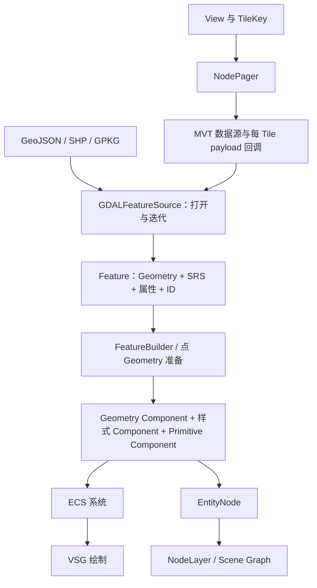
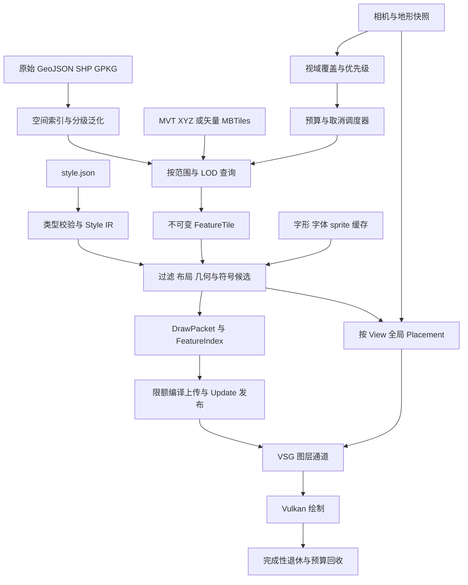

# 矢量：当前渲染链路与大体量 VSG 制图架构

术语用法见[术语表](../术语.md)；本篇保留英文底层术语，中文用于解释。

## 目标与源码身份

本文同时维护当前能力与架构提案 v1。**建议保留 VSG 作为三维渲染后端，建立有预算的矢量瓦片流水线，以 MapLibre Style Specification 为制图兼容目标，并独立建设文字布局与跨瓦片 Placement。** 当前 Demo 仍是整批同步处理，不能通过取消要素数量限制直接获得大数据能力；接收 style.json 也不等于已经拥有完整符号系统。

当前源码身份为 `geostudio-native` 工作副本，HEAD `8285521fd68ec40f76544fb15806eedcbd8892f5` 加已有未提交差异；消费方为 `native-gis-demo` 工作副本，HEAD `a3edece7b26e56cf4360dd9a555e605b8557176a` 加已有差异，消费 SDK 0.3.0／ABI 62 的 `out/install-capabilities`。Rocky 固定来源仍为 `a4d8b141ec478e8440526928b344c6eb93810631`，不等于当前 SDK 内容身份。关键文件哈希见文末。V 编号对应源码证据；历史上游示例仅说明原组合方式，不能当成当前产品已接入。

本轮只维护本文及 [MapLibre Native 调研](../调研分析/MapLibre-Native/README.md)，读取 SDK、Demo 和知识库，不修改代码、依赖锁或消费包。未执行构建、数据读取、GPU 或性能测试；后文目标、预算与接口名均为待实施提案。

最重要的分工是：**GDALFeatureSource 读 Feature，FeatureBuilder 构建 Geometry，ECS System 生成可绘制内容，NodePager 按 View 执行 Paging**。这些接口可以组合，但没有一个入口自动完成任意文件、完整制图样式、标签、编辑和保存的全部工作。

## 两条现成技术路线

### 当前产品实际怎么画

当前消费入口是 [Scene.cpp](../../../../../demo/native-gis-demo/native/Scene.cpp) 的 `Scene::load`，不是 SDK 自动识别并调度全部矢量源。`vector` 与 `mvt` 共用下列流程；MVT 只多了 `MVT:` URI 前缀。

```text
React/Tauri add → 引擎 onNextUpdate → Scene::execute → Scene::load
  → GDALFeatureSource::open：选一个 OGR Layer、计数、范围
  → each：遍历所有有效 Feature、逐点转换求经纬度包围范围
  → polygons / lines / points 三个内存集合
  → registry 写锁内 FeatureBuilder：面三角化、线细分、点坐标转换
  → 最多三个聚合 Entity：Mesh / Line / Point，固定颜色和尺寸
  → EntityNode → NodeLayer → Map / ECSNode
  → MeshSystem / LineSystem / PointSystem 生成 VSG 绘制资源
  → VSG 编译、上传、记录绘制命令 → Vulkan
```

`Scene.cpp:96` 在第 100001 个有效 Feature 时抛出异常，此时还没建立新 EntityNode；因而新数据不会先显示前十万个要素。`114–147` 行在 Registry 写锁内构建整批几何；命令又在更新阶段执行，因此读取、范围计算、三角化都会推迟后续帧。多个实体的聚合减少了一部分 draw 开销，却失去了瓦片粒度的 LOD、视域裁剪与回收；它不是“每要素一个 draw”导致的唯一问题。

MVT 当前由 Demo [CMakeLists.txt](../../../../../demo/native-gis-demo/CMakeLists.txt) 构建同版本 GDAL 的 `ng-mvt` 适配，[main.cpp](../../../../../demo/native-gis-demo/native/main.cpp) 显式注册。SDK 普通消费者不能仅凭 `GDALFeatureSource` 存在就推定拥有该驱动。当前单 PBF 的成功不代表动态 XYZ、TileJSON、多 source-layer 或矢量 MBTiles 已接入。

### “看不到”的排查顺序

以下区分源码已证实的机制与仍需用户数据复现的原因；没有真实输入与运行轨迹，不能认定某个机制就是所有空白场景的根因。

| 阶段 | 当前风险与证据 | 应观察的判据 |
| --- | --- | --- |
| 打开与读取 | 强制要素计数、范围求取可能全扫描；迭代器 500 条队列不限制调用方全量集合；超十万显式失败 | open/scan/read 耗时、错误、内存峰值，而非只看 UI 请求是否成功 |
| 几何生成 | 整批转换、细分和三角化，单个超复杂面即使只有一个 Feature 也可能很重 | 原顶点数、生成顶点/索引数、有效面数、三角化耗时、退化/跳过数 |
| 更新与上传 | 重建在更新线程和 Registry 写锁内；首屏等全部准备完毕 | 最大 update 停顿、compile/upload 队列、首个 resident draw 时间 |
| 空间与显示 | 错误 SRS、单瓦片缺 z/x/y、错误 Layer、跨反经线范围、地形遮挡均需排查 | 实际 TileKey/SRS/bounds、相机位置、可见裁剪数、深度与地形关系 |
| 成功判定 | 当前 evidence 只有 Feature 及分类数量，Feature 有效性检查不等于几何可绘制 | accepted → built → resident → submitted 分级状态；最后画面仍需验收 |

当前面使用固定金黄色、`resolution=10000m` 和 `depthOffset=30`，线使用固定青色、宽度 4 和深度偏移 35，点使用固定红色、宽度 12 和深度偏移 40。Demo 没有设置 `FeatureBuilder::clamper` 或 `colorFunction`。这些参数不能证明贴地正确；特别是地形有实际高程时，深度偏移不能代替高程采样。

**已有基础样式，尚无完整制图系统。** SDK 有 Point/Line/Mesh/PolygonStyle、Label/LabelStyle 数据以及按屏幕矩形 R-tree 避让的 DeclutterSystem；默认 ECS 系统集合没有自动安装 Label/Declutter，旧 Label 绘制在当前 Tauri 未编译的宿主 UI 路径。当前入口不解析 style.json，不生成地图级文字，不维护 glyph/sprite、沿线标注、跨 Tile 去重和稳定 Placement。不能仅添加一个 LabelStyle 就宣称补齐 MapLibre 符号能力。

### SDK 可组合的路线



小数据可以读成一批 Feature 后构建 Geometry。MVT 可以复用库内 NodePager，由 payload 回调负责读取某块 Tile 及构建 Entity。固定 Rocky 来源中已有这两类示例，应用不必先自写一个新的 Paging 调度器。（V1、V6）

## GDALFeatureSource 的公开接口

该类位于 `GEOSTUDIO_NATIVE_HAS_GDAL` 条件下，继承 FeatureSource，不继承 Layer，也不提供 ImageLayer 的 createTile。（V1）

| 属性/方法 | 输入与结果 | 注意事项 |
| --- | --- | --- |
| `uri` | 文件、数据源连接或 GDAL 可识别字符串 | 以 GDAL/OGR 驱动能力为边界 |
| `ogrDriver` | 可选指定驱动 | 是允许的驱动选择，不会安装缺失驱动 |
| `layerName` | 目标 OGR Layer | 留空读取首层；本版还有名称失败后按数字索引 Fallback 的逻辑 |
| `openOptions` | `KEY=VALUE` 字符串集合 | 原样传给 GDALOpenEx，如 MVT 的 CLIP、MBTiles 的 ZOOM_LEVEL |
| `externalLayerHandle` | 外部 OGR Layer Handle | 调用方保持其有效，通常不再提供 URI |
| `externalSRS` | 外部 Layer 的 SRS | 默认 WGS84；外部 Handle 路径应显式确认 |
| `open()` / `close()` | 建立/关闭读取环境 | 打开要检查 Result，不能只看对象非空 |
| `metadata()` / `featureCount()` | 范围、字段名、数量信息 | Metadata 建立可能触发实际扫描 |
| `iterate(io)` / `each(io, callback)` | 依次产生 Feature | each 的回调接收 Feature&&，不是渲染回调 |

`layerName` 的实际逻辑先按名称查找，失败后使用空值 0 或 `atoi(layerName)` 作为索引。因此一个拼错的非数字 Layer 名可能 Fallback 到首层。需要严格匹配 Layer 时，应用应确认所选 Layer 身份，不能把这个行为当作名称校验通过。（V2）

## 数据打开与迭代过程

`openGDALDataset` 以 `GDAL_OF_VECTOR | GDAL_OF_READONLY` 调用 GDALOpenEx，并传入驱动列表和 openOptions。`open` 选中 Layer 后建立字段名列表、SRS 和范围，缺少 SRS 或范围无效会失败；zip 输入有转为 `/vsizip/` 的处理。（V2）

```text
设置 URI / 外部 Layer
  → open
  → GDALOpenEx（只读）
  → 选择 Layer
  → 数量、字段、SRS、范围
  → iterate
  → OGR_L_GetNextFeature
  → 转换 Geometry 和字段
  → 销毁当前 OGRFeature
  → 交给应用处理 Feature
```

本版打开调用 `OGR_L_GetFeatureCount(..., 1)` 和 `OGR_L_GetExtent(..., 1)`。对某些来源，强制计数/范围可能扫描数据；不能把 open 理解为永远只读文件头。Iterator 按最多 500 条的队列分块读取，这不限制整个 Dataset 的最终数量，也不自动限制应用后续收集的内存。（V2）

现有 GeoStudio Demo 的 100000 Feature 护栏是应用策略，不是 Rocky GDALFeatureSource 的固定格式上限。

## Feature、属性和 Geometry 转换

Feature 中包含 ID、Geometry、字段、SRS、范围和地理 Interpolation 方式。Geometry 使用 `points` 与递归 `parts` 表达点线面和 Multipart。（V3）

| Geometry | 数据组织 |
| --- | --- |
| Points | points 存点集合 |
| LineString | points 存连续线 |
| Polygon | points 为 Exterior Ring，parts 为 Hole |
| MultiPoints / MultiLineString / MultiPolygon | parts 存各个独立部件 |

OGR 转换会读取坐标，去掉相邻重复点，处理常见点线面及 Multipart；Polygon 首环成为 Exterior Ring，其余环成为 Hole。GeometryCollection 等复杂/混合输入应核对转换路径，不把 OGR 支持的全部类型自动等同于 Rocky 可直接渲染的类型。

整数、长整数、浮点字段映射为相应数值类型，其他字段走字符串转换；字段名 Metadata 在读取时转为小写。Feature 的属性和值需要由调用方按转换后的名称和类型访问，不假定所有原始驱动字段结构无损保留。（V3）

## FeatureBuilder 的当前公开方法

| 方法 | 输入 | 输出/作用 |
| --- | --- | --- |
| `buildLineGeometry(features, style, geometry)` | 线或可提取线段的 Feature 集合 | LineGeometry，当前构建为独立线段拓扑 |
| `buildMeshGeometry(features, style, geometry)` | Polygon Feature | MeshGeometry（Triangle Mesh） |
| `buildPolygonGeometry(features, style, geometry)` | 多边形 Feature | 保留 Exterior Ring/Hole 的 PolygonGeometry |
| `buildMeshGeometry(polygons, style, mesh)` | PolygonGeometry | 普通 Mesh 绘制路线的 Triangulation |

PointGeometry 可以直接收集经适当坐标处理的点；不能为了统一名称而虚构 FeatureBuilder 的 buildPointGeometry 方法。头文件没有该接口。（V4）

公开配置包括：

- `outputSRS` 默认 WGS84，便于面向多个地图显示参考；输出 SRS 与当前场景 SRS 不是同一个概念。
- `origin` 可用于 Localization。头文件要求不要与默认 WGS84 输出混用；使用非默认输出和 origin 时要配套恢复位置的 Transform。
- `clamper` 为可选 ElevationSession，提供构建期间的高程 Clamping。
- `colorFunction` 可在 Mesh/Polygon 路径保存逐要素颜色，绘制时还需对应样式启用 useGeometryColors。当前线构建虽调用该函数，却未将结果写入 `LineGeometry.colors`；不能据此承诺现成的逐要素线着色。

固定来源 README 的矢量示例仍出现 FeatureView；固定提交的公开 FeatureBuilder.h 没有该类型，FeatureBuilder.cpp 中旧 generate 实现在 `#if 0` 中。本篇以当前公开方法和当前消费方 Scene.cpp 为准，不沿用该旧调用方式。（V4）

## 曲面 Subdivision、面 Triangulation 和 Clamping

### 线

Geodetic Coordinates 的长线段不能简单用一根空间直线表示，否则可能穿入球体。构建器按分辨率与 GreatCircle/Rhumb 等 Interpolation 语义 Subdivision，并处理跨 Antimeridian 线段，再变换到输出 SRS、按需 Localization。（V4）

线宽与颜色是渲染样式；采样分辨率影响 Geometry 数量。不能用增加线宽修复错误的曲面 Interpolation，也不能把提高 Subdivision 密度当成增加原始测量精度。

### 面

地理 Polygon 路径会进行边界准备、Antimeridian 和较大范围处理，在局部 gnomonic 平面中用 weemesh 构建 Mesh、插入边界、去除外部三角形，再转换回地理/输出参考。Hole、凹 Polygon 和自交分别涉及不同有效性条件，不能承诺所有无效 Geometry 都可自动修复。（V4）

`MeshStyle.resolution=0` 的路径采用内部默认 Subdivision 尺度；本提交为约 27830 米。`PolygonStyle` 的边界准备与普通 Mesh Triangulation 又有各自默认处理，不能把一个数值当作全部矢量路径共享的统一误差阈值。

PolygonGeometry 保留环结构，普通 PolygonSystem 可将其转成 Mesh；Overlay 路线还可以消费相应 Geometry。保留 Hole 结构与某个渲染后端最终正确显示 Hole，应分别验证。

### Clamping

FeatureBuilder 的 clamper 可以从源高程层采样；它不同于只查询当前地形 Mesh 的场景 Intersection，也不同于将 Geometry 颜色投影到地形的 Overlay。Depth Offset 主要用于缓解共面冲突，不代替地理高度采样。几种路线的精度、更新和遮挡条件不同，见[三维地形](../三维地形/README.md)。（V4、V5）

## 从 Geometry 到 Registry 和场景

以普通面为例，需要关联 PolygonGeometry、PolygonStyle 与 Polygon Primitive Component；或构建 MeshGeometry 后关联 MeshStyle/Mesh。线和点也分别具有 Geometry、Style 和 Primitive Component。不能把一个独立的 Vertex Array 直接等同于已挂到场景中的可绘制 Entity。（V5）

可复用的装配步骤：

1. 在普通工作内存中准备 Feature 和 Geometry。
2. 在 Registry Write Lock 下创建 Entity/Component，保存必要的样式关联。
3. 由 Application 安装的 ECS 系统处理图形数据。
4. 需要通过 NodeLayer 控制 Visibility 时，用 EntityNode 管理 Entity 集合，再包进 NodeLayer。
5. 打开 NodeLayer 后加入 Map，更新/后台完成时请求新帧。

EntityNode 通过逐帧/逐 View 的 Visibility 状态参与可见性管理，并默认在析构时销毁登记的 Entity。NodeLayer 打开/关闭会为 EntityNode 管理的 Entity 添加/移除 ActiveState。调用方要避免重复销毁或让同一 Entity 被多个自动销毁集合重复管理。（V5）

## MVT：已有 Pager 和示例

Rocky 已有 `NodePager`，可配置 Profile、场景 SRS、Bounding Volume 计算、createPayload、Level、pixelError 和 Replace/Accumulate 策略。配置后调用 `initialize`，可以直接作为场景 Node 或包进 NodeLayer。（V6）

`Demo_MVTFeatures.h` 展示的实际组合为：

```text
NodePager（spherical-mercator；示例固定 14 级）
  → calculateBound：每 TileKey Bounding Volume
  → createPayload(key, io)
  → GDALFeatureSource，URI = MVT:.../z/x/y.pbf
  → 设置 CLIP=NO，打开并迭代
  → 筛选建筑/道路，构建 Polygon/Line Geometry
  → EntityNode 与 Overlay Component
  → NodePager::Payload
  → NodeLayer
```

因此应修正一种容易产生的推断：**GeoStudio Demo 目前只接入单 Tile，不表示 Rocky 库没有按 View Paging 的现成路线。** 最小分页原型可复用 NodePager；生产级矢量仍需补齐后文的预算、状态机、样式代次、覆盖保底与全局符号布局，不能把回调组合视为完整引擎。

该示例硬编码数据服务、属性筛选、样式和 14 级范围，并不是通用 style.json 地图加载器，也不构成已经验证任意多 Level 来源的证据。示例的 OverlayMode 为 Vector；可选 Slughorn/覆盖渲染的条件与 Fallback 要结合构建核对，提案边界见后文“贴地采用双通道”。

## MBTiles、MVT 与 style.json 的责任边界

| 输入/需求 | 现成路线 | 仍需核对 |
| --- | --- | --- |
| 一个有 z/x/y 位置的 PBF/MVT | GDALFeatureSource + MVT 驱动 | Tile 地理定位、源内 Layer 和解码条件 |
| 网络/本地多 Tile | NodePager + 每 Tile 数据/Geometry 回调 | 真实 Level、范围、调度参数和接入 |
| 矢量 MBTiles | GDAL/OGR MBTiles 驱动 + GDALFeatureSource | 当前 GDAL 是否编入驱动，所选 Level/Layer |
| 栅格 MBTiles | MBTilesImageLayer 等影像路线 | 不能作为矢量 Feature 读取接口 |
| style.json | 需要样式/资源解释及渲染映射 | 上述示例没有实现完整规范兼容 |
| 原始矢量编辑写回 | 需要独立编辑模型和保存路线 | 此 FeatureSource 的打开方式是只读 |

GDAL 的 MBTiles 驱动已提供矢量读取和 ZOOM_LEVEL 等打开选项；这可复用底层能力，不需要自行编写 SQLite 容器和 PBF 解码器。现有 SDK 是否具有驱动仍需实际检查，不能只启用 Rocky 自身的 MBTiles 影像选项就认定矢量 MBTiles 可用。[GDAL MBTiles 文档](https://gdal.org/en/stable/drivers/raster/mbtiles.html)

## 最小公开接口片段

以下只演示原始多边形读取和 CPU Geometry 构建，假设已准备 Application；不包含完整 Entity 挂载。片段未在本轮编译执行，输入路径需替换为实际数据。

```cpp
#include <geostudio/native/drivers/gdal/GDALFeatureSource.h>
#include <geostudio/native/render/entity/FeatureBuilder.h>
#include <utility>
#include <vector>

#ifdef GEOSTUDIO_NATIVE_HAS_GDAL
auto source = geostudio::native::GDALFeatureSource::create();
source->uri = "data/polygons.geojson";
std::vector<geostudio::native::Feature> polygons;
auto opened = source->open();
if (opened.ok())
{
    source->each(app.io(), [&](geostudio::native::Feature&& feature)
    {
        if (feature.geometry.type == geostudio::native::Geometry::Type::Polygon ||
            feature.geometry.type == geostudio::native::Geometry::Type::MultiPolygon)
        {
            polygons.emplace_back(std::move(feature));
        }
    });
}
geostudio::native::FeatureBuilder builder;
geostudio::native::PolygonStyle style;
geostudio::native::PolygonGeometry geometry;
builder.buildPolygonGeometry(polygons, style, geometry);
#endif
```

下列是固定 Rocky 来源中的历史示例，已不在当前 SDK 源码目录；当前产品调用以 Demo 的 Scene.cpp 为准。完整的 Entity/样式/场景装配参考 [Demo_PolygonFeatures.h](https://github.com/pelicanmapping/rocky/blob/a4d8b141ec478e8440526928b344c6eb93810631/src/apps/rocky_demo/Demo_PolygonFeatures.h)；线参考 [Demo_LineFeatures.h](https://github.com/pelicanmapping/rocky/blob/a4d8b141ec478e8440526928b344c6eb93810631/src/apps/rocky_demo/Demo_LineFeatures.h)；Paging 参考 [Demo_MVTFeatures.h](https://github.com/pelicanmapping/rocky/blob/a4d8b141ec478e8440526928b344c6eb93810631/src/apps/rocky_demo/Demo_MVTFeatures.h)。复用时按当前能力 include、namespace、feature guard 和生命周期适配，不直接复制旧接口。

## 生命周期及源码可见的待验证项

- Source 的主 Dataset 由 close/析构释放，外部 layer handle 路径不代替调用方管理其所有者。
- Iterator 引用 Source 的 Metadata 和状态，应保持 Source/外部 Handle 存活；遍历过程中不能随意关闭来源。
- 本提交 `iterate` 在普通来源路径为游标重新打开 Dataset，但成功路径没有把局部 dsHandle 保存为 Iterator 成员；Iterator 析构只显式处理 `_nextHandleToQueue`。这与“游标会释放该 Dataset”的注释之间存在静态所有权缺口，需要专门资源回归确认，本文不将其记为已验证无泄漏。（V2）
- IOOptions 被传入读取入口，但当前 readChunk/iterator::each 未见主动取消判断；不能宣称任意读取和构建都能立即取消。
- 属性/Feature ID 不会因 Geometry 批处理就自动成为 Entity 可编辑数据。Picking 返回 Entity 后若要查询源属性或保存修改，需要应用保留来源和 Feature 映射。

这些记录限定当前实现的使用边界，本轮没有修改第三方代码或扩大为缺陷修复。

## 架构提案 v1：选择与兼容边界

本节及后续方案尚未实施。设计目标是让数据总量增长主要影响磁盘与索引规模，让常驻 CPU/GPU 成本主要由视域、LOD 和显式预算决定；极端密集瓦片仍需生产端泛化，不能承诺任意输入恒定开销。

| 路线 | 收益 | 代价与取舍 |
| --- | --- | --- |
| MapLibre Native 完整渲染到纹理，再贴 VSG 地形 | 较快保留一整套地图制图行为，适合作为参考或底图替代方案 | 屏幕文字被烘焙后会随地形透视变形；逐瓦片烘焙缺跨瓦片屏幕避让；更新成本与特征拾取另做；本机 Windows 后端需验证 |
| 给 MapLibre Native 移植 VSG 后端 | 尽量保留 upstream 的 Source/Style/Layout/Placement | gfx/Drawable、投影、Terrain、资源生命周期深度耦合，维护面大；不是把 Vulkan CommandBuffer 塞进 VSG 即可 |
| **VSG 原生矢量后端＋MapLibre 样式兼容层，选定 CPU 模块复用** | 共用三维相机、地形、深度与资源预算；可做真实三维线面、挤出、拾取 | 必须自行承担受支持样式与符号语义；先验证桥接的依赖闭包，再决定哪些算法移植 |

推荐第三条作为长期主线；第一条仅作为有明确限制的二维底图/比较基准选项，不作为沿线文字与三维矢量唯一实现。MapLibre Native 当前官方 [平台矩阵](https://maplibre.org/maplibre-native/docs/book/platforms/index.html) 将 Windows Vulkan 列为不支持；这不证明永远不可移植，但需要单独验证。固定提交、当前后端与复用风险见[专项调研](../调研分析/MapLibre-Native/README.md)。

“接入 MapLibre 样式”值得做，价值是让样式文件、设计工具、属性规则和资源生态可复用。范围要定义为 **GeoStudioStyleProfile v1**：JSON `version: 8`，参考 MapLibre Native 提交 `d2efacc09fcf888a5e76f8eede4268aa23483765` 所锁 Style Spec `24.7.0` 及仓内 `scripts/style-spec-reference/v8.json`，逐项记录属性和表达式支持。在线规范用于查义，不自动升级该兼容基线；不能将 MapLibre GL JS、Native 与新 Mapbox 专有扩展视作完全等价。

Native 固定源码已使用 C++20。若提取其表达式或布局组件，放在私有 adapter 内，以 GeoStudio 自有不可变值对象跨边界，公开 API 继续 C++17；不暴露 `mln`、Vulkan ownership 或第三方 STL/ABI 对象。先做可独立构建、类型语义与许可证核对的短验证。若依赖无法合理收敛，保留自有 IR 与有限兼容实现，不能为追求复用引入另一个完整 Viewer 或破坏现有分层。

## 数据与渲染流水线



### 分层和数据契约

下列类型名为设计名，并非已存在 API。路径表示建议归属，不在本轮新增目录、target 或 header。

| 层与建议位置 | 职责/对象 | 不应承担的职责 |
| --- | --- | --- |
| Core 的 geo/async/cache | TileKey、SourceId、revision、取消令牌、字节预算 | 不持有 Feature、VSG Node 或样式布局 |
| Data 的 vector | `FeatureTile`、属性列/字典、环/部件、稳定 FeatureKey、FeatureIndex | 不请求资源、不访问 Viewer |
| Scene 的 layer/style | `VectorLayer` 配置、Style IR、可见性、FeatureState 与兼容诊断 | 不进行重型解码/三角化，不持有第三方 renderer |
| Drivers 的 gdal/vector | 原始源查询、MVT/MBTiles 适配、资源获取 | 不发布 Registry，不决定逐帧绘制 |
| Streaming 的 vector | 请求状态机、cover 结果消费、缓存、代次、原始数据分块准备 | 不反向包含 Render/Application；通过值对象接收视域需求 |
| Render 的 vector/paging | Tile cover 的相机适配、Geometry Builder、VSG 图资源、Placement 与 picking | 不把数据库扫描放入 update/record |
| Runtime 的 engine | View 生命周期、预算仲裁、短 Update 发布、诊断汇总 | 宿主 IPC 不传整批几何，不承接制图算法 |

Streaming 通过 Data/Scene 定义的无 VSG 数据提供接口取得 FeatureTile，Drivers 实现该接口并由 Runtime 注入，维持 Streaming 仅依赖 Scene/Data/Core 的方向。Render 消费 FeatureTile 并管理 DrawPacket 的构建/上传预算，Streaming 不包含 Render 类型；需要跨层共享的 CPU bucket 必须定义为无后端句柄的 Data 值对象。各阶段通过队列深度与配额反馈传递背压，不能用循环依赖连接流水线。

`FeatureTile` 至少包含 SourceId、source revision、source-layer、canonical z/x/y、CRS、extent/buffer、几何编码、类型化属性、稳定 ID、bounds、几何误差与计数。原始文件无自然 source-layer 时为每个 OGR Layer 建立稳定映射。属性名保留大小写，null/bool/int64/uint64/double/string 明确区分；MVT 的 uint64 ID 保持无损，缺失 ID 与数值 0 分开。跨 JSON/IPC 时用带类型的十进制字符串等明确编码，不能经过 double 丢失精度。现有 GDAL 适配的字段小写化和字符串回退不能直接充当 MapLibre 无损属性模型。

`FeatureKey = sourceId + sourceRevision + sourceLayer + stableId`；分块/切片保留原 feature ID，渲染片段另有 fragment ID。没有可靠 ID 时明示限制或生成与源内容绑定的稳定身份，不能把每 Tile 的临时序号冒充全局 ID。canonical TileKey、overscaled zoom 与 world wrap 分开，跨 LOD 拾取/高亮/符号去重才不会错配。数据读取版本与内容身份用于缓存，数据改变不能复用旧几何。

`DrawPacket` 是不可变 CPU 结果：tile-local 顶点/索引、BucketKey、样式资源引用、FeatureIndex、符号候选及预算估计；它不拥有共享 Registry。Worker 构造完成后才进入限额上传与 Update 发布。只在发布小片段时短暂持有写锁，禁止在锁内读源或三角化。

### 原始矢量：先解决可查询性，再处理可绘制性

1. 小数据继续允许内存临时源，但使用同一 Tile 查询/样式接口，阈值同时考虑要素数、顶点数、预计字节和构建时间。
2. 有可用空间索引的 GPKG/数据库等，通过线程独立的只读句柄按 tile bounds 查询；用驱动能力与实际读取成本判断是否真正索引查询，不能把 `SetSpatialFilter` 自动等同于 O(log N)。对巨大跨域要素还要裁剪与简化，避免每 Tile 反复解码整条大几何。
3. 大 GeoJSON、无空间索引 SHP 或重复全扫描源，走显式准备流程：流式扫描、空间分块、受误差控制的多级概览、源属性索引、稳定 ID。无需把所有 Feature 收进内存；处理队列和每块顶点有上限。低级别必须有真实概览，不让一个全球根 Tile 仍包含所有原始顶点。
4. 没有概览/索引时状态显示 `preparing` 和真实进度，允许取消；若输入支持扫描中预览，可先显示有限块并标明覆盖不完整。任意未准备巨型文件无法保证首次打开立即全域出图，这个准备成本需要显式暴露。
5. 裁剪与简化保持外环/孔洞、相邻边界、线的方向和弧长语义；曲线、混合 GeometryCollection、自交、空几何有明确转换或拒绝策略。不能用“只取前 N 条”替代空间概览，也不能静默丢弃超限要素。

原始数据准备的派生物属于消费项目的缓存，不放源文件旁。拟由 Demo 在其既有 `%LOCALAPPDATA%/GeoStudio/NativeGisDemo` 下配置 `vector-cache`，键绑定源身份、CRS、算法/参数版本；SDK 只接收显式 cache root。原件只读，恢复入口为后续显式准备命令；格式、空间估计和保留策略须在实施前确认。本轮没有创建缓存或进行全量转换。MVT 是显示格式，原始 GIS 精度、编辑与属性查询仍回到原件/索引，不能靠 MVT 反推无损原数据。

### MVT：完整 Tile 身份与格式边界

MVT 保存量化几何与属性，不携带足以独立确定地理位置和投影的全部上下文；按 [MVT 2.1 规范](https://github.com/mapbox/vector-tile-spec/tree/master/2.1) 由来源契约提供定位。明确 TileJSON/模板、XYZ/TMS、z/x/y、bounds、min/maxzoom、source-layer、extent、压缩与源版本。extent 读取实际值，不写死 4096；XYZ 转 MBTiles 行号只在容器适配一次完成，避免双重翻转。

近期可复用已核验 GDAL MVT 驱动，按每瓦片/每源层读取；更高吞吐可评估私有直接 PBF 解码器，避免重复 GDAL metadata 和坐标往返，但必须用对照样本验证环方向、ID、属性类型、buffer 与错误恢复。不能未经测量就断言直接解码必然是瓶颈解决方案。

[GDAL MVT 打开选项](https://gdal.org/en/stable/drivers/vector/mvt.html) 可提供 `X/Y/Z` 与 `CLIP`；保留 buffer 的读取应与绘制遮罩配套。边界外几何用于连接/标注候选，实际填色按有效 Tile cover 裁切，不能靠 `CLIP=NO` 自动消除接缝。超大单 Tile 有压缩/解压字节、要素/顶点和构建时长护栏；超限返回可诊断状态，保留粗级覆盖并提示重新生产，不无限增大缓存。

矢量 MBTiles 按 [GDAL MBTiles](https://gdal.org/en/stable/drivers/raster/mbtiles.html) 或经验证的独立容器适配读取，明确矢量 metadata 与表结构。它和 SDK `MBTilesImageLayer` 是不同消费路线。网络瓦片需要请求合并、截止时间、有限重试/退避、负缓存与取消；缺瓦片、空瓦片、损坏瓦片和鉴权失败是不同状态，不能将全部失败解释为永久空。

## 调度、预算和生命周期

`NodePager` 已实现基于 TileKey 的四叉树、屏幕尺度细化、异步任务、父级替代及过期处理，适合第一阶段桥接。其 `pixelError` 是 Tile 屏幕大小尺度，不自动等于 Feature 泛化误差；已有 `Replace/Accumulate` 也不自动满足透明填色和标注跨 LOD 的制图语义。生产方案在其上建立 VectorTile 状态与预算，确有不能满足的语义时再替换对应选择部分，不并排启动两个争抢同一 Tile 的调度器。

```text
Absent → Queued → Fetching → Decoding → Building
       → CPUReady → UploadQueued → GPUReady → Published
Published → Retiring → Released
任一未发布阶段 → Cancelled / Failed / Empty（均携带来源与阶段）
```

上述阶段可缓存/复用，绝非每帧完整执行。请求键负责去重；source/layout/style/resource revision 与 layer lifetime generation 控制结果是否仍可提交。相机快速变化主要更新优先级与需求集合，不应每帧使所有可复用瓦片失效。取消先停止排队/新请求，在读块、解码、三角化子步骤、发布前检查；不可中断第三方调用完成后丢弃旧代结果，并计入退休预算。

### 视域与覆盖

- 根据三维相机、地球遮挡、Tile bounds/高度区间计算候选，优先视野中心与新区域粗覆盖，再做已有区域细化。跨反经线和 Web Mercator 极区边界必须显式处理；极区或非 Mercator 数据源用独立 Profile，不能假定 MVT 全球覆盖到两极。
- 原始几何误差转屏幕像素作为细化依据之一，另受投影 Tile 尺度、符号密度和预算控制；加入迟滞，避免临界距离抖动。source maxzoom 以后复用 canonical Tile 数据，按当前显示 zoom 求样式，不无限请求不存在的子瓦片。
- 子 Tile 未 ready 时保留可用父级。对部分就绪的子覆盖，维护空间 cover mask：已被子级覆盖的父区域不重复绘制；空瓦片也能确认对应覆盖完成。绘制“整块父＋已有子”会使半透明面、道路双画。
- 多 View 共用原始/解码数据和可能共享的几何缓存；每 View 的 cover、可见性、Placement、fade 与深度相关状态独立。全局预算对多 View 仲裁，不能每个 View 独享一次完整上限。

### 三维相机到 style zoom 的契约

数据 canonical zoom、overscaled zoom、连续 `styleZoom` 与布局求值 zoom 分开保存。不能把相机高度、整数 Tile z 直接当成样式 zoom，否则同一地点在视窗/DPI/俯仰变化后线宽和标签密度会跳变。

建议 v1 用视口焦点处的地面分辨率定义连续 styleZoom：对有效地形/椭球交点附近相隔一个逻辑像素的射线求地面距离，取约定的代表尺度 `g`（米/逻辑像素）；Mercator 兼容模式采用 `z = log2(2πR cos(φ) / (512g))`，`R=6378137m`，`φ` 为参考点纬度。512 为此兼容配置的逻辑瓦片尺度，独立于 MVT extent；DPR 只在物理/逻辑像素转换时应用一次。该映射是 GeoStudio 的三维扩展约定，不宣称等同上游 globe 实现。

高俯仰时屏幕地面分辨率不均匀，参考尺度的取样方向和迟滞须固定并回归；焦点无有效交点时保持上次有效值或使用显式配置，禁止产生 NaN 或无限细化。每个 View 使用一个一致的 styleZoom，Tile 选择仍可局部细化；极区/非 Mercator 来源有独立映射。paint 按连续值、layout 按对应规范属性的求值规则处理，不能统一四舍五入。

### 有界成本与背压

预算同时限制读取任务、CPU 构建任务、队列字节、解码数据、几何、glyph/sprite、staging、GPU 常驻与待退休资源。总活跃内存近似为这些项目之和，常驻预算不是进程峰值。先预留估算配额，再分块调整；构建膨胀时暂停/细分/降低 LOD，不能先分配完再检查。看不见的低优先任务、预取与高 LOD 先退让，保住最低可用覆盖；若连它也超预算，则明确报预算不足。

以下仅是首轮测试的起始配置建议，**不是现有默认值或测得性能**；实施时依据 CPU 核数、设备堆与其他图层占用调整。

| 项目 | 起始建议 | 超额行为 |
| --- | --- | --- |
| I/O 与 CPU 构建 | I/O 8，CPU `min(4, 可用核心数-1)` 且至少 1；队列另有总字节限额 | 按优先级等待，合并同 Tile 请求，限制长期饥饿 |
| 矢量 CPU 总工作集 | 512 MiB，含解码、构建中、缓存和队列；原始准备另限额运行 | 先停止预取、减少细化、回收不可见缓存 |
| 矢量逻辑 GPU 资源预算 | 256 MiB，含 atlas、几何、staging 和待退休分配 | 完成回收前不继续分配；和地形/模型协调 |
| 每帧新上传 | 4 MiB 与 2 ms CPU 提交预算双门限，单项超限需拆分 | 跨帧提交，保持已有画面；shader/PSO准备不能长时间阻塞主线程 |
| Placement | 2 ms CPU 起始预算、候选数上限按测量设定 | 先处理高优先级；必要时保留旧布局/降低密度并报告降级 |

上述逻辑 GPU 预算不等于纯显存峰值；物理内存按实际 memory heap 分类，host-visible staging 同时纳入 CPU 峰值观察，UMA 的共享分配在总物理占用中不双算。纹理/顶点缓存、构建中缓存和已发布对象不能多份拥有同一数据却分别漏计。优先按 `Tile × LayoutGroup × Primitive/Material` 批处理，跨同布局样式共享几何；颜色变化不能强迫读源。避免逐 Feature Entity 和巨型全图 Entity 两个极端。只有测量证明提交瓶颈后，再评估实例化、间接绘制和 GPU culling；这些优化不替代分页与预算。

### Vulkan/VSG 发布与回收

Worker 只写自身结果；CPU 构建、VSG 编译/上传、场景发布分阶段，并使用既有编译/传输设施可支持的线程模型。图结构替换发生在安全 Update 边界，Record 读取稳定版本；Descriptor、buffer 和 atlas 页不能在 GPU 使用期间原地覆盖。

当前 `VSGContext::dispose` 是 `_gc` 多轮延迟持有机制，并非通用逐 Tile fence 完成证明。已存在的 `ResourceMaintenance` 和 VSG `001-resource-retirement.patch` 只在满足空闲/完成条件时回收对应池资源。新矢量退休须关联最后一次 upload/draw 使用的完成状态，完成后才复用内存、descriptor 或 atlas slot；不能用固定帧数、引用计数归零或 Device waitIdle 每次移除来替代该协议。

关闭图层执行：停止新选择 → 取消/使旧代失效 → 从 View 脱离 → pump 已发出任务 → 等待实际完成条件 → 释放。单图层关闭不得停掉共享 Viewer；全局 shutdown 则按引擎既有顺序等待。需要把 CPU owner、引用持有、GPU allocation、池中保留分别统计，不能以工作集尚未下降立即断言泄漏，或以缓存池存在掩盖持续增长。

## 样式系统与完善符号系统

### Style IR 与增量更新

解析顺序为 schema/能力检查 → Source/Layer 解析 → 类型化表达式 AST/IR → 依赖分析 → filter/layout/paint 编译。表达式遵循 [MapLibre Expressions](https://maplibre.org/maplibre-style-spec/expressions/) 的类型、默认值和求值条件；不能把所有属性都在每帧每个 Feature 上用通用 JSON 解释一遍。

| 依赖或变化 | 求值与失效范围 |
| --- | --- |
| 常量 | 样式编译时求值；共享材质常量 |
| Feature 属性与 filter | Tile 准备阶段；字段裁剪需包含所有 filter/layout/paint/查询依赖 |
| camera/zoom 与 composite | 区分连续 paint 与 layout 求值时机；可缓存端点插值或更新小 buffer，遵守具体属性语义 |
| feature-state | 只用于支持它的属性；更新对应 FeatureKey 的 paint 数据，不能无条件允许参与 layout/filter |
| 文本、font、placement 或 layout | 重建受影响候选/Bucket并重新布局，保持旧版本至新版本 ready |
| 颜色、透明度等 paint | 尽量更新 uniform/属性 buffer；pattern/资源变化按依赖升级失效范围 |
| source 数据/投影/几何误差策略 | 失效对应解码或几何缓存，不误用仅改色路径 |

Style diff 具有 revision；原始数据缓存不带无关样式键，布局缓存绑定 layout/字段依赖，GPU packet 绑定 shader/material/资源版本，Placement 绑定 View/相机/候选版本。相机变化不必重做拓扑，style paint 改色不必重读磁盘。

### 兼容目标与错误策略

[Style Sources](https://maplibre.org/maplibre-style-spec/sources/)、[Layers](https://maplibre.org/maplibre-style-spec/layers/) 定义数据与显示关系。首批支持面向真实项目样式选择，不把规范出现的每个字段都默认接受。

| 能力组 | v1 规划目标 | 独立验证或后续扩展 |
| --- | --- | --- |
| sources/layers | vector 与受限 geojson；source-layer、min/maxzoom、visibility、filter、顺序 | 本地原始源采用 namespaced GeoStudio 扩展并声明；raster/terrain 由既有图层桥接 |
| expressions | get/has/id/geometry-type、类型转换、case/match/coalesce、比较/all/any、step/interpolate、受限 zoom/feature-state | locale/collator、within、复杂格式及新增运算符逐项扩展 |
| background/fill/circle | 背景、颜色、透明度、轮廓、圆半径/边框；孔洞与抗锯齿 | background 映射到地图表面/约定通道，不清空三维模型画面；pattern、特殊混合语义需资源和像素回归 |
| line | 标准 line-width 使用逻辑像素，米制宽度另作 GeoStudio 扩展；cap/join/miter、casing/gap、dash、offset、颜色与透明度 | line-pattern/gradient 及跨 Tile 弧长连续需要专项 |
| symbol | 图标/文字、font stack、尺寸/halo、锚点/偏移、排序、碰撞与道路沿线文字 | 竖排/复杂脚本、rich text、所有 optional/overlap 组合逐项证明 |
| fill-extrusion 与三维扩展 | fill-extrusion 是规范既有图层类型，单独实现 height/base/color 等受支持子集；absolute/relative/clamp、地形/模型遮挡为扩展策略 | 超出规范部分使用 namespaced 扩展；三维投影不承诺与平面逐像素等价 |

输出每个 layer/property 的 `supported / unsupported / degraded / resource-missing` 诊断。默认严格拒绝会改变关键显示语义的未支持项；可显式选择宽松模式，并显示降级清单。不能静默忽略 filter、source-layer 或字体缺失后仍报告完整兼容。无样式原始文件可生成明确标识的默认样式；现有硬编码颜色只作为这个默认样式的初始规则。

### 图标与文字不是 Geometry 的附属参数

完整符号子系统需要 Font/Glyph Provider、Sprite/Image Provider、Shaper、SymbolLayout、Placement、CrossTileIdentity、SymbolRenderer 和查询映射共同工作。地图符号是风格规则加候选布局的结果；SDK 的普通业务 Label 可以通过适配加入同一碰撞域，但不能各自避让后叠加。

- 字体：缓存键包含字体内容版本、font stack、字号/栅格化策略、glyph identity；缺字按明确 fallback 链处理。支持远端 glyph PBF 的兼容路径，以及有实际字体文件的本地 HarfBuzz/FreeType 路径。unicode-range PBF 的编码不能未经验证当成任意 OpenType glyph-ID 的字库；复杂脚本需要字体数据、shaping、bidi 和行分割一致配合。
- 资源：sprite JSON 与图像必须同版，区分普通 RGBA 图标与 SDF 图标，处理 pixelRatio、padding、content/stretch、halo 和图标文本组合。异步加载失败可回退文字或缺失图标占位，但必须按样式 optional 规则决定是否出现整个符号。
- 布局：按文字 run 完成字形选择、排版、换行、对齐与字距；点标注尝试 variable anchors；道路文字沿几何弧长产生候选，限制转角、保持方向可读，记录重复间距。多边形标注先求内部候选，不直接取可能落孔洞的包围盒中心。
- 绘制：使用共享 atlas 和批量 quad/instance，SDF/MSDF 方案必须配套采样、halo 和不同缩放测试，不等于只接入一个字体库。atlas 更新/淘汰服从 GPU 完成性和 revision，不能复用仍被 packet 引用的槽位。
- 国际化：中文标点/回退、拉丁混排、RTL、Indic、emoji 与竖排分别列用例。MapLibre Native 固定源码已有 HarfBuzz 相关实现，也不代表 GeoStudio 自动继承所有脚本能力；兼容按本项目实际路径验证。

### Placement 与跨瓦片稳定性

Worker 为 Tile 输出候选锚点、文字 quad、碰撞形状、优先级与 FeatureKey；每个 View 汇集全部可见候选，再按样式顺序和 sort key 全局放置。碰撞索引使用屏幕坐标，允许 box/circle 或沿线分段覆盖；考虑 pitch/bearing、DPI、图标和文字组合以及 allow-overlap/ignore-placement 的不同语义。

跨 Tile/跨 zoom 的身份不能仅按相同文本合并：相邻城市可能同名，一条道路允许重复标注。优先使用稳定 FeatureKey＋symbol style group＋沿线锚点/重复位置，缺 ID 时采用明确的几何匹配策略并记录限制。维护上一帧可见状态、跨父子层级继承、位置迟滞和 fade，避免平移/缩放闪烁；仅淡入淡出不能解决重复锚点。

字体、sprite、候选或相机发生变化，按脏范围/时间预算增量更新。先用 CPU 放置便于确定性回归；规模测量后再讨论 GPU 加速。地球背面候选先剔除，地形/模型遮挡策略必须与实际绘制一致；不要让不可见文字长期抢占可见文字的位置。多 View 的 Placement 不共用一个全局碰撞结果。

## 三维绘制：几何、贴地、顺序与交互

### 精度、曲率与几何

当前 Mesh/Line/PointSystem 已进行双精度变换、precisionOffset 和局部 float 顶点处理；问题不应描述成完全没有精度控制。提案将局部化粒度收敛到 Tile/patch，用 CPU double 处理 SRS、ECEF/ENU 与相机相减，再上传有限跨度 float/量化顶点。超大单 Entity 的单原点不能作为所有尺度的精度保证。MVT 量化误差、简化误差、球面细分误差分开记录。

面使用保孔洞三角化与带误差上限的曲面细分；线使用可移植的三角形条带/挤出 shader 实现宽线，不依赖设备原生宽线功能。线端点、join/miter、近裁面、零长度段和尖角要有稳定行为。虚线/pattern 的弧长相位要在裁剪前确定并跨 Tile 延续；若数据只提供独立片段且无连续身份，明确该能力限制。

### 贴地采用双通道

| 通道 | 适用对象 | 实施约束 |
| --- | --- | --- |
| Terrain drape/composite | 土地覆盖、普通道路底图、地面填色 | 可复用现有 Overlay/Terrain 思路；Tile color/mask 与地形采样同一定位，空间 cover 防重画。固定分辨率烘焙的像素线宽随视图变化，需按投影分辨率重建或改走动态几何路径 |
| 原生几何与屏幕符号 | 精确宽线、动态高亮、离地线/点、挤出、图标与文字 | absolute/relative/clamp 明确；采样高程或地形 GPU 高程时随 terrain revision 更新；按需求深度测试与遮挡，不把文字一律烘焙进地形 |

不能把 Slughorn 可选矢量覆盖设为基础依赖；当前 feature guard、许可/可分发性和设备能力需单独确认。普通几何路线必须独立可用。Overlay raster fallback 可以作为显式降级，不能悄悄改变 feature picking 或高亮行为。

### 绘制顺序与拾取

制图顺序来自 style layer 顺序。构建可以按 Tile 并行，绘制不能简单按“Tile A 全部层→Tile B 全部层”，否则道路压盖/透明填色错误；应在有效 pass 内按 style layer 收集 Tile packets，再做保持语义的材质分组。三维不透明几何、地表合成、透明图形和屏幕符号定义各自 depth/blend/stencil 策略，并对跨通道样式顺序限制给出诊断；材质排序不能随意改变透明结果。

每 Tile 保留轻量 FeatureIndex，把 triangle/segment/instance 反查到 FeatureKey；CPU 空间索引作为基本查询路线，精确前景选择可选 GPU ID pass，并异步读回。ID attachment 使用整数/无混合等适当约束，采样帧与相机 revision 一致；拾取需匹配渲染的 cover mask、可见性、透明规则与遮挡，不能返回仅有 bounds 命中的未显示要素。全局状态保存于 FeatureKey，Tile 卸载后仍能重新高亮同一要素。属性按需从源索引取，渲染缓存不常驻全部原始字段。

## 实施顺序与可验收目标

本轮没有修改代码；下表用于后续确认具体文件/行为范围。每一步先完成小样本闭环，再扩大数据规模，不以“架构搭好”代替画面与性能证据。

| 阶段 | 可交付闭环 | 必须通过的关卡 |
| --- | --- | --- |
| A：当前空白诊断与异步闭环 | 阶段耗时/计数、错误可见；读取/构建移出 Update；小块可发布与取消 | 复现样本区分超限、长耗时、空几何/遮挡；旧 generation 不能挂回；原始小数据无回退 |
| B：可显示的大数据 | MVT 多级多瓦片＋原始索引/概览 TileProvider，先粗后细与总预算 | 新区域无可用数据时有明确状态；父级保底无双画；平移/隐藏/移除/重载资源稳定 |
| C：样式基础 | schema/IR、fill/line/circle、filter/source-layer、常用表达式与增量改色 | 与固定 MapLibre 参考相同输入做二维对照；类型/默认值和未支持项诊断明确 |
| D：完整符号主链 | glyph/sprite、中文/图标、点与沿线文字、全局碰撞、跨 zoom 稳定身份 | 接缝、重复名、快速缩放、DPI、字体失败、复杂脚本支持矩阵分别通过 |
| E：三维一致与优化 | 地形双通道、挤出/遮挡、精确查询、多 View、长期资源回收 | GPU/画面验收、持续压力、预算上限；再按 profile 优化 batching/间接绘制 |

性能验收先固定硬件/驱动、SDK/样式/数据哈希、分辨率/DPI、地形与模型共存状态、相机轨迹、冷/热缓存和网络条件。建议起点为 1920×1080 下稳态 p95 帧时间 ≤33.3ms（目标 30 FPS）、矢量主线程发布 p95 ≤2ms；有预制概览和本地可用瓦片时，首次有意义覆盖目标 ≤2s。它们是待认可目标，不是测得结果；未索引大文件首次准备耗时单列，不纳入上述首屏承诺。

需要同时报告首字节、首块 built、首块 resident、首个有意义画面、视域完成度、帧时间 p50/p95/p99、最大停顿、取消延迟、CPU/GPU峰值、各级队列/退休字节、Tile cache命中、draw/bucket/vertex数与placement时间。`submitted>0` 只能说明提交；应配合画面确认实际覆盖，不能报告为“所有要素正确”。

| 样本与操作 | 目标 | 规模与执行状态 |
| --- | --- | --- |
| 点线面、凹面/孔洞、空值/大小写属性、超长单线/单面 | 几何与样式语义、顶点护栏、非空输出 | 先最小确定性 fixture；本轮未生成/运行 |
| 相邻 2×2 MVT＋父级、不同 extent、buffer、XYZ/TMS、缺失/空 Tile | 接缝、来源定位、父子覆盖与跨 Tile 标签 | 优先复用/创建小样本，限定少量 Tile；本轮未运行 |
| 反经线、高纬、贴地与离地、斜视/旋转、多 View | 坐标、精度、遮挡与各 View 独立 Placement | 固定少量几何与相机位置；本轮未运行 |
| paint改色、layout改字、source替换、移动中反复移除/重载 | 缓存失效、取消、并发一致与退休 | 先小样本重复操作；本轮未运行 |
| 用户实际大数据与完整路径巡航 | 首屏、稳态帧率、字节预算、长时增长 | 后续显式选输入/规模/输出位置，再执行；本轮不复制或转换完整输入 |

二维兼容对照与三维正确性分别验收：地球投影、地形 drape 与遮挡不可能仅靠平面 screenshot 差分证明。已有 CPU/编译测试可以支撑算法与接口，但不代替 GPU 行为与用户人工验收。

## 知识依据与源码身份

开发前使用知识工具 `lookup` 检索 `VSG MapLibre 矢量`、`MapLibre` 无命中；`矢量` 命中数字地球相关条目。已阅读 [矢量数据与折线](../../../../../apps/GeoStudio-Knowledge-Base/docs/渲染引擎/矢量与标注/矢量数据与折线.md)、[球面布告板与文字标注](../../../../../apps/GeoStudio-Knowledge-Base/docs/渲染引擎/矢量与标注/球面布告板与文字标注.md)、[并行资源准备](../../../../../apps/GeoStudio-Knowledge-Base/docs/渲染引擎/资源与并发/并行资源准备.md) 的相关原理与[来源说明](../../../../../apps/GeoStudio-Knowledge-Base/docs/资料来源/三维数字地球引擎设计/来源与维护.md)，来源身份 `SRC-ZOTERO-FU64PJMH`、中文第 1 版。工具标为“尚未治理”，仅用作曲率、屏幕符号与异步准备的背景，书中的 OpenGL/硬件经验不当成当前 Vulkan 性能证据。

当前依赖锁中 VSG 为 `e4718bf078a26930e0b6f5932d2537b689fa3969` 并带既有本地资源退休补丁；本方案不更新锁。以下最小源码身份用于复核当前观察，后续改变文件须重新审阅结论；哈希不替代源码原件。

| 仓库与相对文件 | 本轮读取的 SHA-256 |
| --- | --- |
| geostudio-native `src/drivers/gdal/GDALFeatureSource.cpp` | `169cc1e57c9769cbcaeab714d20137e61805c8370c9ad262c7b717d8d3cea549` |
| geostudio-native `src/render/entity/FeatureBuilder.cpp` | `72d75c01c2e41e01e9077862912f335b6eafb2dfa6d69e84c9fcb2fc02c135af` |
| geostudio-native `src/render/paging/NodePager.cpp` | `f2af2b7aab690ec729030e5f430699a9734770b6f7781522b749b415335b3d2e` |
| native-gis-demo `native/Scene.cpp` | `af55ccb63dee5f8117d590c4bc132edd787fc9ba8f7be17ae17401700d98ced3` |

## 既有接口验证入口

| 用例 | 目标 | 状态 |
| --- | --- | --- |
| 小型 GeoJSON/SHP/GPKG | 正确 Layer、属性、SRS、点线面和范围 | 公开链路已核对，未运行 |
| 凹多边形 Triangulation | 边界和三角形覆盖 | 已有 tests_tessellation 入口，未执行 |
| Hole/矢量跨 Antimeridian | 环结构、覆盖和边界连续 | 本轮提出的运行用例，未执行，不声称已有测试完整覆盖 |
| 改变 resolution | Geometry 数量与曲面贴合变化，区分源精度 | 可操作用例，未运行 |
| MVT Paging 历史示例 | 随 View 请求 TileKey，payload 装配与释放 | 固定上游组合可追溯；当前产品未接入，未运行 |
| 矢量 MBTiles | 驱动、Level、Layer 和读取结果 | 底层路线明确，未验证当前构建 |
| Visibility/移除/重复加载 | ActiveState、Visibility、Entity 与来源释放 | 可操作用例，未运行 |

## 源码证据与导航

| 编号 | 文件与稳定入口 | 核对内容 |
| --- | --- | --- |
| V1 | [GDALFeatureSource.h](../../../src/drivers/gdal/GDALFeatureSource.h)、[Feature.h](../../../src/data/vector/Feature.h) | 公开数据源、Feature、迭代接口 |
| V2 | [GDALFeatureSource.cpp](../../../src/drivers/gdal/GDALFeatureSource.cpp)：`open_OGR_layer`、`openGDALDataset`、`open`、`iterate`、`iterator_impl`、`close` | 只读、Metadata、500 条队列和 Handle 边界 |
| V3 | [GDALFeatureSource.cpp](../../../src/drivers/gdal/GDALFeatureSource.cpp)：`create_geometry`、`create_polygon`、`create_feature_from_OGR_handle` | Geometry、字段及 SRS 转换 |
| V4 | [FeatureBuilder.h](../../../src/render/entity/FeatureBuilder.h)、[FeatureBuilder.cpp](../../../src/render/entity/FeatureBuilder.cpp)：公开 build 方法、`compile_polygon_feature`、Subdivision 函数 | 公共方法、曲面、Triangulation 和 Localization |
| V5 | [Point.h](../../../src/scene/entity/Point.h)、[Line.h](../../../src/scene/entity/Line.h)、[Mesh.h](../../../src/scene/entity/Mesh.h)、[Polygon.h](../../../src/scene/entity/Polygon.h)、[EntityNode.h](../../../src/render/entity/EntityNode.h)、[NodeLayer.cpp](../../../src/render/vsg/NodeLayer.cpp) | Component、样式、Visibility 与 Entity 生命周期 |
| V6 | [NodePager.h](../../../src/render/paging/NodePager.h)、[Demo_MVTFeatures.h](https://github.com/pelicanmapping/rocky/blob/a4d8b141ec478e8440526928b344c6eb93810631/src/apps/rocky_demo/Demo_MVTFeatures.h) | 现成 Paging 能力与示例范围 |
| V7 | [tests_tessellation.cpp](../../../tests/globe/tests_tessellation.cpp)、[Demo_PolygonFeatures.h](https://github.com/pelicanmapping/rocky/blob/a4d8b141ec478e8440526928b344c6eb93810631/src/apps/rocky_demo/Demo_PolygonFeatures.h)、[Demo_LineFeatures.h](https://github.com/pelicanmapping/rocky/blob/a4d8b141ec478e8440526928b344c6eb93810631/src/apps/rocky_demo/Demo_LineFeatures.h) | 测试/实际调用入口，非本轮运行结果 |
| V8 | [Scene.cpp](../../../../../demo/native-gis-demo/native/Scene.cpp)：`load`/`execute`；[main.cpp](../../../../../demo/native-gis-demo/native/main.cpp)；[CMakeLists.txt](../../../../../demo/native-gis-demo/CMakeLists.txt) | 当前整批同步链路、要素护栏、硬编码样式及宿主 MVT 注册 |
| V9 | [MeshSystem.cpp](../../../src/render/entity/MeshSystem.cpp)、[LineSystem.cpp](../../../src/render/entity/LineSystem.cpp)、[ECSNode.cpp](../../../src/render/entity/ECSNode.cpp) | 几何复制、局部化、DrawIndexed、默认系统集合 |
| V10 | [Label.h](../../../src/scene/entity/Label.h)、[DeclutterSystem.cpp](../../../src/render/entity/DeclutterSystem.cpp) | 标签状态与已有屏幕矩形避让边界 |
| V11 | [NodePager.cpp](../../../src/render/paging/NodePager.cpp)、[VSGContext.cpp](../../../src/render/vsg/VSGContext.cpp)、[ResourceMaintenance.cpp](../../../src/runtime/engine/ResourceMaintenance.cpp) | 现有分页、延迟持有与资源池维护边界 |

继续阅读：[坐标系统](../坐标系统/README.md)、[三维地形](../三维地形/README.md)、[总体架构](../总体架构/README.md)。原资料梳理范围见[方案](../梳理方案.md)、[当前说明](../README.md)，其中旧 P1/P2 不等于本文架构实施阶段 A–E。
