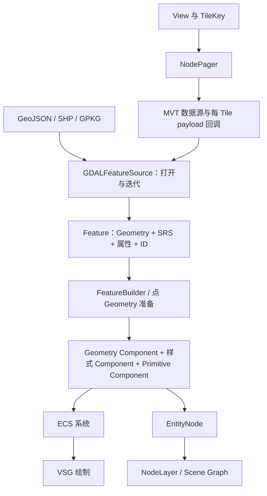

# 矢量：从 GDALFeatureSource 到 Geometry、ECS 与 Paging

术语用法见[术语表](../术语.md)；本篇保留英文底层术语，中文用于解释。

## 目标与源码身份

本篇解释小体量原始矢量与按 Tile 组织的矢量的现成接口路线。源码基线为 `a4d8b141ec478e8440526928b344c6eb93810631`，V 编号对应文末证据。本文已核对定义、实现和调用示例；未执行新构建、数据读取或 GPU 验证。

最重要的分工是：**GDALFeatureSource 读 Feature，FeatureBuilder 构建 Geometry，ECS System 生成可绘制内容，NodePager 按 View 执行 Paging**。这些接口可以组合，但没有一个入口自动完成任意文件、完整制图样式、标签、编辑和保存的全部工作。

## 两条现成技术路线



小数据可以读成一批 Feature 后构建 Geometry。MVT 可以复用库内 NodePager，由 payload 回调负责读取某块 Tile 及构建 Entity。官方已有这两类示例，应用不必先自写一个新的 Paging 调度器。（V1、V6）

## GDALFeatureSource 的公开接口

该类位于 `ROCKY_HAS_GDAL` 条件下，继承 FeatureSource，不继承 Layer，也不提供 ImageLayer 的 createTile。（V1）

| 属性/方法 | 输入与结果 | 注意事项 |
| --- | --- | --- |
| `uri` | 文件、数据源连接或 GDAL 可识别字符串 | 以 GDAL/OGR 驱动能力为边界 |
| `ogrDriver` | 可选指定驱动 | 是允许的驱动选择，不会安装缺失驱动 |
| `layerName` | 目标 OGR Layer | 留空读取首层；本版还有名称失败后按数字索引 Fallback 的逻辑 |
| `openOptions` | `KEY=VALUE` 字符串集合 | 原样传给 GDALOpenEx，如 MVT 的 CLIP、MBTiles 的 ZOOM_LEVEL |
| `externalLayerHandle` | 外部 OGR Layer Handle | 调用方保持其有效，通常不再提供 URI |
| `externalSRS` | 外部 Layer 的 SRS | 默认 WGS84；外部 Handle 路径应显式确认 |
| `open()` / `close()` | 建立/关闭读取环境 | 打开要检查 Result，不能只看对象非空 |
| `metadata()` / `featureCount()` | 范围、字段名、数量信息 | Metadata 建立可能触发实际扫描 |
| `iterate(io)` / `each(io, callback)` | 依次产生 Feature | each 的回调接收 Feature&&，不是渲染回调 |

`layerName` 的实际逻辑先按名称查找，失败后使用空值 0 或 `atoi(layerName)` 作为索引。因此一个拼错的非数字 Layer 名可能 Fallback 到首层。需要严格匹配 Layer 时，应用应确认所选 Layer 身份，不能把这个行为当作名称校验通过。（V2）

## 数据打开与迭代过程

`openGDALDataset` 以 `GDAL_OF_VECTOR | GDAL_OF_READONLY` 调用 GDALOpenEx，并传入驱动列表和 openOptions。`open` 选中 Layer 后建立字段名列表、SRS 和范围，缺少 SRS 或范围无效会失败；zip 输入有转为 `/vsizip/` 的处理。（V2）

```text
设置 URI / 外部 Layer
  → open
  → GDALOpenEx（只读）
  → 选择 Layer
  → 数量、字段、SRS、范围
  → iterate
  → OGR_L_GetNextFeature
  → 转换 Geometry 和字段
  → 销毁当前 OGRFeature
  → 交给应用处理 Feature
```

本版打开调用 `OGR_L_GetFeatureCount(..., 1)` 和 `OGR_L_GetExtent(..., 1)`。对某些来源，强制计数/范围可能扫描数据；不能把 open 理解为永远只读文件头。Iterator 按最多 500 条的队列分块读取，这不限制整个 Dataset 的最终数量，也不自动限制应用后续收集的内存。（V2）

现有 GeoStudio Demo 的 100000 Feature 护栏是应用策略，不是 Rocky GDALFeatureSource 的固定格式上限。

## Feature、属性和 Geometry 转换

Feature 中包含 ID、Geometry、字段、SRS、范围和地理 Interpolation 方式。Geometry 使用 `points` 与递归 `parts` 表达点线面和 Multipart。（V3）

| Geometry | 数据组织 |
| --- | --- |
| Points | points 存点集合 |
| LineString | points 存连续线 |
| Polygon | points 为 Exterior Ring，parts 为 Hole |
| MultiPoints / MultiLineString / MultiPolygon | parts 存各个独立部件 |

OGR 转换会读取坐标，去掉相邻重复点，处理常见点线面及 Multipart；Polygon 首环成为 Exterior Ring，其余环成为 Hole。GeometryCollection 等复杂/混合输入应核对转换路径，不把 OGR 支持的全部类型自动等同于 Rocky 可直接渲染的类型。

整数、长整数、浮点字段映射为相应数值类型，其他字段走字符串转换；字段名 Metadata 在读取时转为小写。Feature 的属性和值需要由调用方按转换后的名称和类型访问，不假定所有原始驱动字段结构无损保留。（V3）

## FeatureBuilder 的当前公开方法

| 方法 | 输入 | 输出/作用 |
| --- | --- | --- |
| `buildLineGeometry(features, style, geometry)` | 线或可提取线段的 Feature 集合 | LineGeometry，当前构建为独立线段拓扑 |
| `buildMeshGeometry(features, style, geometry)` | Polygon Feature | MeshGeometry（Triangle Mesh） |
| `buildPolygonGeometry(features, style, geometry)` | 多边形 Feature | 保留 Exterior Ring/Hole 的 PolygonGeometry |
| `buildMeshGeometry(polygons, style, mesh)` | PolygonGeometry | 普通 Mesh 绘制路线的 Triangulation |

PointGeometry 可以直接收集经适当坐标处理的点；不能为了统一名称而虚构 FeatureBuilder 的 buildPointGeometry 方法。头文件没有该接口。（V4）

公开配置包括：

- `outputSRS` 默认 WGS84，便于面向多个地图显示参考；输出 SRS 与当前场景 SRS 不是同一个概念。
- `origin` 可用于 Localization。头文件要求不要与默认 WGS84 输出混用；使用非默认输出和 origin 时要配套恢复位置的 Transform。
- `clamper` 为可选 ElevationSession，提供构建期间的高程 Clamping。
- `colorFunction` 可根据 Feature 计算颜色；Geometry 中保存了颜色还需要对应样式启用 useGeometryColors。

当前上游 README 的矢量示例仍出现 FeatureView；固定提交的公开 FeatureBuilder.h 没有该类型，FeatureBuilder.cpp 中旧 generate 实现在 `#if 0` 中。本篇以当前公开方法和实际 Demo 为准，不沿用该旧调用方式。（V4）

## 曲面 Subdivision、面 Triangulation 和 Clamping

### 线

Geodetic Coordinates 的长线段不能简单用一根空间直线表示，否则可能穿入球体。构建器按分辨率与 GreatCircle/Rhumb 等 Interpolation 语义 Subdivision，并处理跨 Antimeridian 线段，再变换到输出 SRS、按需 Localization。（V4）

线宽与颜色是渲染样式；采样分辨率影响 Geometry 数量。不能用增加线宽修复错误的曲面 Interpolation，也不能把提高 Subdivision 密度当成增加原始测量精度。

### 面

地理 Polygon 路径会进行边界准备、Antimeridian 和较大范围处理，在局部 gnomonic 平面中用 weemesh 构建 Mesh、插入边界、去除外部三角形，再转换回地理/输出参考。Hole、凹 Polygon 和自交分别涉及不同有效性条件，不能承诺所有无效 Geometry 都可自动修复。（V4）

`MeshStyle.resolution=0` 的路径采用内部默认 Subdivision 尺度；本提交为约 27830 米。`PolygonStyle` 的边界准备与普通 Mesh Triangulation 又有各自默认处理，不能把一个数值当作全部矢量路径共享的统一误差阈值。

PolygonGeometry 保留环结构，普通 PolygonSystem 可将其转成 Mesh；Overlay 路线还可以消费相应 Geometry。保留 Hole 结构与某个渲染后端最终正确显示 Hole，应分别验证。

### Clamping

FeatureBuilder 的 clamper 可以从源高程层采样；它不同于只查询当前地形 Mesh 的场景 Intersection，也不同于将 Geometry 颜色投影到地形的 Overlay。Depth Offset 主要用于缓解共面冲突，不代替地理高度采样。几种路线的精度、更新和遮挡条件不同，见[三维地形](../三维地形/README.md)。（V4、V5）

## 从 Geometry 到 Registry 和场景

以普通面为例，需要关联 PolygonGeometry、PolygonStyle 与 Polygon Primitive Component；或构建 MeshGeometry 后关联 MeshStyle/Mesh。线和点也分别具有 Geometry、Style 和 Primitive Component。不能把一个独立的 Vertex Array 直接等同于已挂到场景中的可绘制 Entity。（V5）

可复用的装配步骤：

1. 在普通工作内存中准备 Feature 和 Geometry。
2. 在 Registry Write Lock 下创建 Entity/Component，保存必要的样式关联。
3. 由 Application 安装的 ECS 系统处理图形数据。
4. 需要通过 NodeLayer 控制 Visibility 时，用 EntityNode 管理 Entity 集合，再包进 NodeLayer。
5. 打开 NodeLayer 后加入 Map，更新/后台完成时请求新帧。

EntityNode 通过逐帧/逐 View 的 Visibility 状态参与可见性管理，并默认在析构时销毁登记的 Entity。NodeLayer 打开/关闭会为 EntityNode 管理的 Entity 添加/移除 ActiveState。调用方要避免重复销毁或让同一 Entity 被多个自动销毁集合重复管理。（V5）

## MVT：已有 Pager 和示例

Rocky 已有 `NodePager`，可配置 Profile、场景 SRS、Bounding Volume 计算、createPayload、Level、pixelError 和 Replace/Accumulate 策略。配置后调用 `initialize`，可以直接作为场景 Node 或包进 NodeLayer。（V6）

`Demo_MVTFeatures.h` 展示的实际组合为：

```text
NodePager（spherical-mercator；示例固定 14 级）
  → calculateBound：每 TileKey Bounding Volume
  → createPayload(key, io)
  → GDALFeatureSource，URI = MVT:.../z/x/y.pbf
  → 设置 CLIP=NO，打开并迭代
  → 筛选建筑/道路，构建 Polygon/Line Geometry
  → EntityNode 与 Overlay Component
  → NodePager::Payload
  → NodeLayer
```

因此应修正一种容易产生的推断：**GeoStudio Demo 目前只接入单 Tile，不表示 Rocky 库没有按 View Paging 的现成路线。** 使用 NodePager 不需要先研发新的调度器，但数据源、Bounding Volume、样式、Layer 选择和错误处理仍需要连接。

该示例硬编码数据服务、属性筛选、样式和 14 级范围，并不是通用 style.json 地图加载器，也不构成已经验证任意多 Level 来源的证据。示例的 OverlayMode 为 Vector；可选 Slughorn/覆盖渲染的条件与 Fallback 要结合构建核对，高级机制留给 P2。

## MBTiles、MVT 与 style.json 的责任边界

| 输入/需求 | 现成路线 | 仍需核对 |
| --- | --- | --- |
| 一个有 z/x/y 位置的 PBF/MVT | GDALFeatureSource + MVT 驱动 | Tile 地理定位、源内 Layer 和解码条件 |
| 网络/本地多 Tile | NodePager + 每 Tile 数据/Geometry 回调 | 真实 Level、范围、调度参数和接入 |
| 矢量 MBTiles | GDAL/OGR MBTiles 驱动 + GDALFeatureSource | 当前 GDAL 是否编入驱动，所选 Level/Layer |
| 栅格 MBTiles | MBTilesImageLayer 等影像路线 | 不能作为矢量 Feature 读取接口 |
| style.json | 需要样式/资源解释及渲染映射 | 上述示例没有实现完整规范兼容 |
| 原始矢量编辑写回 | 需要独立编辑模型和保存路线 | 此 FeatureSource 的打开方式是只读 |

GDAL 的 MBTiles 驱动已提供矢量读取和 ZOOM_LEVEL 等打开选项；这可复用底层能力，不需要自行编写 SQLite 容器和 PBF 解码器。现有 SDK 是否具有驱动仍需实际检查，不能只启用 Rocky 自身的 MBTiles 影像选项就认定矢量 MBTiles 可用。[GDAL MBTiles 文档](https://gdal.org/en/stable/drivers/raster/mbtiles.html)

## 最小公开接口片段

以下只演示原始多边形读取和 CPU Geometry 构建，假设已准备 Application；不包含完整 Entity 挂载。片段未在本轮编译执行，输入路径需替换为实际数据。

```cpp
#include <rocky/GDALFeatureSource.h>
#include <rocky/vsg/ecs/FeatureBuilder.h>
#include <utility>
#include <vector>

#ifdef ROCKY_HAS_GDAL
auto source = rocky::GDALFeatureSource::create();
source->uri = "data/polygons.geojson";
std::vector<rocky::Feature> polygons;
auto opened = source->open();
if (opened.ok())
{
    source->each(app.io(), [&](rocky::Feature&& feature)
    {
        if (feature.geometry.type == rocky::Geometry::Type::Polygon ||
            feature.geometry.type == rocky::Geometry::Type::MultiPolygon)
        {
            polygons.emplace_back(std::move(feature));
        }
    });
}
rocky::FeatureBuilder builder;
rocky::PolygonStyle style;
rocky::PolygonGeometry geometry;
builder.buildPolygonGeometry(polygons, style, geometry);
#endif
```

完整的 Entity/样式/场景装配参考 [Demo_PolygonFeatures.h](../../../src/apps/rocky_demo/Demo_PolygonFeatures.h)；线参考 [Demo_LineFeatures.h](../../../src/apps/rocky_demo/Demo_LineFeatures.h)；Paging 参考 [Demo_MVTFeatures.h](../../../src/apps/rocky_demo/Demo_MVTFeatures.h)。优先复用当前版本示例，而不是复制已失效的 README 代码。

## 生命周期及源码可见的待验证项

- Source 的主 Dataset 由 close/析构释放，外部 layer handle 路径不代替调用方管理其所有者。
- Iterator 引用 Source 的 Metadata 和状态，应保持 Source/外部 Handle 存活；遍历过程中不能随意关闭来源。
- 本提交 `iterate` 在普通来源路径为游标重新打开 Dataset，但成功路径没有把局部 dsHandle 保存为 Iterator 成员；Iterator 析构只显式处理 `_nextHandleToQueue`。这与“游标会释放该 Dataset”的注释之间存在静态所有权缺口，需要专门资源回归确认，本文不将其记为已验证无泄漏。（V2）
- IOOptions 被传入读取入口，但当前 readChunk/iterator::each 未见主动取消判断；不能宣称任意读取和构建都能立即取消。
- 属性/Feature ID 不会因 Geometry 批处理就自动成为 Entity 可编辑数据。Picking 返回 Entity 后若要查询源属性或保存修改，需要应用保留来源和 Feature 映射。

这些记录限定当前实现的使用边界，本轮没有修改第三方代码或扩大为缺陷修复。

## 验证入口

| 用例 | 目标 | 状态 |
| --- | --- | --- |
| 小型 GeoJSON/SHP/GPKG | 正确 Layer、属性、SRS、点线面和范围 | 公开链路已核对，未运行 |
| 凹多边形 Triangulation | 边界和三角形覆盖 | 已有 tests_tessellation 入口，未执行 |
| Hole/矢量跨 Antimeridian | 环结构、覆盖和边界连续 | 本轮提出的运行用例，未执行，不声称已有测试完整覆盖 |
| 改变 resolution | Geometry 数量与曲面贴合变化，区分源精度 | 可操作用例，未运行 |
| MVT Paging 示例 | 随 View 请求 TileKey，payload 装配与释放 | 现成示例已核对，未运行 |
| 矢量 MBTiles | 驱动、Level、Layer 和读取结果 | 底层路线明确，未验证当前构建 |
| Visibility/移除/重复加载 | ActiveState、Visibility、Entity 与来源释放 | 可操作用例，未运行 |

## 源码证据与导航

| 编号 | 文件与稳定入口 | 核对内容 |
| --- | --- | --- |
| V1 | [GDALFeatureSource.h](../../../src/rocky/GDALFeatureSource.h)、[Feature.h](../../../src/rocky/Feature.h) | 公开数据源、Feature、迭代接口 |
| V2 | [GDALFeatureSource.cpp](../../../src/rocky/GDALFeatureSource.cpp)：`open_OGR_layer`、`openGDALDataset`、`open`、`iterate`、`iterator_impl`、`close` | 只读、Metadata、500 条队列和 Handle 边界 |
| V3 | [GDALFeatureSource.cpp](../../../src/rocky/GDALFeatureSource.cpp)：`create_geometry`、`create_polygon`、`create_feature_from_OGR_handle` | Geometry、字段及 SRS 转换 |
| V4 | [FeatureBuilder.h](../../../src/rocky/vsg/ecs/FeatureBuilder.h)、[FeatureBuilder.cpp](../../../src/rocky/vsg/ecs/FeatureBuilder.cpp)：公开 build 方法、`compile_polygon_feature`、Subdivision 函数 | 公共方法、曲面、Triangulation 和 Localization |
| V5 | [Point.h](../../../src/rocky/ecs/Point.h)、[Line.h](../../../src/rocky/ecs/Line.h)、[Mesh.h](../../../src/rocky/ecs/Mesh.h)、[Polygon.h](../../../src/rocky/ecs/Polygon.h)、[EntityNode.h](../../../src/rocky/vsg/ecs/EntityNode.h)、[NodeLayer.cpp](../../../src/rocky/vsg/NodeLayer.cpp) | Component、样式、Visibility 与 Entity 生命周期 |
| V6 | [NodePager.h](../../../src/rocky/vsg/NodePager.h)、[Demo_MVTFeatures.h](../../../src/apps/rocky_demo/Demo_MVTFeatures.h) | 现成 Paging 能力与示例范围 |
| V7 | [tests_tessellation.cpp](../../../src/tests/tests_tessellation.cpp)、[Demo_PolygonFeatures.h](../../../src/apps/rocky_demo/Demo_PolygonFeatures.h)、[Demo_LineFeatures.h](../../../src/apps/rocky_demo/Demo_LineFeatures.h) | 测试/实际调用入口，非本轮运行结果 |

继续阅读：[坐标系统](../坐标系统/README.md)、[三维地形](../三维地形/README.md)、[总体架构](../总体架构/README.md)。P1/P2 范围和维护记录见[方案](../梳理方案.md)、[主任务](../任务/001-Rocky架构与技术实现梳理.md)。
