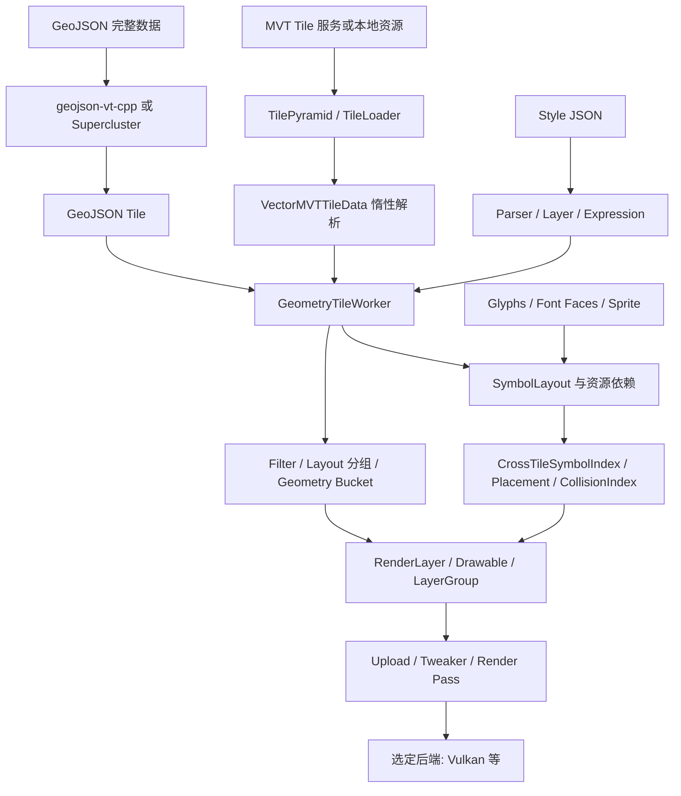

# MapLibre Native 矢量渲染调研

本页面向 `geostudio-native` 的 VSG 矢量架构选型，重点解释原始 GeoJSON、Mapbox Vector Tile（MVT）、样式、Symbol 与 Vulkan 的关系。**建议采用 MapLibre Style Spec 作为样式交换格式，借鉴并验证可复用的 CPU 算法，由 VSG 承担 GeoStudio 的 GPU 资源和提交；不要把“支持 Vulkan”理解成已经能嵌入 VSG 的三维地球。** 项目方案见[矢量渲染架构](../../矢量/README.md)。

状态：源码调研与技术提案；未引入依赖、修改引擎、构建 MapLibre Native 或完成 GPU／大数据验收。本文的性能结论是机制分析，不包含未经测量的吞吐量、内存上限或帧率承诺。

## 来源身份与阅读边界

| 项目 | 固定身份／边界 |
| --- | --- |
| 上游 | [maplibre/maplibre-native](https://github.com/maplibre/maplibre-native)，只读调研 |
| 源码基线 | [`d2efacc09fcf888a5e76f8eede4268aa23483765`](https://github.com/maplibre/maplibre-native/commit/d2efacc09fcf888a5e76f8eede4268aa23483765)，由本次读取的 `main` 解析获得；后文源码链接均固定此 commit |
| 路径／namespace | 本基线为 `src/mln`、`include/mln`、`mln`；旧资料常写 `mbgl`。部分 CMake target 仍为 `mbgl-core`，不能据此拼出旧源码路径 |
| 构建基础 | CMake 最低版本 3.25、C++20；公开到 GeoStudio 的 C++17 API 需要私有适配隔离，不能透传上游类型与编译选项 |
| 样式版本 | JSON 根 `version: 8`；本基线 `package-lock.json` 锁定 `@maplibre/maplibre-gl-style-spec` **24.7.0**，仓内快照为 `scripts/style-spec-reference/v8.json`。包版本与 JSON schema 的版本号不是同一概念 |
| 文档身份 | 仓内设计说明与源码共同核对。官方 Style Spec 网站是滚动资料，支持矩阵不能代替固定 Native 版本的实现验证 |
| 本地关系 | 当前 GeoStudio-Native 是消费方候选，尚未消费此 MapLibre Native 基线；工作区既有 `packages/MapLibre-GL-JS` 属于另一项目，版本、补丁与产物不能混用 |

源码身份依据 [S01](#源码与官方资料索引)、[S02](#源码与官方资料索引)、[S03](#源码与官方资料索引)。上游开发文档中的 OpenGL 专属描述带有历史背景；本基线已经强制使用 Drawable Renderer，并在构建时从 OpenGL、Metal、Vulkan、WebGPU 四种后端中选择一种。不能把“仓库包含多个后端”写成同一个构建会同时启用多个后端。

## MapLibre Native 解决的是哪一层问题

MapLibre Native 是地图引擎：它将 Source、Tile、Style、Layout、Symbol Placement 和 Renderer 连成一个可交互系统。Vulkan 是其后端之一；VSG 是另一个独立的 Vulkan Scene Graph。二者都调用 Vulkan，并不意味着 Scene Graph、相机、Device、资源生命周期或命令提交接口相同。

| 对象 | 职责 | 不应混淆的概念 |
| --- | --- | --- |
| Source | 数据源、Tile 元信息与加载入口 | 一个 Source 可被多个 Style Layer 使用 |
| MVT source-layer | Tile 内按名称组织的 Feature 集合 | 不是绘制层，也不携带完整 Style |
| Style Layer | 按顺序定义 Filter、Layout、Paint、缩放区间 | 同一组道路可用多个 Style Layer 形成路缘、路面与道路名称 |
| TilePyramid | 按视图选择 Tile，处理加载、缓存、Overscaling 与可用替代 Tile | 不负责从任意大 Shapefile 自动生产高质量多级数据 |
| Layout / Bucket | 将选定 Feature 转为可复用几何、属性和 Symbol 候选 | Bucket 不是“一个 Feature 一个 Draw Call” |
| Placement | 根据当前视图决定候选文字／图标的位置与可见性 | 不能只在每个 Tile 内独立碰撞 |
| Drawable / LayerGroup | 持续维护可绘制对象、Shader、属性与渲染状态 | 不能直接当作 `vsg::Node` |

MVT 只是一种矢量 Tile 编码；拿到 `.pbf` 还需要 z/x/y、Tile Scheme、Source Layer 名称、缩放范围、属性约定和可匹配的 Style。文件扩展名本身不足以推断数据内容或渲染支持。[S04–S08](#源码与官方资料索引)

## 从输入到一帧图像

### MVT：先按视图选择，再解析需要的 Tile

1. `RenderVectorSource` 将 TileSet 的 zoom range、bounds 和当前视图交给 `TilePyramid::update`。本基线也有 MLT 路径；本文聚焦 MVT，不能将两种编码混称为 MVT。
2. `TilePyramid` 计算覆盖区域及 Overscaled Tile ID，复用活动 Tile 与缓存，选择可用的父／子 Tile，并在配置允许时请求较低层级用于预显示。请求、显示和缓存不是同一个集合。
3. `VectorTile` 持有 `TileLoader`；MVT 结果进入 `VectorMVTTileData`。`getLayer` 延迟解析 Tile Layer，Feature 的属性和 Geometry 也按访问需要展开，并将 Tile 自带 extent 缩放到引擎内部 extent。
4. `GeometryTileWorker` 根据 Style Layer 的 `source-layer` 取数据；Filter 不匹配的 Feature 不构建对应几何。布局一致的 Style Layer 可以共享 Bucket，Paint 属性仍可分别绑定。
5. 结果回到 Renderer，异步加载中的其他 Tile 可以继续显示；新结果经 Upload 和绘制进入画面。

这一方案减少一次视图要处理的数据量，但前提是 Tile Pyramid 合理。只有最高层级、低层级 Tile 过密、单 Tile 内巨大 Polygon、缺失 source-layer 或全部 Feature 被 Filter 排除，仍可能出现慢、空白或不完整结果。预切片并不等于已经获得多尺度性能。[S04–S08](#源码与官方资料索引)

### GeoJSON：运行时切片仍有整份输入的代价

`GeoJSONSource` 接收 GeoJSON 对象或加载 URL 数据；`GeoJSONData::create` 再构造 `geojson-vt-cpp` 索引，或者在配置 Cluster 时构造 Supercluster。随后通过 `getTile` 按 Tile ID 取得局部 Geometry，进入共用的 GeometryTileWorker。

`maxzoom`、`buffer`、`tolerance`、`lineMetrics` 进入运行时 Tiling 选项；Cluster 使用自己的 radius、maxZoom、minPoints 与属性归并选项。它们分别影响细节、边缘连续性、几何简化与点聚合，不是一个统一的“质量”开关。[S09](#源码与官方资料索引)

**这不是任意大文件的外存读取架构。** 在产生局部 Tile 之前，下载／解析输入和建立索引仍有成本；启动时数据、索引和派生 Tile 可同时占用内存。GeoStudio 的 Shapefile、GPKG、FileGDB 等原始数据需要自己的 GDAL／数据库适配、空间查询、分页或生产型 Tiling；不能先将全库转成一个内存 GeoJSON，再期待 MapLibre 样式消除该开销。

### Worker：异步、合并更新与资源依赖

`GeometryTileWorker` 是 Actor 接收方，运行在调度系统上，不等于每个 Tile 独占一个 OS Thread。数据／Layer／图片／Glyph 的变更通过状态机组织；同一 Tile 的更新合并处理，取消通过 obsolete 状态等机制协作完成。后台任务仍必须有可终止的边界，不能假设任意算法执行中都可立即抢占。

普通几何和 Symbol 资源存在依赖：Worker 会收集 Glyph 与 Image 请求，资源到达后再完成所需 Layout。由此可见，文字迟迟不出现不一定是 Vulkan 错误，也可能是字体、Sprite、数据匹配或 Layout 阶段没有完成。GeoStudio 的调度设计应保留明确阶段状态，并评估让基础几何先显示、Symbol 随资源就绪再补齐。[S07](#源码与官方资料索引)

## 样式系统不是把 JSON 颜色读出来

### 基本语义与推荐兼容边界

Style 文档指定 Sources、按顺序排列的 Layers，以及 Glyph／Sprite／Font Faces。Layer 使用 `source` 与 `source-layer` 选择数据，再用 `filter`、`minzoom`、`maxzoom`、`visibility` 控制参与范围。

`layout` 影响几何生成、文本内容与候选布局；`paint` 控制颜色、透明度、线宽、Halo 等外观。这个分类用于失效分析，不意味着所有 Paint 变更都只有一个 Uniform 更新；数据驱动属性、Pattern 依赖、常量与非恒定属性切换，可能需要重新生成属性缓冲或 Drawable。[S02、S03、S10](#源码与官方资料索引)

| 属性依赖 | 常见输入 | 合理的计算位置与缓存 |
| --- | --- | --- |
| 常量 | 固定颜色、透明度 | Style 编译后共享；绘制时 Uniform 或公共状态 |
| Camera | `zoom` 与插值 | 视图／缩放变化时更新，不重复扫描全部 Feature |
| Source | Feature 属性、类型、ID | 解码／Bucket 构建时计算；结果随几何或 Feature 属性缓存 |
| Composite | Feature 属性 + zoom | 按所需 zoom 样本生成属性，再进行插值；不能简单在加载时求一次 |
| Feature State | 选中、悬停等运行态 | 稳定 ID 到可见数据范围的映射；局部更新并可重放到重新加载的 Tile |

`Expression` 在 C++ Core 中解析和求值，涉及类型检查、错误、默认值、Filter 与 Feature 上下文。`PaintPropertyBinder` 区分常量、Source 与 Composite 的 Uniform／Attribute 绑定方式。GeoStudio 可以复用语义和经验证的实现，但不宜在每帧为每个顶点重新解释 JSON。[S10](#源码与官方资料索引)

建议将兼容声明写成：**“MapLibre Style Spec JSON v8，参考 Native 固定 commit 与仓内 schema，仅支持显式登记并通过测试的子集。”** 第一批覆盖 `background / fill / line / circle / symbol`，再扩展 `fill-extrusion / heatmap / raster / hillshade` 等能力；未支持属性必须诊断，不能悄悄忽略后宣称完整兼容。Mapbox 新专有扩展、滚动 GL JS 能力和 Native 支持不能互相替代。[S02、S03、W01–W03](#源码与官方资料索引)

### Geometry Bucket 与绘制批次

`group_by_layout` 的分组键包括类型、Source、Source Layer、zoom、visibility、Filter 以及 Layout 差异。布局一致时共享 Bucket，节省重复 Geometry 构建；不能只按颜色合并，破坏透明排序或样式层顺序。

| 类型 | 上游处理重点 | 对 VSG 的启示 |
| --- | --- | --- |
| Fill | 分类外环／内环，Earcut Tessellation，生成 Fill 与 Outline 段 | 保留孔洞、环语义和索引上限；Tile 边界不能误当业务边界描边 |
| Line | Polyline 几何、cap／join、overscaling、连续距离等属性 | 宽线需要几何／Shader 方案，不能依赖平台宽线支持；虚线和渐变需要连续距离契约 |
| Circle | 以专用属性与 Shader 绘制点符号 | 大量点按 Tile／样式批次组织，不创建海量独立 Entity |
| Symbol | Glyph／Icon Quads、布局与碰撞数据、动态透明度 | Geometry、Placement 和 Atlas 生命周期应独立，可增量更新 |

这些机制位于 Bucket、Generator、Layout 与 RenderLayer 等层，不能把某一个上游 Bucket 的内存直接解释成 VSG Vertex Buffer。需要冻结独立的中间数据契约，显式转换属性布局、索引、资源句柄和 Shader 定义。[S06、S11、S12](#源码与官方资料索引)

## Symbol 系统：文字、图标、碰撞与跨 Tile 稳定性

### 从文本到可绘制 Glyph

1. 对每个 Feature 求值 `text-field`、`text-font`、`icon-image`、大小、偏移与排序等 Layout 属性；同一 Symbol 可同时包含文本与图标。
2. 收集 Glyph 与 Image 依赖。`GlyphManager` 支持 Glyph PBF 范围请求、平台 `LocalGlyphRasterizer`，以及启用 HarfBuzz 时的 Font Face 路径；`SpriteLoader` 加载图片与配套元数据，ImageManager 维护资源。
3. Shaping 负责文字尺寸、换行、字距、对齐、方向等；SymbolLayout 为点、线及线中点等生成候选，处理沿线文字、最大折角、保持正向、可变 Anchor、横竖排和图文适配。
4. Glyph／Icon 数据放入 Atlas，生成 Quads 和碰撞元数据；SDF 让字体缩放、描边和 Halo 通过 Shader 完成。普通彩色 Icon 与 SDF Icon 的着色语义不同，不能一律按单色字体处理。

“Sprite”是资源图集及索引，“Glyph PBF”是字形数据传输格式，“Glyph Atlas”是运行时 GPU 资源组织；三者不能混称为同一种文件。[S12–S15](#源码与官方资料索引)

### 中文与复杂脚本的事实边界

本基线已将 `MLN_TEXT_SHAPING_HARFBUZZ` 默认设为 ON，并引入 FreeType／HarfBuzz。Parser 在该构建选项开启时读取 `font-faces`；关闭时不会处理该路径。`GlyphManager` 能从字体文件创建 `HBShaper`，Shaping 消费 Glyph advances 和 offsets。因此，“Native 没有 HarfBuzz，只能使用 PBF”已经不适用于这一基线。[S01、S03、S14、S16](#源码与官方资料索引)

但有这些组件，不等于所有脚本和字体组合都验证通过：固定的 `harfbuzz_impl.cpp` 按 UTF-16 脚本分段，并设置 `HB_DIRECTION_LTR`；整体还涉及 Bidi、字体覆盖、Fallback、字体资源加载与横竖排逻辑。不能仅凭这个函数断言整个引擎不支持 RTL，也不能由依赖 HarfBuzz 反推 Arabic、Indic、Emoji 全部正确。

GeoStudio 应明确资源与验收矩阵：中文常用字／生僻字、CJK 标点与竖排、拉丁数字混排、Arabic 与数字混排、Indic 组合字、缺字／缺字体、非 BMP 字符、沿曲线标签以及离线字体。Font Stack 名称必须对应实际可获取资源；字体与 Sprite 的许可证也须独立登记。没有可用字体时必须有可定位诊断，而不是只显示“Layer 已加载”。

### CollisionIndex 与 Placement 的职责

`CollisionIndex` 根据当前 Transform 将碰撞数据投影到屏幕空间，通过空间索引处理矩形／沿线碰撞形状；`Placement` 决定候选是否放置，处理文字和图标的 optional／overlap／ignore-placement 语义、可变 Anchor 与状态过渡。

碰撞是视图级问题：来自不同 Tile 的名称最终占据同一屏幕，应使用共享的视图碰撞状态；是否跨 Source 互相避让属于 Collision Group 策略。单纯在 Worker 内对每个 Tile 独立排布，会在边界和缩放过程中产生重叠。地图 Transform 中的投影、pitch、屏幕尺寸与 label plane 都参与上游算法，移植到 ECEF／地形时必须重新验证。[S17、S18](#源码与官方资料索引)

### CrossTileSymbolIndex 不是业务 Feature ID

上游按 Symbol Key 与缩放后的 Anchor 邻近关系，在父／子层级和 Tile 更新间匹配 Symbol，分配／继承 cross-tile ID。Placement 利用这些身份做重复抑制与淡入淡出，减少 Tile 替换时的闪烁；不能只把所有同名道路合成一个 ID，也不能将 cross-tile ID 当成业务数据库主键。

GeoStudio 应同时保留两种身份：稳定业务 Feature ID 用于查询、选中和状态；Symbol Instance ID 用于候选、去重和过渡。同一 Feature 可以生成多个沿线名称，而 Tile Clipping 后多个片段也可能对应同一 Feature。[S19](#源码与官方资料索引)

## Drawable Renderer 与 Vulkan 集成边界

`RenderOrchestrator` 处理 Style 差异、Source 更新、Layer 求值、跨 Tile Symbol 与 Placement，形成 RenderTree。`Renderer::Impl` 更新 LayerGroup、运行 Tweaker、上传 Bucket／Atlas／Uniform 等资源，然后执行相应 Render Pass。`Drawable` 持续保存绘制所需状态；Vulkan 实现负责 Pipeline、Buffer、Descriptor、Texture 与 Draw 命令。[S20–S22](#源码与官方资料索引)

### 平台支持必须与源码存在区分

固定 commit 的官方平台表将 Android、Linux 的 Vulkan 标为支持，**Windows Vulkan 标为不支持**；Windows OpenGL 标为支持。这个结论来自平台支持声明，不表示所有 Vulkan 通用源文件都无法在 Windows 编译，也不能由头文件存在 Win32 宏反推 Windows 平台已经受支持。[S23](#源码与官方资料索引)

对当前 Windows GeoStudio，直接将完整 Native Vulkan Renderer 作为成熟可嵌入库的前提不成立。若探索此路线，首先需要单独验证受控构建、平台 Window／Surface、字体与网络服务、Headless 输出、Validation Layer 和资源释放，再考虑与 VSG 共存。

### 为什么同为 Vulkan 仍然不能直接拼接

固定的 Vulkan `RendererBackend` 默认初始化 Instance、Device、Queue、Allocator、Command Pool 与 Swapchain；`HeadlessBackend` 提供离屏图像读取，但其公开构造参数不是 VSG Device／CommandBuffer。Backend 有可覆盖初始化钩子及共享 Context 的生命周期处理，说明适配并非理论上不可能；**本次没有发现可直接接收 VSG Viewer 并完成集成的公开契约，也没有实测此组合。**[S21、S24](#源码与官方资料索引)

若共享或交换 GPU 资源，至少应定义：

- Device／Queue／Allocator 的所有者和线程规则，以及停止、异常与设备丢失时的释放顺序。
- Render Pass、Attachment 格式、Sample Count、Viewport、Depth／Stencil、透明混合与颜色空间。
- Image Layout、Barrier、Semaphore／Fence、Queue Family ownership、Frames In Flight 与延迟释放。
- 两套相机与投影、Tile 坐标、屏幕尺寸和 DPR 如何一致；贴地、地平线、地形遮挡与地图 Symbol 的关系。
- Style 更新、数据取消、GPU 在途引用如何与宿主生命周期同步；不能由两个系统各自 Present 同一画面。

这些是集成设计要求，不是已经完成的能力。直接把 MapLibre 输出贴到 Terrain 可复用二维样式效果，但文字会随纹理变形、放大模糊，跨 Tile 标签和真正三维遮挡也需额外处理；频繁 CPU Readback 再 Upload 会增加传输开销。

## 对 GeoStudio 两个痛点的结论

### 大体量数据看不到结果

MapLibre 的启示是以**有限可见数据和逐步就绪的 Tile**驱动渲染，而不是全库读取完成后才开始构建画面。性能来自数据金字塔、筛选、简化、批处理、异步调度、缓存和渐进替换共同作用，不来自 MVT 或 Vulkan 的名称。

| 可能瓶颈 | 上游提供的思路 | GeoStudio 仍需实现／验证 |
| --- | --- | --- |
| 原始大文件解析／索引慢 | GeoJSON runtime Tiling 可局部消费 | 对原始源做空间查询、外存索引或显式生产多级 Tile；限制同时驻留数据 |
| 全量 Geometry 与 Scene Node | Layout 分组、Bucket、Drawable | 按 Tile／样式批次组织几何，避免每个 Feature 一个完整场景对象 |
| 切片仍长时间空白 | Parent fallback、低层级 prefetch、缓存 | 保证概览 Tile 真实可用；GPU 上传与场景合并设预算 |
| 过期任务挤占新视图 | Actor 合并更新与 obsolete 检查 | 全链路 Request Generation、优先级、取消、Backpressure 与失败状态 |
| 文字资源阻塞 | 独立 Glyph／Image 依赖管理 | 记录等待原因，提供基础几何先显及可恢复的离线资源策略 |

这些是针对痛点的架构推论；当前 GeoStudio 的具体阻塞位置以[现状源码审查](../../矢量/README.md)为准，必须分别测量读取、解码、几何、Compile、Upload 与首个可见 Draw，不能只统计“文件加载完成”。

### 缺少样式系统

接入 MapLibre Style Spec 很合适，能复用样式编辑与交换生态，并统一原始矢量和 MVT 的外观表达。收益成立的前提是建立数据属性与 `source-layer` 契约，并完整处理 Expression、Layout、资源、Placement 和更新失效。只导入颜色、线宽和名称字段，会形成有限的样式适配器，不能称为完整 MapLibre Symbol 系统。

建议选择顺序：

| 方案 | 价值 | 代价与适用边界 | 建议 |
| --- | --- | --- | --- |
| 完整 Native 作为独立二维 Map View | 最快复用其样式与 Symbol 体系 | 独立相机／视图；当前 Windows Vulkan 支持与三维融合都需额外工作 | 可作为参考渲染器或独立二维视图候选 |
| Native 离屏输出为 Terrain Texture | 快速获得二维底图效果 | 分辨率、Readback／Upload、投影、跨 Tile 标签与三维查询受限 | 可用于受限底图验证，不作为通用三维矢量主架构 |
| Style Spec + 经验证的 CPU 算法 + VSG Renderer | 统一地球、模型、Depth 和 GPU 生命周期 | 需要维护兼容子集、数据契约、字体与全局 Placement；不能承诺短期完成所有规范 | **推荐长期主线** |
| 为 Native 新增 VSG backend／深度修改 Vulkan backend | 可能尽量保留 Native 全流程 | 内部类型、RenderTree、投影和平台生命周期耦合深，长期 Fork 成本高 | 仅在小型 Spike 证明收益后再评审 |

## 复用与验证建议

先建立可观测的最小闭环：相同小型 MVT／GeoJSON、固定 style.json、固定字体与 Sprite，在参考引擎与 VSG 中核对 Feature 选择、Expression 值、Geometry、Symbol 和层顺序。随后才扩大数据量，分别检验首帧、平移缩放、稳定内存及取消回收。

| 验证层 | 必须覆盖的代表情况 |
| --- | --- |
| Style 语义 | 缺字段、类型错误、zoom 插值、Filter、Feature State、未知属性诊断、局部 Paint 更新与 Layout 失效 |
| 数据 | MVT extent 与 source-layer、空 Tile、损坏 Tile、父级替代、Tile 边界裁剪、稳定 ID、反经线与高纬 |
| Geometry | 带孔 Polygon、MultiPolygon、密集 Line、join／cap、Dash 连续性、索引分段、半透明顺序 |
| Symbol | 中文与复杂脚本、缺字体、Sprite DPR、沿线重复、跨 Tile 去重、可变 Anchor、快速缩放淡入淡出 |
| 三维 | 地球／局部平面转换、贴地、地形更新、深度遮挡、地平线、远近精度、屏幕像素尺寸 |
| 生命周期 | 快速移出视野、Source 切换、Style 变更、资源失败重试、在途 GPU 引用、可重复释放与加载 |
| 性能 | 首个有意义画面、Frame CPU／GPU 分位数、队列长度、解码／布局／上传耗时、CPU／GPU 峰值及稳态驻留 |

上游已有 Unit Test、Render Test、Benchmark 和 Tracy 支持，可作为验证设计参考，不能把上游通过等同于 GeoStudio 适配通过。测试应固定设备、数据、Style、相机路径、分辨率与冷／热缓存状态；性能阈值由项目数据和设备验证后确定。[S01、S25](#源码与官方资料索引)

## 许可证与依赖维护

MapLibre Native 主仓库为 BSD-2-Clause；源码与二进制再分发需要按许可证保留相应版权、条件与免责声明。仓库内及 vendor 的其他组件、地图数据、字体、Sprite、在线服务条款需要独立核对，主仓许可证不自动覆盖这些资源。本文未复制实现代码。[S26](#源码与官方资料索引)

实施复用前应固定 commit、相关子模块与工具链，记录采用的文件／模块、原许可证和完整补丁，并隔离内部 C++ API。仓库 README 明确将 Core C++ API 标为 unstable，因此只按类名链接上游、将内部结构暴露为 GeoStudio ABI，或随 `main` 自动升级，都会引入不必要的维护风险。[S01](#源码与官方资料索引)

## 源码与官方资料索引

以下 S 编号全部固定于同一源码 commit；它们提供可恢复的内容身份，不表示本机已安装或构建。W 编号为滚动规范网页，只作语义导航。本文按多个源码模块交叉核验机制；未完整审计所有平台和全部 Style 属性。

| 编号 | 来源与定位 | 支撑内容 |
| --- | --- | --- |
| S01 | [README](https://github.com/maplibre/maplibre-native/blob/d2efacc09fcf888a5e76f8eede4268aa23483765/README.md)、[CMakeLists](https://github.com/maplibre/maplibre-native/blob/d2efacc09fcf888a5e76f8eede4268aa23483765/CMakeLists.txt)、[backend options](https://github.com/maplibre/maplibre-native/blob/d2efacc09fcf888a5e76f8eede4268aa23483765/cmake/validate-backend-options.cmake) | 定位、C++20、编译选项、单后端、Drawable 与 API 稳定性 |
| S02 | [package.json](https://github.com/maplibre/maplibre-native/blob/d2efacc09fcf888a5e76f8eede4268aa23483765/package.json)、[package-lock.json](https://github.com/maplibre/maplibre-native/blob/d2efacc09fcf888a5e76f8eede4268aa23483765/package-lock.json)、[v8 schema](https://github.com/maplibre/maplibre-native/blob/d2efacc09fcf888a5e76f8eede4268aa23483765/scripts/style-spec-reference/v8.json) | Style Spec 包锁与仓内参考快照 |
| S03 | [style/parser.cpp](https://github.com/maplibre/maplibre-native/blob/d2efacc09fcf888a5e76f8eede4268aa23483765/src/mln/style/parser.cpp) | v8、Layer／Source 及 Font Faces 解析 |
| S04 | [render_vector_source.cpp](https://github.com/maplibre/maplibre-native/blob/d2efacc09fcf888a5e76f8eede4268aa23483765/src/mln/renderer/sources/render_vector_source.cpp) | Source → TilePyramid；MVT／MLT 分流 |
| S05 | [tile_pyramid.cpp](https://github.com/maplibre/maplibre-native/blob/d2efacc09fcf888a5e76f8eede4268aa23483765/src/mln/renderer/tile_pyramid.cpp) | Tile Selection、缓存、Prefetch、Overscaling |
| S06 | [group_by_layout.cpp](https://github.com/maplibre/maplibre-native/blob/d2efacc09fcf888a5e76f8eede4268aa23483765/src/mln/renderer/group_by_layout.cpp) | 分组键与共享 Layout |
| S07 | [geometry_tile_worker.cpp](https://github.com/maplibre/maplibre-native/blob/d2efacc09fcf888a5e76f8eede4268aa23483765/src/mln/tile/geometry_tile_worker.cpp)、[Worker 设计](https://github.com/maplibre/maplibre-native/blob/d2efacc09fcf888a5e76f8eede4268aa23483765/docs/mdbook/src/design/geometry-tile-worker.md) | 状态机、合并、取消、资源依赖与 Bucket |
| S08 | [vector_tile.cpp](https://github.com/maplibre/maplibre-native/blob/d2efacc09fcf888a5e76f8eede4268aa23483765/src/mln/tile/vector_tile.cpp)、[vector_mvt_tile_data.cpp](https://github.com/maplibre/maplibre-native/blob/d2efacc09fcf888a5e76f8eede4268aa23483765/src/mln/tile/vector_mvt_tile_data.cpp) | TileLoader、惰性 MVT 解析、extent 与 Feature |
| S09 | [geojson_source.cpp](https://github.com/maplibre/maplibre-native/blob/d2efacc09fcf888a5e76f8eede4268aa23483765/src/mln/style/sources/geojson_source.cpp)、[geojson_source_impl.cpp](https://github.com/maplibre/maplibre-native/blob/d2efacc09fcf888a5e76f8eede4268aa23483765/src/mln/style/sources/geojson_source_impl.cpp) | GeoJSONVT、Supercluster 与 Tiling 选项 |
| S10 | [expression/parsing_context.cpp](https://github.com/maplibre/maplibre-native/blob/d2efacc09fcf888a5e76f8eede4268aa23483765/src/mln/style/expression/parsing_context.cpp)、[paint_property_binder.hpp](https://github.com/maplibre/maplibre-native/blob/d2efacc09fcf888a5e76f8eede4268aa23483765/src/mln/renderer/paint_property_binder.hpp) | Expression、常量／Source／Composite 属性绑定 |
| S11 | [fill_bucket.cpp](https://github.com/maplibre/maplibre-native/blob/d2efacc09fcf888a5e76f8eede4268aa23483765/src/mln/renderer/buckets/fill_bucket.cpp)、[fill_generator.cpp](https://github.com/maplibre/maplibre-native/blob/d2efacc09fcf888a5e76f8eede4268aa23483765/src/mln/gfx/fill_generator.cpp)、[line_bucket.cpp](https://github.com/maplibre/maplibre-native/blob/d2efacc09fcf888a5e76f8eede4268aa23483765/src/mln/renderer/buckets/line_bucket.cpp) | Polygon Tessellation、Outline、Polyline 与连续距离 |
| S12 | [symbol_layout.cpp](https://github.com/maplibre/maplibre-native/blob/d2efacc09fcf888a5e76f8eede4268aa23483765/src/mln/layout/symbol_layout.cpp)、[symbol_bucket.cpp](https://github.com/maplibre/maplibre-native/blob/d2efacc09fcf888a5e76f8eede4268aa23483765/src/mln/renderer/buckets/symbol_bucket.cpp) | 文本／Icon 候选、Quads 与动态属性 |
| S13 | [sprite_loader.cpp](https://github.com/maplibre/maplibre-native/blob/d2efacc09fcf888a5e76f8eede4268aa23483765/src/mln/sprite/sprite_loader.cpp) | Sprite 图像及元数据加载 |
| S14 | [glyph_manager.cpp](https://github.com/maplibre/maplibre-native/blob/d2efacc09fcf888a5e76f8eede4268aa23483765/src/mln/text/glyph_manager.cpp) | PBF、Local Rasterizer、Font Face 与 HBShaper |
| S15 | [shaping.cpp](https://github.com/maplibre/maplibre-native/blob/d2efacc09fcf888a5e76f8eede4268aa23483765/src/mln/text/shaping.cpp) | 换行、对齐、方向、Glyph 位置与 HB offsets |
| S16 | [harfbuzz_impl.cpp](https://github.com/maplibre/maplibre-native/blob/d2efacc09fcf888a5e76f8eede4268aa23483765/src/mln/text/harfbuzz_impl.cpp) | 字体、分段、方向与 hb_shape |
| S17 | [collision_index.cpp](https://github.com/maplibre/maplibre-native/blob/d2efacc09fcf888a5e76f8eede4268aa23483765/src/mln/text/collision_index.cpp) | 屏幕空间碰撞与投影依赖 |
| S18 | [placement.cpp](https://github.com/maplibre/maplibre-native/blob/d2efacc09fcf888a5e76f8eede4268aa23483765/src/mln/text/placement.cpp) | 放置、可变 Anchor、Collision Group 与淡入淡出 |
| S19 | [cross_tile_symbol_index.cpp](https://github.com/maplibre/maplibre-native/blob/d2efacc09fcf888a5e76f8eede4268aa23483765/src/mln/text/cross_tile_symbol_index.cpp) | Symbol Key、Anchor 匹配、跨层级身份 |
| S20 | [render_orchestrator.cpp](https://github.com/maplibre/maplibre-native/blob/d2efacc09fcf888a5e76f8eede4268aa23483765/src/mln/renderer/render_orchestrator.cpp)、[renderer_impl.cpp](https://github.com/maplibre/maplibre-native/blob/d2efacc09fcf888a5e76f8eede4268aa23483765/src/mln/renderer/renderer_impl.cpp) | Style 更新、Placement、Upload、Tweaker 与 Render Pass |
| S21 | [vulkan/renderer_backend.cpp](https://github.com/maplibre/maplibre-native/blob/d2efacc09fcf888a5e76f8eede4268aa23483765/src/mln/vulkan/renderer_backend.cpp)、[renderer_backend.hpp](https://github.com/maplibre/maplibre-native/blob/d2efacc09fcf888a5e76f8eede4268aa23483765/include/mln/vulkan/renderer_backend.hpp) | Vulkan 对象所有权、初始化与共享 Context 钩子 |
| S22 | [vulkan/drawable.cpp](https://github.com/maplibre/maplibre-native/blob/d2efacc09fcf888a5e76f8eede4268aa23483765/src/mln/vulkan/drawable.cpp)、[render_symbol_layer.cpp](https://github.com/maplibre/maplibre-native/blob/d2efacc09fcf888a5e76f8eede4268aa23483765/src/mln/renderer/layers/render_symbol_layer.cpp) | GPU 绘制状态与 Symbol Renderer |
| S23 | [平台支持矩阵](https://github.com/maplibre/maplibre-native/blob/d2efacc09fcf888a5e76f8eede4268aa23483765/docs/mdbook/src/platforms/README.md) | 平台／后端支持声明；Windows Vulkan 边界 |
| S24 | [HeadlessBackend 接口](https://github.com/maplibre/maplibre-native/blob/d2efacc09fcf888a5e76f8eede4268aa23483765/platform/default/include/mln/vulkan/headless_backend.hpp)、[实现](https://github.com/maplibre/maplibre-native/blob/d2efacc09fcf888a5e76f8eede4268aa23483765/platform/default/src/mln/vulkan/headless_backend.cpp) | 离屏初始化与图像读取接口 |
| S25 | [Render Tests](https://github.com/maplibre/maplibre-native/blob/d2efacc09fcf888a5e76f8eede4268aa23483765/docs/mdbook/src/render-tests.md) | 上游图像测试入口 |
| S26 | [LICENSE.md](https://github.com/maplibre/maplibre-native/blob/d2efacc09fcf888a5e76f8eede4268aa23483765/LICENSE.md)、[.gitmodules](https://github.com/maplibre/maplibre-native/blob/d2efacc09fcf888a5e76f8eede4268aa23483765/.gitmodules) | 主仓许可证及第三方来源定位 |
| W01 | [Style Spec Introduction](https://maplibre.org/maplibre-style-spec/) | 滚动规范总入口 |
| W02 | [Sources](https://maplibre.org/maplibre-style-spec/sources/) | Source 参数语义与平台支持说明 |
| W03 | [Layers](https://maplibre.org/maplibre-style-spec/layers/) | Layer／Symbol 属性语义与平台支持说明 |
