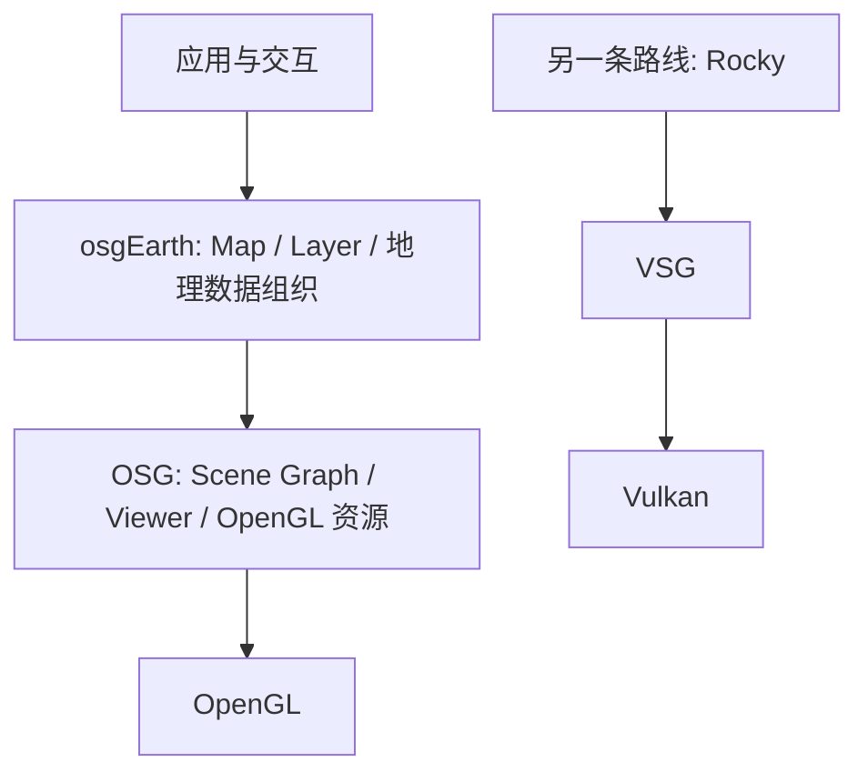

# osgEarth 架构概览

osgEarth 是基于 OSG 的地理空间 SDK。它在通用 Scene Graph 之上组织地图及数据 Layer，用来解决地理数据如何参与地图/地形显示的问题。目录沿用用户要求的 `OSG-Earth`，正文使用项目官方名称 `osgEarth`。[官方入口](https://docs.osgearth.org/en/latest/)

本篇为 P0 官方文档架构概览，页面标识版本为 3.8.0；未引入、固定或编译本地 osgEarth 源码。因此下面的 Map/Layer 与配置关系属于官方文档说明，尚不是固定 Commit 的内部实现结论。P1 必须先补足源码身份，再展开调用链。来源边界见[来源与版本](../来源与版本.md)，术语见[术语表](../../术语.md)。

## 与 OSG、Rocky 的分工



图示是理解两类 SDK 的职责对照：osgEarth 与 Rocky 面向地理业务，OSG 与 VSG 面向通用渲染。它不表示前两者接口兼容、后两者 API 对等，也不表示 osgEarth 是 Rocky 必须链接的依赖。Rocky 侧关系由本地 [总体架构](../../总体架构/README.md)及 [VSG 连接](../VSG/README.md#rocky-的连接点与排查顺序)支撑。

## 官方文档表达的配置与数据模型

| 概念 | 官方文档中的角色 | 需要区分的对象 |
| --- | --- | --- |
| Map | 组织地图配置与参与的 Layer | 不是操作系统窗口或独立 Renderer |
| Layer | 不同数据/行为的配置单元，按类型接入 | Layer 类型不能由文件扩展名一概代替 |
| Earth File | 用 XML 表达地图和 Layer 配置，可由工具/应用读取 | 不等于原始影像或模型本身 |
| Imagery / Elevation | 分别提供影像与高程的数据路线 | 颜色纹理与高度值用途不同 |
| Feature 数据与样式 | Feature Source、StyleSheet 与消费 Feature 的 Layer 分开 | 读到 Feature 不自动等于生成可见场景 |

这些关系来自官方 [Earth File](https://docs.osgearth.org/en/latest/earthfile.html) 和 [Data](https://docs.osgearth.org/en/latest/data.html) 页面。Earth File 中定义 Layer 的方式有助于理解 SDK 的组合模型，不能直接拿去当 Rocky 配置格式。

官方 Earth File 的矢量示例将 `OGRFeatures`、`StyleSheet` 和 `FeatureImage` 组合，分别承担 Feature 来源、外观和影像化消费。它展示了“读矢量”和“选择显示路线”之间的分工；本轮没有据此判断所有矢量格式、全部 Style 属性或 Feature 编辑均可用。[官方 Earth File 示例](https://docs.osgearth.org/en/latest/earthfile.html)

## 三类链路如何阅读

以下为依据官方配置关系整理的概念链，不声称已经逐函数追踪内部执行：

```text
影像来源 → Imagery Layer → 地图/地形显示 → OSG
高程来源 → Elevation Layer → 地形表达 → OSG
Feature 来源 + 样式 → 对应 Feature 消费 Layer → OSG 场景
```

原始文件读取、坐标解释、请求层级、Geometry/纹理生成和 GPU 绘制应分别分析。源码级的 SRS 转换、重采样、Tile Cache、Terrain 更新和 Shader 组合尚留 P1；不把 Rocky 已读到的具体做法套入 osgEarth。

UI 宿主属于另一层。基于 OSG 的 SDK 与必须使用 Qt 不是同一个结论；本篇不选择新的宿主，不实现 React/原生窗口组合，也不把 Earth File 当作前端 UI 协议。

## 对 GeoStudio 的参考价值

本轮主要借助 osgEarth 的模块划分理解三个问题：地图数据模型为何应与 Renderer 分开；为什么矢量来源和外观生成不是同一步；为什么影像、高程和普通三维模型不能仅靠一个通用文件加载函数处理。

这些是架构参考。当前明确的桌面验证仍围绕 Rocky/VSG/vsgXchange 的现成接口展开，不因参考 osgEarth 自动引入第二套地理运行栈。性能、数据兼容及编辑能力均需具体版本和用例验证。

## P1 源码梳理计划

| 顺序 | 研究对象 | 应回答的问题 |
| --- | --- | --- |
| 1 | 固定版本、构建模块与实际依赖 | 使用哪个 Tag/Commit，哪些插件/后端真正启用？ |
| 2 | Map、Layer 与 MapNode 等候选入口 | 数据模型、生命周期、场景连接如何实现？ |
| 3 | Terrain、Profile/Tile、Elevation/Imagery | 请求、合成、Refinement、更新与资源如何衔接？ |
| 4 | FeatureSource、Style、Feature 显示路线 | 如何读 Feature、生成场景或影像，错误如何传播？ |
| 5 | SRS、Shader 组合、交互与任务调度 | 具体坐标/线程/Shader 契约是什么？ |

`VirtualProgram`、`EarthManipulator` 等名称仅作为后续源码定位候选，当前未核对其固定版本定义或行为。完成源码身份和调用分析后再更新本篇，不用本轮概览代替 P1 深入结论。

## 官方依据与未执行项

| 编号 | 官方资料 | 本轮用途 |
| --- | --- | --- |
| E1 | [osgEarth Documentation](https://docs.osgearth.org/en/latest/) | 项目定位、文档版本与 OSG 关系 |
| E2 | [Earth File](https://docs.osgearth.org/en/latest/earthfile.html) | Map/Layer 配置、矢量来源与样式示例 |
| E3 | [Data](https://docs.osgearth.org/en/latest/data.html) | 数据组织和接入方向；不作本机支持清单 |

未执行源码获取、配置构建、API 片段编译、GPU 运行或数据验收。`latest` 链接会变化；本轮只保留上述阅读范围和页面版本边界，P1 不得把它当成固定 Commit 的证据。返回[调研总览](../README.md)。
