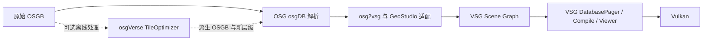

# osgVerse 工程调研与 OSGB 接入价值

方案版本 v1；状态为源码调研与选型建议，尚未在 GeoStudio 中编译或运行 osgVerse。研究对象是 [xarray/osgverse](https://github.com/xarray/osgverse)，固定到 commit `f3dd52d47489fb2ac162cbd21dfb645f4e786a66`，该提交 CMake 声明版本 `0.9.0`。以下区分上游能力、源码观察和本项目建议，不以 README 的平台或性能宣称代替项目实测。

**结论：osgVerse 适合作为 OSGB 数据组织、顶层重建和模型优化的参考，但不作为 GeoStudio-Native 的 VSG 渲染运行时依赖。** 原生 OSGB 接入优先使用 OSG 解析器、osg2vsg 转换和 VSG DatabasePager；具体路线与阶段见 [OSGB 技术方案](../../三维模型/OSGB/README.md)。

## 工程定位

osgVerse 是围绕 OpenSceneGraph 建设的三维引擎扩展集合，包含 Rendering Pipeline、模型与图像 I/O、模型处理、动画、UI、脚本、插件及应用。它的主要对象体系是 `osg::Node`、`osg::StateSet`、`osgDB::ReaderWriter` 和 `osgViewer`。[S1、S2]

它与相关项目的关系如下：

| 项目 | 核心职责 | 与本次需求的关系 |
| --- | --- | --- |
| OpenSceneGraph | OSG Scene Graph、序列化、插件读取、OpenGL 渲染 | 复用 OSGB 反序列化和图像读取能力 |
| osgVerse | 扩展 OSG 的渲染、数据、模型处理与应用能力 | 参考数据组织和离线优化；不是 VSG Reader 的替代品 |
| osg2vsg | 将 OSG 对象转换为 VSG 对象，也有图形 API 互操作示例 | OSGB 在线读取与场景转换的首选候选 |
| VulkanSceneGraph | VSG Scene Graph、Vulkan 资源、Compile、Frame Loop、Paging | GeoStudio 的最终渲染和分页执行层 |
| GeoStudio-Native | GIS、场景、数据访问、模型导入与运行时装配 | 承担数据集入口、空间定位、兼容检查和生命周期 |

虚线为后续可选路线，不是首次打开原始 OSGB 的前置步骤。

## 目录与模块

以下按上游目录、README 模块定义和 CMake 编排归纳；未逐一审计全部插件实现。[S1、S2、S3]

| 目录 | 模块或内容 | 对 GeoStudio 的价值 |
| --- | --- | --- |
| `readerwriter/` | `osgVerseReaderWriter`；格式读取、纹理处理、`TileOptimizer`、自定义 `DatabasePager`、文件缓存等 | 本次重点；数据处理算法与入口组织参考 |
| `modeling/` | `osgVerseModeling`；Geometry Merge、简化与计算几何 | 后续生成远景粗模、合并批次的参考 |
| `pipeline/` | `osgVersePipeline`；PBR、阴影、Deferred Rendering 与效果 | OSG 渲染实现参考，不能直接挂入 VSG |
| `animation/` | `osgVerseAnimation`；路径、角色、物理与粒子等 | 静态倾斜摄影首期不需要 |
| `ui/`、`script/`、`ai/` | UI、基于序列化的脚本及 AI 相关能力 | 不进入本次 SDK 接入范围 |
| `wrappers/` | osgVerse 扩展对象的 Serializer Wrapper | 使用扩展 OSGB 对象时必须核查对应读取支持 |
| `plugins/` | glTF、3D Tiles、图像、地理数据、点云、视频和数据库等 OSG 插件 | 按明确格式选择；存在插件不代表 VSG 直接支持 |
| `applications/` | Viewer、编辑器及不同宿主应用 | 理解 OSG 使用方式，不替换 GeoStudio 宿主 |
| `tests/` | 实验与演示程序，包括 `paging_lod_test.cpp` | 可定位算法调用；不等于完整自动化测试覆盖 |
| `helpers/`、`3rdparty/`、`assets/` | 工具链、内嵌依赖与样例资源 | 后续选择性获取；本轮没有克隆或下载模型 |

`osgVerseReaderWriter` 并非仅依赖 `osgDB` 的轻量 Reader 库：其 CMake 链接 `osgVerseDependency`、`osgVerseAnimation`、`osgVerseModeling`、`osgVersePipeline`，以及 OSG 的 Viewer、Text、GA 等组件，并包含窗口实现。直接将整个模块链接进 GeoStudio::Import 会带入超出 OSGB 解码需求的依赖。[S3]

## OSGB 相关实现

### TileOptimizer：相邻合并和顶层重建

主要入口为 `readerwriter/OsgbTileOptimizer.h/.cpp` 中的 `osgVerse::TileOptimizer`。[S4、S5]

| 入口 | 源码中的职责 | 应用边界 |
| --- | --- | --- |
| `prepare` | 扫描输入目录，从名称与正则提取瓦片编号，保存分组和范围 | 有命名和编号假设；不是任意 OSGB 数据集的通用发现器 |
| `processAdjacency` | 对相邻网格瓦片分组、合并并写出派生瓦片 | 属于数据生产，会产生新文件与引用关系 |
| `processGroundLevel` | 逐层组织更高层级，最终写出 `Tile_Root.osgb` | 顶层重建候选；输出根为 `osg::ProxyNode` |
| `processTopTileFiles` | 组织粗细模型与 `PagedLOD`，设置 Bounds 和 Range | 必须核验生成层级的切换语义和地理范围 |
| `mergeNodes`、`mergeGeometries` | 收集 Geometry、合并和简化，处理子文件映射 | 不能仅凭合并完成推断纹理、边界和属性无损 |
| `setUseThreads`、`setLodScale`、`setMergingSimplifyRatio` | 处理并发、LOD 参数和简化比例 | 参数需由样本和误差目标确定，不能照搬示例 |

`tests/paging_lod_test.cpp` 包含相邻处理和 `top` 分支，实际调用 `prepare → processAdjacency` 或 `prepare → processGroundLevel`。这证明仓库有可追踪的处理入口，尚不证明我们的数据能够直接使用。[S6]

接入前必须处理的限制：

1. 编号提取和索引使用 `osg::Vec2s/Vec3s` 等 short 类型，并按网格编号遍历；不规则命名、大编号、稀疏分布和跨测区数据需要复核。
2. `prepare` 的声明对 Draco 和 BasisU 默认启用；演示程序又有自己的开关默认值。必须显式指定参数，不能依赖默认行为。
3. Draco 路线可产生 `osgVerse::DracoGeometry`，压缩纹理路线也需要相应支持；它们不能被等同为基础 OSG 插件即可无条件消费的普通 OSGB。
4. 输出根使用 `ProxyNode`，而本轮所查 osg2vsg 默认转换器没有专门的 `ProxyNode` 外部文件转换分支。必须验证读入时是否已展开引用，或者在适配层显式处理；不能承诺把重建结果交给 osg2vsg 就会完整显示。
5. 有图像临时输出及清理调用。未来运行前需审核具体写入和删除范围，满足工作区逐文件删除要求；本轮没有执行优化程序。

因此，建议先参考其算法与层级组织，再决定独立离线工具或受控移植。不要为解决首次 OSGB 显示就引入模型重建、Draco、GPU Texture Baking 和全部 osgVerse 模块。

### verse_tiles：目录和 metadata.xml 入口

`plugins/osgdb_3dtiles/ReaderWriter3dTiles.cpp` 同时包含 3D Tiles JSON 和 OSGB 数据集入口。源码示例使用 `metadata.xml.verse_tiles` 或 `Data.verse_tiles`；`.verse_tiles` 是 OSG 伪扩展，不是新的 OSGB 标准。[S7]

OSGB 分支的实际行为：

- `createFromMetadata` 定位同级 `Data/`，读取 `SRS`、`SRSOrigin`。
- `createFromFolder` 枚举目录，常见分支按 `Data/<名称>/<名称>.osgb` 构造入口，并用 `ProxyNode` 引用文件。
- `SRS`、`SRSOrigin` 在该函数中保存为 UserValue；这里没有执行完整 CRS 转换，也没有直接生成 VSG 的地理变换。

可借鉴的是“一个数据集入口组织多棵 OSGB 树”的模式。GeoStudio 应按真实数据约定解析元数据，并显式完成空间变换，不能把插件名中的 `3dtiles` 或 UserValue 的存在理解为已完成地理定位。

该插件的 3D Tiles 分支还使用伪文件请求和 Options 上下文。若试图经 OSG 再桥接到 VSG，必须单独核对上下文是否完整传递；已有 GeoStudio 3D Tiles 路线不需要为 OSGB 接入改走这一链路。

### osgVerse DatabasePager

`osgVerse::DatabasePager` 继承 `osgDB::DatabasePager`，增加优先级、读取队列和 Merge Callback 等机制，操作对象仍为 OSG Node、PagedLOD 和 FrameStamp。[S8]

可参考调度取舍，但不能代替 `vsg::DatabasePager`。GeoStudio 在线读取方案只让 OSG 承担解析和必要 CPU 转换，分页请求、Vulkan Compile、活动场景合并与资源退休由 VSG 和宿主管理。首期不同时运行两套 Pager。

## Vulkan 与 VSG 的边界

上游 README 提及 Google ANGLE 跨图形 API 支持；`readerwriter/VulkanExtension.h` 给出定制 ANGLE 扩展、取得 Vulkan Instance/Device/Queue 等对象的方案，`VulkanManager` 使用这些对象查询信息。[S1、S9]

这仍然是 **OSG/GLES 经 ANGLE 使用 Vulkan 后端** 的路线。它没有据此把 OSG Scene Graph 转成 `vsg::Node`，也不自动接入 VSG 的 Descriptor、CompileManager、DatabasePager、深度关系和对象 Picking。

本轮所核对的工程入口、构建清单及相关文件中，没有发现可直接交付 GeoStudio 的 VSG OSGB Reader。这个结论限于本次源码范围，不推断整个仓库未来不会提供 VSG 集成。

若需求变为保留 OSG 画面并与 Vulkan 互操作，需要另行设计设备、图像共享、同步和合成；那是独立的双引擎方案，本次不推荐。

## 构建、版本与许可

- 固定提交 CMake 最低要求为 `3.13`，与 README 的概括性要求不完全一致；实施以实际 CMake 为准。基础配置为 C++14，`VERSE_SUPPORT_CPP17` 默认 ON，并按编译器条件调整。[S2]
- README 说明主要基于 OSG 3.7.0，兼容更早 OSG 的主张需要实际验证；GeoStudio 现有 OSG 3.6.5 不因调研自动升级。[S1]
- Qt、CUDA/MUSA、ANGLE、SDL、Draco 等按用途选择。默认构建存在多个非 OSGB 必需模块，不能把“可选”理解成首次构建必然最小。[S2、S3]
- 根项目采用 MIT；内嵌及外部依赖另见上游 `THIRDPARTY_LICENSES.md`。后续若复制代码、构建或分发组件，保留各自版权和许可证，并按实际启用清单核查，不能以根 LICENSE 代表全部依赖。[S10、S11]

本页的 osgVerse 调研仅使用公开源码和本地资料，没有编译 osgVerse 或执行其优化程序。后续原生 OSGB 首版已固定 OSG/osg2vsg 依赖并接入 SDK 和 Demo，实施状态见 [OSGB 技术方案](../../三维模型/OSGB/README.md)；第三方源码保持只读，未运行图形窗口。

## 建议优先级

| 优先级 | osgVerse 的使用方式 | 进入条件 |
| --- | --- | --- |
| P0 | 阅读目录入口、PagedLOD 与 TileOptimizer 设计；不加入 SDK 依赖 | 与 OSGB 最小读取方案并行作为设计参考 |
| P1 | 如果真实数据大量顶层根导致启动或远景问题，先建立数据集索引和调度指标 | 原生读取、空间定位与基本 Paging 已通过 |
| P2 | 评估受控的顶层重建、相邻合并与粗模生成；选择移植算法或独立工具 | 有实际瓶颈、明确误差目标、输出位置和兼容测试 |
| 后续专项 | Draco/BasisU、GPU Texture Baking、扩展类型 | 收益足够且读取、许可与构建闭包均已核实 |
| 不作为当前路线 | osgVerse 全引擎接入、ANGLE 替代 VSG、双 Pager | 不解决当前最短的 VSG 原生 OSGB 接入路径 |

## 固定来源与阅读顺序

所有 osgVerse 链接固定为同一 commit；目录用于概览，关键结论定位到具体源码。本页为独立技术归纳，不复制上游完整文档或资源。

| 编号 | 固定来源 | 主要用途 |
| --- | --- | --- |
| S1 | [README.md](https://github.com/xarray/osgverse/blob/f3dd52d47489fb2ac162cbd21dfb645f4e786a66/README.md) | 定位、模块与依赖声明 |
| S2 | [CMakeLists.txt](https://github.com/xarray/osgverse/blob/f3dd52d47489fb2ac162cbd21dfb645f4e786a66/CMakeLists.txt) | 实际版本、标准、模块编排 |
| S3 | [readerwriter/CMakeLists.txt](https://github.com/xarray/osgverse/blob/f3dd52d47489fb2ac162cbd21dfb645f4e786a66/readerwriter/CMakeLists.txt) | ReaderWriter 的真实依赖闭包 |
| S4 | [OsgbTileOptimizer.h](https://github.com/xarray/osgverse/blob/f3dd52d47489fb2ac162cbd21dfb645f4e786a66/readerwriter/OsgbTileOptimizer.h) | API、默认参数、编号类型 |
| S5 | [OsgbTileOptimizer.cpp](https://github.com/xarray/osgverse/blob/f3dd52d47489fb2ac162cbd21dfb645f4e786a66/readerwriter/OsgbTileOptimizer.cpp) | 合并、顶层重建、扩展对象与输出 |
| S6 | [paging_lod_test.cpp](https://github.com/xarray/osgverse/blob/f3dd52d47489fb2ac162cbd21dfb645f4e786a66/tests/paging_lod_test.cpp) | 实际调用与参数入口 |
| S7 | [ReaderWriter3dTiles.cpp](https://github.com/xarray/osgverse/blob/f3dd52d47489fb2ac162cbd21dfb645f4e786a66/plugins/osgdb_3dtiles/ReaderWriter3dTiles.cpp) | OSGB 目录、metadata、ProxyNode |
| S8 | [DatabasePager.h](https://github.com/xarray/osgverse/blob/f3dd52d47489fb2ac162cbd21dfb645f4e786a66/readerwriter/DatabasePager.h) | OSG Paging 与合并扩展 |
| S9 | [VulkanExtension.h](https://github.com/xarray/osgverse/blob/f3dd52d47489fb2ac162cbd21dfb645f4e786a66/readerwriter/VulkanExtension.h) | ANGLE/Vulkan 边界 |
| S10 | [LICENSE](https://github.com/xarray/osgverse/blob/f3dd52d47489fb2ac162cbd21dfb645f4e786a66/LICENSE) | 根项目许可 |
| S11 | [THIRDPARTY_LICENSES.md](https://github.com/xarray/osgverse/blob/f3dd52d47489fb2ac162cbd21dfb645f4e786a66/THIRDPARTY_LICENSES.md) | 第三方许可清单 |
| S12 | [osg2vsg ConvertToVsg.h](https://github.com/vsg-dev/osg2vsg/blob/8494fc6cb25d8d74cc41a8737f77e8a639ea39fb/src/osg2vsg/ConvertToVsg.h)、[ConvertToVsg.cpp](https://github.com/vsg-dev/osg2vsg/blob/8494fc6cb25d8d74cc41a8737f77e8a639ea39fb/src/osg2vsg/ConvertToVsg.cpp) | ProxyNode 和 PagedLOD 转换边界 |

建议依次阅读 S1 → S3 → S7 → S4/S5/S6，再结合 [OSGB 方案](../../三维模型/OSGB/README.md)审查转换器、分页与空间定位。
