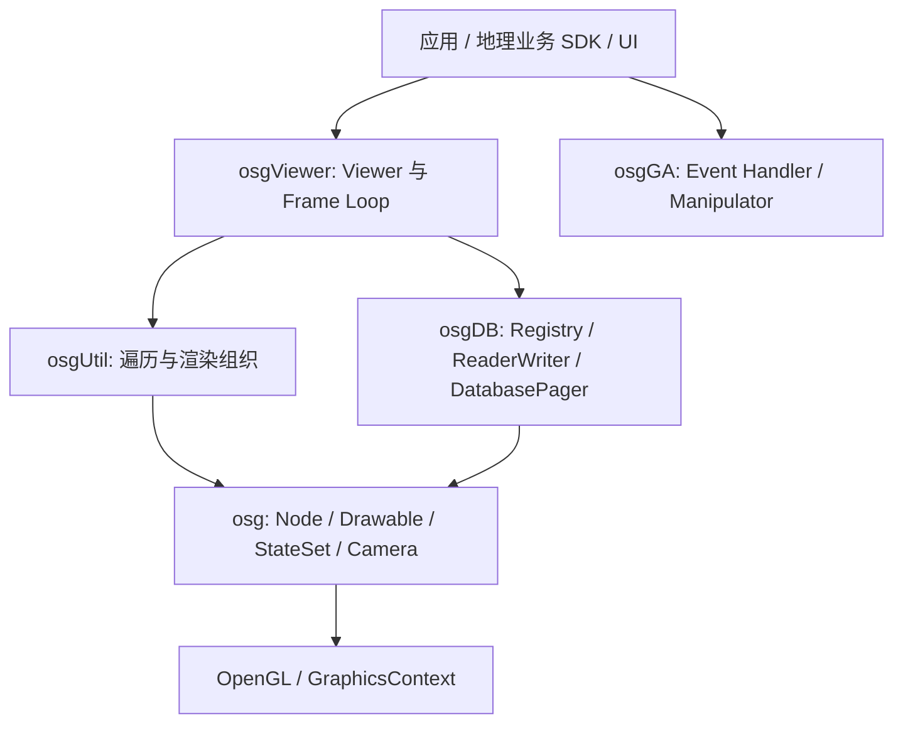

# OSG 架构概览

OpenSceneGraph（OSG）是基于 OpenGL 的 Scene Graph 框架。它组织场景对象、渲染状态、Viewer、事件和插件 I/O；地理数据模型、地图 Layer 与 GIS 编辑并非这些通用对象自动提供的能力。osgEarth 在 OSG 上补充地理业务，VSG 则是另一套以 Vulkan 为基础的框架，不能当作替换动态库即可兼容的 OSG 新后端。

本篇是 P0 职责与公开接口概览，未完成 P1 的 Cull/Draw、线程和插件内部调用链分析。固定来源为 OpenSceneGraph 3.6.5、Commit `a827840baf0786d72e11ac16d5338a4ee25779db`；本地来源见[manifest](../../../../../../third-party/osg/manifest.json)与[统一来源页](../来源与版本.md)，术语见[术语表](../../术语.md)。本轮未构建或运行 OSG。

## 模块分层



| 模块 | 主要职责 | 当前阅读边界 |
| --- | --- | --- |
| `osg` | Object/Node、Group、Drawable/Geometry、Transform、Camera、StateSet 等基础类型 | 结合 Node、Geode、StateSet 头文件建立对象关系 |
| `osgDB` | Registry、ReaderWriter、Options、插件 I/O、DatabasePager | 核对公开读取/合并接口，不展开所有插件实现 |
| `osgUtil` | CullVisitor 等场景遍历与渲染组织 | 确认 CullVisitor 与 StateGraph/RenderBin 的连接；具体排序和 Draw 留 P1 |
| `osgViewer` | Viewer、窗口/GraphicsContext 管理、Frame Loop | 以 ViewerBase 的 frame 接口与注释为依据 |
| `osgGA` | GUIEventHandler、输入与 Camera 操作相关接口 | 是事件适配能力，不代表强制使用某个 UI 框架 |
| 其他模块 | osgText、osgTerrain、osgAnimation、OpenThreads 等 | 在源码构建清单中确认存在，本轮不作功能覆盖分析 |

模块与接口入口见 O1–O5。名字相近不表示 `osg::StateSet` 与 `vsg::StateGroup`、两库 DatabasePager 具有相同调用契约。

## 场景与状态的基础关系

`Node` 提供场景遍历和状态关联，Group 用于组织 Child，Transform 影响空间关系，Geode 提供 Drawable 管理接口。Geometry 描述可绘制数据；StateSet 关联纹理、模式、Shader 等渲染状态。OSG 使用引用计数与 `ref_ptr` 管理对象 Lifetime，但并发修改和 OpenGL 资源释放仍有单独约束。[O1]

理解状态时要区分“场景中声明什么状态”和“本帧怎样排序、应用、绘制”。CullVisitor 中可以看到 RenderBin/StateGraph 相关组织；完整的 StateSet 继承、Override/Protected 规则、RenderLeaf 和 Draw 顺序属于 P1，不在本篇凭名称推断。[O3]

## Frame Loop 与 Paging

`ViewerBase::frame` 的公开说明给出以下顺序：[O2]

```text
advance → eventTraversal → updateTraversal → renderingTraversals
```

这是阶段划分，不表示每个阶段都有独立线程。完整 Cull/Draw 并发方式需要结合 Viewer 配置与具体实现；本轮不从接口注释推导运行时线程数量或性能。

`osg::PagedLOD` 与 `osgDB::DatabasePager` 提供外部子图的 Paging 设施。DatabasePager 的公开注释明确后台读取与主 Scene Graph 同步的分工；`updateSceneGraph` 要在单线程 Update 阶段调用。可见“OSG 只会一次加载全部模型”不是对底层机制的准确描述。[O4]

这也不能反向证明任意 OSGB 数据具有合理的 LOD、Bounds、Tile 划分或纹理组织。性能判断仍需具体数据和运行证据，本轮不比较 OSG、VSG、CesiumJS 的测量成绩。

## osgDB、OSGB 与 VSG 的关系

`osgDB::Registry` 组织 ReaderWriter 读取，支持读取回调和实际实现入口。Reader 插件是否存在、能否被当前程序发现、是否包含对应依赖，均影响读取结果；不能把仓库里有插件源码等同于本机部署完成。[O5]

OSGB 是 OSG 数据生态中的一种序列化输入。读取 OSGB 与最终使用 OSG Renderer 是两个问题：vsgXchange 可选 `osg2vsg` 路线可以借助 OSG 读取后转换为 VSG Node。但这需要相应依赖与转换覆盖，不能由当前普通 OBJ/GLB Reader 自动获得；当前 Demo 也未启用该路线。详见 [vsgXchange](../vsgXchange/README.md)。

GeoStudio 本阶段可用这些知识分析 OSGB 来源、空间层级及导出数据问题；不因本篇概览改变已讨论的 Rocky/VSG 桌面路线，也不展开 OSG 渲染宿主实现。

## P1 继续梳理的内容

| 顺序 | 待展开主题 | 必须补齐的证据 |
| --- | --- | --- |
| 1 | Viewer、Scene、Camera 与 Cull/Draw | `ViewerBase/Viewer/Renderer` 实现和具体调用者 |
| 2 | StateSet、StateGraph、RenderBin、RenderLeaf | 状态继承、排序和 OpenGL 应用链 |
| 3 | osgDB 插件、Options 与序列化 | 插件查找/注册、OSGB Reader 及错误返回 |
| 4 | PagedLOD、DatabasePager、IncrementalCompileOperation | 请求、后台读取、GL Compile、Update Merge 和退休 |
| 5 | 线程模型与资源 Lifetime | GraphicsContext、并发阶段与可复现用例 |

以上是后续阅读计划，不表示这些调用链已完成本轮核对。

## 源码证据

| 编号 | 本地入口 | 说明 |
| --- | --- | --- |
| O1 | [Node](../../../../../../third-party/osg/source/OpenSceneGraph-3.6.5/include/osg/Node)、[Geode](../../../../../../third-party/osg/source/OpenSceneGraph-3.6.5/include/osg/Geode)、[StateSet](../../../../../../third-party/osg/source/OpenSceneGraph-3.6.5/include/osg/StateSet) | 类型、StateSet 关联、Drawable 入口；P0 只读接口范围 |
| O2 | [ViewerBase](../../../../../../third-party/osg/source/OpenSceneGraph-3.6.5/include/osgViewer/ViewerBase)：`frame`、`eventTraversal`、`updateTraversal`、`renderingTraversals` | Frame Loop 公开契约 |
| O3 | [CullVisitor](../../../../../../third-party/osg/source/OpenSceneGraph-3.6.5/include/osgUtil/CullVisitor)、[模块清单](../../../../../../third-party/osg/source/OpenSceneGraph-3.6.5/src/CMakeLists.txt)、[GUIEventHandler](../../../../../../third-party/osg/source/OpenSceneGraph-3.6.5/include/osgGA/GUIEventHandler) | 模块与关键连接；未展开完整 Cull/Draw |
| O4 | [PagedLOD](../../../../../../third-party/osg/source/OpenSceneGraph-3.6.5/include/osg/PagedLOD)、[DatabasePager](../../../../../../third-party/osg/source/OpenSceneGraph-3.6.5/include/osgDB/DatabasePager)：`updateSceneGraph` | Paging 接口与合并阶段约束 |
| O5 | [Registry](../../../../../../third-party/osg/source/OpenSceneGraph-3.6.5/include/osgDB/Registry)：`readNode`、`readNodeImplementation` | Reader/回调入口；插件动态加载实现留 P1 |

返回[调研总览](../README.md)，或继续阅读 [osgEarth 概览](../OSG-Earth/README.md)。
