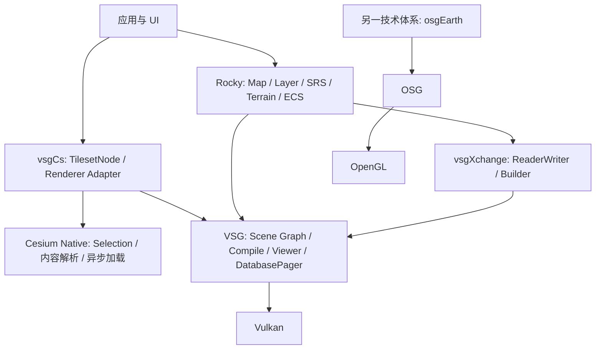

# 渲染基础库架构调研

本目录解释 OpenSceneGraph（OSG）、osgEarth、VulkanSceneGraph（VSG）、vsgXchange 和 vsgCs 的职责、调用链及与 Rocky 的关系。术语统一见[术语表](../术语.md)，版本与证据边界见[来源与版本](来源与版本.md)。

当前按[方案 v1](梳理方案.md)完成 P0：四库职责总览、VSG 核心运行链、vsgXchange 数据读取链，以及 3D Tiles 的现成实现与缺口。OSG、osgEarth 的 P0 架构概览已经建立，深入实现属于 P1。当前交付为静态源码分析和官方资料梳理，尚未执行新的构建、GPU 场景或数据验收；内容身份及人工验收状态见[主任务 002](../任务/002-渲染基础库架构调研.md)。

新增 [vsgCs 调研](vsgCs/README.md)，核查 Cesium Native 的接入、3D Tiles/Quantized Mesh/PNTS、Overlay 与 UI/构建边界。[任务 003](../任务/003-vsgCs架构与数据链路调研.md)独立登记本次内容身份和自检，不改写任务 002 的历史结果；目前同样未做构建或数据验收。

## 各库分别解决什么问题

| 库 | 主要职责 | 本轮深度 | 与 GeoStudio 的关系 |
| --- | --- | --- | --- |
| [OSG](OSG/README.md) | OpenGL Scene Graph、状态管理、Viewer、插件 I/O 与 Paging | P0 模块与接口概览；完整运行链留 P1 | 帮助理解已有 OSGB 数据及原生 Scene Graph；不将其设为新桌面渲染基础 |
| [osgEarth](OSG-Earth/README.md) | 在 OSG 上组织 Map、Layer、地理数据和地形显示 | P0 官方文档概览；未固定本地源码 | 用于理解地理 SDK 与通用渲染框架的分工 |
| [VSG](VSG/README.md) | Vulkan 对象封装、Scene Graph、Compile、Record、Submit、Present 和 DatabasePager | P0 核心链源码分析 | Rocky 的底层渲染与通用场景框架 |
| [vsgXchange](vsgXchange/README.md) | 把模型、图像、字体、3D Tiles 等外部输入转换成 VSG 对象 | P0 数据链源码分析 | 为 Rocky/VSG 扩展 ReaderWriter；不负责完整 GIS 编辑或地图 Layer 体系 |
| [vsgCs](vsgCs/README.md) | 将 Cesium Native 的 Tileset/异步加载与 VSG 渲染连接 | 独立增量调研：核心链、格式矩阵与接入建议 | 3D Tiles、Quantized Mesh、PNTS 的现成验证候选；未集成到当前 Demo |

图中表达职责和依赖方向。Rocky 与 osgEarth 有相近的问题域，不表示类型、数据配置或插件兼容。vsgXchange 的可选 `osg2vsg` 转换路线可以读取 OSG 数据并产生 VSG Node；它不把最后的 Renderer 改成 OSG。[VSG 证据 V1–V4](VSG/README.md#源码证据)、[vsgXchange 证据 X1、X4](vsgXchange/README.md#源码证据)。

vsgCs 与 Rocky 共同使用 VSG，图示仅表示组合基础；当前没有建立两者共用 Device/Viewer 的运行验证。[vsgCs 证据 C2–C5](vsgCs/来源与构建边界.md#源码证据)。

## 用数据链理解分工

### 原始影像和高程

`GDALImageLayer / GDALElevationLayer → Rocky Tile 请求与地形处理 → VSG 资源 → Vulkan`。

文件能被 GDAL 打开，只回答数据访问问题。Rocky 还负责 SRS、Profile、TileKey、重采样、地形 Mesh 和场景更新。vsgXchange 的 GDAL ReaderWriter 返回 VSG 数据对象，不自动承担这些地图职责。详见已有[栅格](../栅格/README.md)、[三维地形](../三维地形/README.md)及 [X4](vsgXchange/README.md#源码证据)。

### 普通三维模型

`OBJ / glTF / GLB → vsgXchange ReaderWriter → VSG Node、Geometry、StateGroup → Compile → Record / Submit / Present`。

模型的相对纹理路径、Up Axis、单位与地理位置需要各自处理。得到 Node 不代表已经有 GeoTransform，也不代表具备对象编辑、撤销或源文件写回。Rocky 可通过 NodeLayer 承载已有 Node；普通模型并不自动变成地形 Tile。[X2–X6](vsgXchange/README.md#源码证据)、[V4–V8](VSG/README.md#源码证据)。

### vsgXchange 的 3D Tiles

`Tiles3D → Tileset / Tile → Builder → LOD / PagedLOD → RecordTraversal 发起请求 → DatabasePager 读取与 Compile → Viewer::update 合并 → 绘制`。

这里有两段独立责任：vsgXchange 解释数据并建立场景层级，VSG 执行通用 Paging。内部的 `children.tiles` 是携带 Tile/Builder 上下文的虚拟请求，不要求数据目录存在同名文件。Rocky 的 TerrainTilePager、NodePager 是另外的机制，不能当作 VSG DatabasePager 的别名。[X7–X10](vsgXchange/README.md#源码证据)、[V9–V10](VSG/README.md#源码证据)。

### vsgCs 的 Native Tileset

`Cesium Native Tileset → 内容转换/glTF Model → vsgResourcePreparer → VSG Compile → 每帧 ViewUpdateResult 选择内容 → 绘制`。

这条链由 Cesium Native 推进 Tile Selection/加载，不使用 vsgXchange Tiles3D 的 Builder/PagedLOD 调度。已找到 PNTS Converter、VSG Point Pipeline 和 Quantized Mesh 的 `layer.json` Loader；原始矢量、GeoTIFF/DEM、OSGB、LAS/LAZ 不能据此视为直接支持。[vsgCs 数据能力与优先级](vsgCs/数据能力与接入建议.md)。

## P0 得到的明确边界

- VSG 的 Viewer、Window 和 Rocky 的默认 Application 不要求 Qt。React、Qt 或其他 UI 的宿主集成是应用层事项；本轮没有实现新的宿主。
- 当前 vsgXchange 有 B3DM、CMPT、I3DM 的实现入口；`read_pnts` 仅报告未实现，不能将扩展名声明解释为 PNTS 点云已经可用。
- B3DM 会把内部内容交给 GLB Reader。当前 GLB Reader 按 JSON/BIN Chunk 布局解码；遇到旧布局或不匹配内容仍需具体分析，不能仅凭“3D Tiles 1.0”判断兼容。
- 3D Tiles Builder 可能返回空或部分 Group；应用应核对实际 Drawable、读取警告、路径、Bounds 和 Compile 结果，不能只判断根指针非空。
- 当前 Demo 的 Assimp 配置只明确请求 OBJ Importer；可选依赖启用与上游支持列表均不能代替当前二进制的格式验收。

以上均为固定源码或配置观察，详细定位见对应章节。没有据此诊断或修复 `D:\data\3d\osgb\DNHDL\3DTILES\3dtiles10`，也没有测试该目录。

vsgCs 的补充结论不改变上述 vsgXchange 版本中的 PNTS 缺口。Native 路线已有 PNTS 实现，但本轮依赖的 GltfReader 仍会拒绝 GLB 1；使用 vsgCs 不能先承诺修复任意旧 3D Tiles。vsgCs 不要求 Qt，当前构建仍依赖 ImGui/vsgImGui，React 宿主另需连接。[来源与边界](vsgCs/来源与构建边界.md)。

## 阅读与后续顺序

1. 先读[术语](../术语.md)与[来源](来源与版本.md)，明确对象和证据层级。
2. 阅读 VSG，理解 Scene Graph、运行时 Compile、Frame Loop、DatabasePager。
3. 阅读 vsgXchange，理解 ReaderWriter、Options、模型与 3D Tiles 转换。
4. 阅读 vsgCs，比较 Native Tile Selection/Preparer 和 vsgXchange Pager 两条路线。
5. 结合 OSG、osgEarth 概览理解技术背景；P1 再深入其状态、地形和运行机制。

P1/P2 的具体范围、交付标准和优先级保留在[梳理方案](梳理方案.md)。本目录维护调研结论；Demo 的安装、构建和实测记录仍由 [Native GIS Demo](../../../../../demo/native-gis-demo/README.md) 维护。
