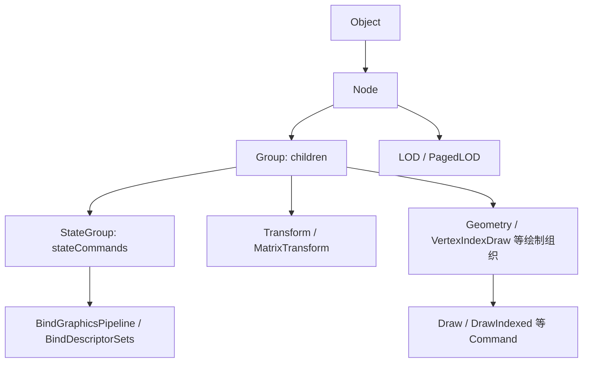
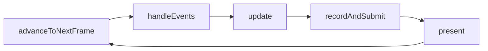
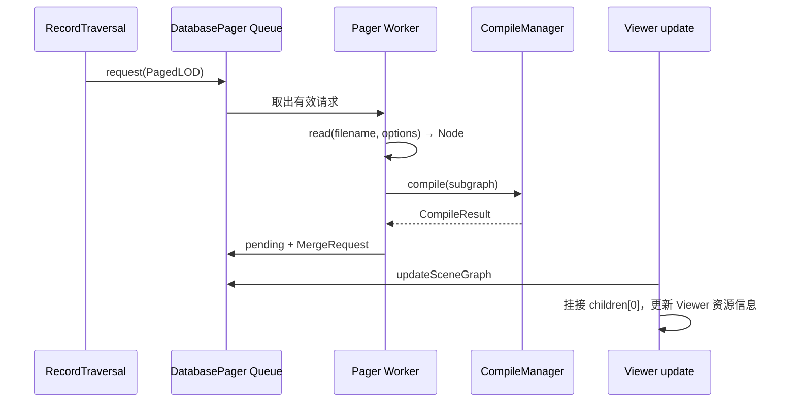

# VSG 核心架构与运行链

VulkanSceneGraph（VSG）把 Vulkan 资源和命令组织成可遍历、可共享、可序列化的对象。Rocky 在其上实现地理业务；vsgXchange 为其扩展外部数据读取。VSG 本身不等于三维地球 SDK，也不会单凭一个 TIFF 或 SHP 文件完成 SRS、制图、地形和编辑。

本篇对应 Commit `e4718bf078a26930e0b6f5932d2537b689fa3969`，CMake 版本 1.1.16、SOVERSION 17。V 编号见[源码证据](#源码证据)，缓存来源和复核范围见[来源与版本](../来源与版本.md)。术语见[共用术语表](../../术语.md)。本轮为 P0 静态源码分析，示例未编译、GPU 未运行。

## 模块与职责

| 层次 | 主要对象/目录 | 负责的事情 |
| --- | --- | --- |
| 对象基础 | `core/Object`、`ref_ptr`、`Data`、Visitor | Lifetime、元数据、数据数组和遍历分派 |
| 场景表达 | `nodes/Group`、`StateGroup`、`MatrixTransform`、Geometry、LOD、PagedLOD | 空间组织、状态作用范围、绘制对象与细节层级 |
| 渲染资源 | `state`、`vk`、ShaderSet | Buffer、Image、Descriptor、Pipeline、设备和 Vulkan 对象 |
| 应用运行 | `app/Viewer`、Window、View、Camera、CommandGraph、RenderGraph | 窗口、事件、相机、运行任务、命令记录与提交 |
| 资源准备 | CompileTraversal、CompileManager、TransferTask | 为当前设备/场景准备资源，组织传输 |
| 数据访问 | `io/ReaderWriter`、Options、SharedObjects、DatabasePager | I/O 分发、共享、后台读取与场景合并 |

此处是源码职责分组，不是必须一层对应一个线程。Viewer 可以组织多窗口、按 Device/Queue 关联的任务，实际并发取决于任务配置和宿主；不能把一个 Node 固定理解为一个 Draw Call。Device 数量还受构建选项 `VSG_MAX_DEVICES` 约束，本版默认值为 1，多任务不表示当前构建已经启用多个 Device。[V1–V8、来源页的 VSG CMake]

## Object、Node 与 Scene Graph

`Object` 提供引用计数、`accept/traverse`、序列化及元数据接口。`ref_ptr<T>` 管理引用；`setObject/getRefObject` 可附加上下文，`setValue` 可附加值。对象可共享，所以 Scene Graph 不必是严格的树。引用计数是 Lifetime 机制，不表示对象的任意字段都能并发写，也不证明 GPU 已经不再使用某资源。[V1]



图中箭头说明对象组织与典型包含关系，不逐条表示 C++ 直接继承。遍历以 `accept` 选择 Visitor 对应的 `apply`；不同 Visitor 的处理不相同，不能用“都会递归访问所有子级”替代 RecordTraversal 的具体行为。

`RecordTraversal::apply(StateGroup)` 先将 StateCommand 放到对应状态栈，遍历子图后恢复栈；遇到绘制 Command 时记录当时有效的状态。`MatrixTransform` 对应 Model-View 等状态的进入/恢复。这样可以在父级描述共享状态，同时保持局部作用范围；这不表示每帧重新创建 GraphicsPipeline。[V2]

LOD/PagedLOD 的选择、CullGroup/CullNode 的可见性测试发生在 RecordTraversal 的专门分支。Bounds 不正确可能让完整加载的模型从未被选中或绘制，定位时应把“读取为空”和“遍历时不可见”分开。

## 三种 Graph 与 View

| 名称 | 所表达的关系 | 不应混同的对象 |
| --- | --- | --- |
| Scene Graph | Node、Transform、状态和 Geometry 的场景关系 | 不等于每帧 GPU 执行完毕的证明 |
| CommandGraph | 面向 Device/Queue、CommandBuffer 的记录组织，可关联 Window | 不是 GIS Layer 列表 |
| RenderGraph | Render Pass 的 Framebuffer/Window、区域、Clear Values、Viewport 等组织 | 不能仅凭名称当成自动分析资源依赖的通用 Frame Graph |
| View | Camera 与对应场景、Viewport、View 相关状态 | 不是地图数据 SRS，也不是操作系统窗口本身 |

`createCommandGraphForView(window, camera, scene)` 提供常见装配入口。典型结构为 CommandGraph 内含 RenderGraph，再含 View/Scene；也可以按应用需要自行组织。窗口只解决原生 Surface 和输出等问题，Qt 是可选宿主集成方案，VSG Viewer/Window 不以 Qt 为前提。[V3]

Rocky 的 MapNode 可以进入 Scene Graph，同时承载 Terrain/ECS。选择 Rocky 并不要求应用绕开 VSG 的资源与任务生命周期；自定义 UI 也不会消除这些阶段。

## 从初始化到 Frame Loop

### 初始化顺序

1. 准备 ReaderWriter/Options，读取或构建场景。
2. 创建 Window、Camera、View/Graphs，交给 Viewer。
3. `assignRecordAndSubmitTaskAndPresentation` 建立任务与 Presentation。
4. 调用 `Viewer::compile`，再运行 Frame Loop。

`Viewer::compile` 在尚无 RecordAndSubmitTask 时直接返回空 CompileResult，因而先后顺序有实际意义。它收集各 Device 的 ResourceRequirements、Views/Bins 等，创建 CompileManager，准备任务资源与动态数据传输。如果发现 PagedLOD，会建立/连接 DatabasePager，再启动其后台读取线程。[V4]

### 一帧的职责



| 阶段 | 本版源码中的关键工作 | 对集成的含义 |
| --- | --- | --- |
| `advanceToNextFrame` | 推进 FrameStamp，检查窗口/帧条件并准备下一帧 | 不用 UI 任意回调代替完整运行顺序 |
| `handleEvents` | 分发窗口和输入事件 | Event Handler 和 Camera 操作属于应用层配置 |
| `update` | 调用 DatabasePager 的场景更新、按 CompileResult 更新 Viewer，再执行 Update Operations 与动画 | 后台读到的子图在受控更新阶段进入活动场景 |
| `recordAndSubmit` | 重置/记录 CommandGraph，通过对应任务提交；可走工作线程同步路径 | CPU Record 和 GPU Submit 不是同一步完成证明 |
| `present` | 对 Presentation 执行显示 | 提交成功与最终画面正确仍应分别检查 |

顺序对应 `Viewer.cpp`，不是对所有图形框架的泛化。[V4]

### 最小调用顺序示意

以下仅说明顺序，前提是调用方已正确创建 `window`、`camera` 和可绘制 `scene`，并配置所需 Event Handler。它不是完整 Demo，未编译运行。

```cpp
#include <vsg/all.h>

void runConfiguredScene(vsg::ref_ptr<vsg::Window> window,
                        vsg::ref_ptr<vsg::Camera> camera,
                        vsg::ref_ptr<vsg::Node> scene)
{
    auto viewer = vsg::Viewer::create();
    viewer->addWindow(window);
    auto commands = vsg::createCommandGraphForView(window, camera, scene);
    viewer->assignRecordAndSubmitTaskAndPresentation({commands});
    viewer->compile();

    while (viewer->advanceToNextFrame())
    {
        viewer->handleEvents();
        viewer->update();
        viewer->recordAndSubmit();
        viewer->present();
    }
}
```

实际应用还需要检查 Window 创建、CompileResult、异常、退出与日志；本段不构成这些处理的完整实现。

## Compile、资源与 Transfer

### Compile 是运行时资源准备

数据文件读取后，CPU 上可以已经存在 Node、数组和材质描述，但对应 Device 上的 Buffer、Image、Descriptor 和 Pipeline 尚需准备。CompileTraversal 针对 Context 遍历对象并执行资源准备；CompileManager 管理可用 CompileTraversal 和结果收集。它们与 C++ 编译器构建软件、Shader Compiler 处理 Shader 是不同环节。[V5]

`CompileTraversal::compile` 的便捷方法默认会记录准备任务并等待完成；CompileManager 的工作也可能等待可用 Context 或资源。把 Compile 放入后台不等于完全无等待，更不能在工作线程随意挂接子图。[V5]

| 对象 | 作用 | 需要区分的概念 |
| --- | --- | --- |
| `Data` | CPU 可访问的数据及属性 | 不是 `VkBuffer` 或磁盘文件 |
| `Buffer` / `Image` | Vulkan 数据资源封装 | 文件已解析不等于资源已准备 |
| `ImageView` / `Sampler` | 规定 Image 视图与采样方式 | 不等于 Camera View 或 `rocky::Image::viewAs` |
| `DescriptorSet` / `PipelineLayout` | 资源绑定与布局 | 不负责解释地理坐标 |
| `GraphicsPipeline` | Shader 与固定功能状态的组合 | 不等于 Scene Graph 或全部应用帧流程 |
| `ShaderSet` | Shader、Attribute/Descriptor 等配置集合 | 是上层配置设施，不代表任意模型扩展都已支持 |

对象定义见 V6；本篇不展开 Vulkan 每项同步规则或全设备兼容清单。

### 数据变化与资源生命周期

`Data::properties.dataVariance` 有四个重要值：[V7]

| 值 | 本版语义 |
| --- | --- |
| `STATIC_DATA` | 按不变化的数据处理 |
| `STATIC_DATA_UNREF_AFTER_TRANSFER` | 传输后可释放所持 CPU Data 引用 |
| `DYNAMIC_DATA` | Record 之前更新，需要向 GPU 传输 |
| `DYNAMIC_DATA_TRANSFER_AFTER_RECORD` | Record 期间更新，需要在之后传输 |

`Data::dirty()` 增加修改计数，不能单独替代动态资源注册、传输配置和宿主更新流程。修改 CPU 数组、不通知相关机制，并不自动保证下一帧刷新；反过来，设置动态标志也不提供几何编辑器、拓扑重建或源文件写回。

引用计数负责对象生存，GPU 资源退休还涉及提交完成与资源回收时机。Viewer/Compile/Pager 的生命周期应作为整体管理，不能以 Node 已从 Group 删除就推断所有 GPU 资源已安全回收。深入 Fence、Semaphore、Barrier 与内存行为留 P2。

## ReaderWriter、Options 与返回类型

`vsg::read(filename, options)` 有两条分发路径：[V8]

- `options->readerWriters` 非空：按顺序调用，每次遇到第一个非空 Object 就返回；全部返回空则结束。
- 未提供 ReaderWriter 列表：走 VSG 原生格式、SPIR-V、GLSL、JSON、文本等内置分支。

因此一旦提供自定义列表，不能假定列表失败后还会自动转向所有内置 Reader。`vsgXchange::all` 自身包含常见 VSG 内置 Reader，是它补齐了这些入口。

`read_cast<Node>` 是先取得一个 Object，再做类型转换；它不会因为该 Object 不是 Node 就继续尝试后面的 Reader。某个 Reader 将 JSON 读成通用对象，可能导致 Node 转换为空，尽管后面的 Reader 本可解释该格式。Reader 顺序因而是语义的一部分。[V8]

| Options 字段/服务 | 作用与边界 |
| --- | --- |
| `readerWriters` | 明确的 Reader 顺序 |
| `paths`、`findFileCallback`、`checkFilenameHint` | 文件查找和路径上下文，影响外部纹理和子内容 |
| `extensionHint` | 流/内存没有可靠文件名时提供格式提示 |
| `sceneCoordinateConvention`、`formatCoordinateConventions` | 场景与格式的 Up Axis 约定；本版场景默认 `Z_UP`，不是 EPSG/CRS 转换 |
| `sharedObjects` | 对象共享及重复加载协调；不是永久磁盘 Cache |
| `fileCache` | 文件缓存位置/策略相关上下文；具体 Reader 决定是否使用 |
| `operationThreads` | 交给使用该选项的读取操作组织并发；不自动使所有 I/O 异步 |

SharedObjects、文件 Cache、DatabasePager 的场景 Residency 是不同层次，不应归为同一个“缓存已打开”。

## PagedLOD 与 DatabasePager

### PagedLOD 表达什么

本版 `PagedLOD` 具有固定的两个 Child：[V9]

- `children[0]`：高细节 Node，尚未就绪时可从 `filename` 与 `options` 请求。
- `children[1]`：低细节 Node，在自身阈值满足时可用于当前显示。

每个 Child 保存 `minimumScreenHeightRatio`；Node 还保存 Bounding Sphere、请求状态、优先级和 pending 结果。普通 Visitor 可以访问现有 Child，但 RecordTraversal 根据可见性和屏幕尺寸条件选择至多一个分支，二者行为不同。

`RecordTraversal::apply(PagedLOD)` 先做范围/距离相关判断。若需要高细节且已经存在，访问高细节并返回；若尚未存在且有 DatabasePager，则更新请求优先级并按请求计数入队。随后仍可检查低细节分支。Fallback 是否有效取决于低细节 Node 是否存在、阈值及可见性，不能保证任意失败都还有可见内容。[V9]

### 从后台读取到 Update 合并



DatabasePager 的后台循环读取文件、判断 Node、调用 CompileManager，成功后等待 Merge。`updateSceneGraph` 才把 pending 挂到高细节 Child，并管理不再需要内容的退休/卸载。请求过期、读取失败、Compile 失败或异常会进入丢弃处理，包含下次尝试的延迟状态。[V10]

这条链说明后台读取、资源准备与修改活动 Scene Graph 是三个阶段。代码中有请求状态与锁，不表示所有共享 Node 都可无约束并发写，也不保证瞬时取消、零停顿或固定内存上限。

### 与 Rocky 的不同 Pager

Rocky 的 `TerrainTilePager` 按地形 Tile 构建、更新地形场景，`NodePager` 可按 TileKey 构建普通 Payload；VSG DatabasePager 处理 PagedLOD 发出的通用外部子图请求。vsgXchange 3D Tiles 路线使用的是后者。不能用调整 Rocky Terrain 设置的方法直接推断 3D Tiles 的 Paging 行为。[V11]

## Rocky 的连接点与排查顺序

`VSGContext.cpp` 在对应宏启用时把 `vsgXchange::all` 加入 ReaderWriter Options；图像流路线选择 Reader 并将 VSG Data 转为 Rocky Image。运行时 `VSGContextImpl::compile` 调用 Viewer 的 CompileManager，累计结果供后续 Update 处理。已有[总体架构](../../总体架构/README.md)与[三维地形](../../三维地形/README.md)解释其地理侧职责。[V11]

出现“能读文件但没有画面”时，可按链检查：

1. 输入是否到达正确 Reader、返回类型是否为 Node、是否只有空 Group。
2. 相对路径、SRS/GeoTransform、单位、Up Axis 和 Bounds 是否正确。
3. Graph/任务是否在 Compile 之前装配；新增场景是否完成资源准备与受控合并。
4. Frame Loop 是否持续执行 Update/Record/Submit/Present；PagedLOD 是否确实进入请求条件。
5. 是否有纹理、Shader、设备或 Compile 错误。

以上是基于调用链的诊断建议，本轮没有据此完成任何数据集的运行定位。VSG 不要求 Qt；React UI 与原生 Vulkan 画面的组合还需要宿主窗口、线程、事件与进程/消息边界设计，属于应用集成阶段。

## 源码证据

全部相对路径指向本轮只读副本，版本身份见篇首与来源页。编号用于定位相关结论，不表示每个文件所有功能均已审计。

| 编号 | 入口与稳定符号 | 支撑主题 |
| --- | --- | --- |
| V1 | [Object.h](../../../../../../demo/native-gis-demo/.deps/src/VulkanSceneGraph-e4718bf078a26930e0b6f5932d2537b689fa3969/include/vsg/core/Object.h)、[Node.h](../../../../../../demo/native-gis-demo/.deps/src/VulkanSceneGraph-e4718bf078a26930e0b6f5932d2537b689fa3969/include/vsg/nodes/Node.h) | Object、引用计数、元数据与遍历 |
| V2 | [StateGroup.h](../../../../../../demo/native-gis-demo/.deps/src/VulkanSceneGraph-e4718bf078a26930e0b6f5932d2537b689fa3969/include/vsg/nodes/StateGroup.h)、[RecordTraversal.cpp](../../../../../../demo/native-gis-demo/.deps/src/VulkanSceneGraph-e4718bf078a26930e0b6f5932d2537b689fa3969/src/vsg/app/RecordTraversal.cpp)：`apply(StateGroup/MatrixTransform/LOD/PagedLOD)` | 状态作用范围、选择与 Culling |
| V3 | [CommandGraph.h](../../../../../../demo/native-gis-demo/.deps/src/VulkanSceneGraph-e4718bf078a26930e0b6f5932d2537b689fa3969/include/vsg/app/CommandGraph.h)、[RenderGraph.h](../../../../../../demo/native-gis-demo/.deps/src/VulkanSceneGraph-e4718bf078a26930e0b6f5932d2537b689fa3969/include/vsg/app/RenderGraph.h)、[Viewer.h](../../../../../../demo/native-gis-demo/.deps/src/VulkanSceneGraph-e4718bf078a26930e0b6f5932d2537b689fa3969/include/vsg/app/Viewer.h)、[Window.h](../../../../../../demo/native-gis-demo/.deps/src/VulkanSceneGraph-e4718bf078a26930e0b6f5932d2537b689fa3969/include/vsg/app/Window.h)：`Window::create` | Graph、Viewer 与原生窗口入口 |
| V4 | [Viewer.cpp](../../../../../../demo/native-gis-demo/.deps/src/VulkanSceneGraph-e4718bf078a26930e0b6f5932d2537b689fa3969/src/vsg/app/Viewer.cpp)：`compile`、`assignRecordAndSubmitTaskAndPresentation`、`update`、`recordAndSubmit`、`present` | 初始化、帧循环和 Pager 连接 |
| V5 | [CompileTraversal.h](../../../../../../demo/native-gis-demo/.deps/src/VulkanSceneGraph-e4718bf078a26930e0b6f5932d2537b689fa3969/include/vsg/app/CompileTraversal.h)、[CompileManager.h](../../../../../../demo/native-gis-demo/.deps/src/VulkanSceneGraph-e4718bf078a26930e0b6f5932d2537b689fa3969/include/vsg/app/CompileManager.h)、[CompileManager.cpp](../../../../../../demo/native-gis-demo/.deps/src/VulkanSceneGraph-e4718bf078a26930e0b6f5932d2537b689fa3969/src/vsg/app/CompileManager.cpp) | Context、Compile、资源收集与结果 |
| V6 | [GraphicsPipeline.h](../../../../../../demo/native-gis-demo/.deps/src/VulkanSceneGraph-e4718bf078a26930e0b6f5932d2537b689fa3969/include/vsg/state/GraphicsPipeline.h)、[ShaderSet.h](../../../../../../demo/native-gis-demo/.deps/src/VulkanSceneGraph-e4718bf078a26930e0b6f5932d2537b689fa3969/include/vsg/utils/ShaderSet.h)、[Buffer.h](../../../../../../demo/native-gis-demo/.deps/src/VulkanSceneGraph-e4718bf078a26930e0b6f5932d2537b689fa3969/include/vsg/state/Buffer.h)、[Image.h](../../../../../../demo/native-gis-demo/.deps/src/VulkanSceneGraph-e4718bf078a26930e0b6f5932d2537b689fa3969/include/vsg/state/Image.h)、[ImageView.h](../../../../../../demo/native-gis-demo/.deps/src/VulkanSceneGraph-e4718bf078a26930e0b6f5932d2537b689fa3969/include/vsg/state/ImageView.h)、[Sampler.h](../../../../../../demo/native-gis-demo/.deps/src/VulkanSceneGraph-e4718bf078a26930e0b6f5932d2537b689fa3969/include/vsg/state/Sampler.h)、[DescriptorSet.h](../../../../../../demo/native-gis-demo/.deps/src/VulkanSceneGraph-e4718bf078a26930e0b6f5932d2537b689fa3969/include/vsg/state/DescriptorSet.h)、[PipelineLayout.h](../../../../../../demo/native-gis-demo/.deps/src/VulkanSceneGraph-e4718bf078a26930e0b6f5932d2537b689fa3969/include/vsg/state/PipelineLayout.h) | 资源定义、Pipeline/Shader 配置入口；同步细节留 P2 |
| V7 | [Data.h](../../../../../../demo/native-gis-demo/.deps/src/VulkanSceneGraph-e4718bf078a26930e0b6f5932d2537b689fa3969/include/vsg/core/Data.h)：`DataVariance`、`dirty` | CPU Data 与动态传输语义 |
| V8 | [read.cpp](../../../../../../demo/native-gis-demo/.deps/src/VulkanSceneGraph-e4718bf078a26930e0b6f5932d2537b689fa3969/src/vsg/io/read.cpp)、[read.h](../../../../../../demo/native-gis-demo/.deps/src/VulkanSceneGraph-e4718bf078a26930e0b6f5932d2537b689fa3969/include/vsg/io/read.h)、[ReaderWriter.cpp](../../../../../../demo/native-gis-demo/.deps/src/VulkanSceneGraph-e4718bf078a26930e0b6f5932d2537b689fa3969/src/vsg/io/ReaderWriter.cpp)、[Options.h](../../../../../../demo/native-gis-demo/.deps/src/VulkanSceneGraph-e4718bf078a26930e0b6f5932d2537b689fa3969/include/vsg/io/Options.h) | 分发、转换、Composite 与读取环境 |
| V9 | [PagedLOD.h](../../../../../../demo/native-gis-demo/.deps/src/VulkanSceneGraph-e4718bf078a26930e0b6f5932d2537b689fa3969/include/vsg/nodes/PagedLOD.h)、V2 `apply(PagedLOD)` | 双 Child、阈值、请求与低细节 |
| V10 | [DatabasePager.cpp](../../../../../../demo/native-gis-demo/.deps/src/VulkanSceneGraph-e4718bf078a26930e0b6f5932d2537b689fa3969/src/vsg/io/DatabasePager.cpp)：`start`、`updateSceneGraph`、`requestDiscarded` | 后台 Read/Compile、Merge、退休 |
| V11 | [VSGContext.cpp](../../../../src/rocky/vsg/VSGContext.cpp)、[TerrainTilePager.h](../../../../src/rocky/vsg/terrain/TerrainTilePager.h)、[NodePager.h](../../../../src/rocky/vsg/NodePager.h) | Rocky 连接点与不同 Pager 边界 |

## 后续范围

P1 对照 OSG 的 Cull/Draw、状态组织和资源准备机制；P2 再深入 GPU 同步、多线程 Record、资源退休、内存预算与性能。当前没有给出“VSG 一定比 CesiumJS 快”的测量结论，也没有用切换 API 代替数据组织与算法分析。返回[调研总览](../README.md)。
