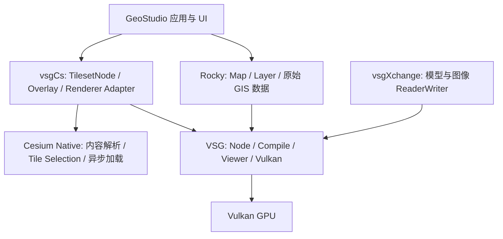
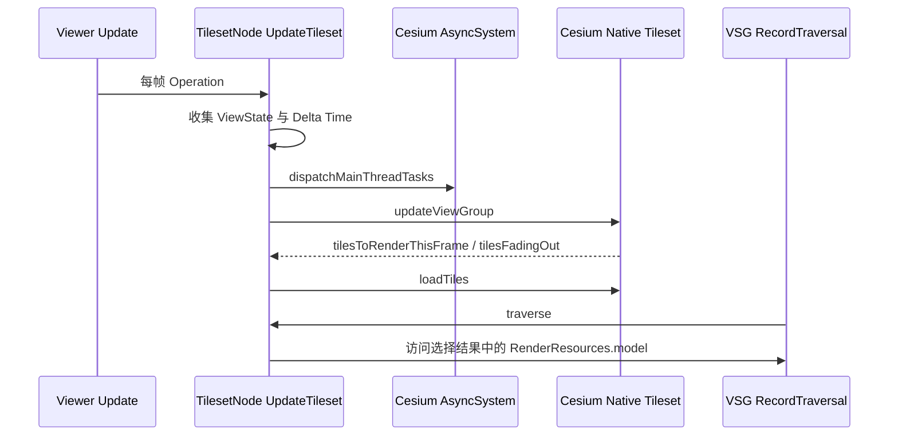

# vsgCs 架构与数据链路

vsgCs 将 Cesium Native 的内容读取、Tile Selection 和异步加载接到 VSG。它为 3D Tiles、Quantized Mesh Terrain、Raster Overlay 和相关 glTF 内容提供原生渲染集成，是 Rocky/VSG 桌面路线中值得验证的补充组件；原始矢量、GeoTIFF、DEM 和编辑仍需各自的数据与业务接口。

本篇分析 [timoore/vsgCs](https://github.com/timoore/vsgCs) 的固定 Commit `72176fdfb35acb8462c5760c1b432d72f19c767a`。CMake 声明 1.1.0；其 Overlay Port 指定 Cesium Native 0.58.0，本轮解析并核对对应 Commit `56840e6ce2c8d0ff50a46f8c09ddae52c29d5e6f`。这是远端固定源码的静态分析，不表示 GeoStudio 已安装、构建或消费该组合。

建议依次阅读本篇、[数据能力与接入建议](数据能力与接入建议.md)、[来源与构建边界](来源与构建边界.md)。C/N 编号统一指向来源页的[源码证据](来源与构建边界.md#源码证据)；英文术语见[共享术语](../../术语.md)。本次交付与检查由[任务 003](../../任务/003-vsgCs架构与数据链路调研.md)记录。

## 与现有各库如何组合



图示表达职责，不表示当前已经完成 Rocky/vsgCs 集成。Rocky 不是 vsgCs 的上游依赖，vsgCs 也不是 Rocky 的新 Renderer；两者共同使用 VSG，具备组合基础，仍需统一 Viewer、Device、Camera、坐标和生命周期。

| 组件 | 本路线中的职责 | 需要区分的能力 |
| --- | --- | --- |
| Cesium Native | Tileset、内容转换、Terrain、Raster Overlay、异步加载与 Tile Selection | 是 C++ 库集合，不自动产生 Vulkan 画面，也不是 CesiumJS 的浏览器 Renderer |
| vsgCs | 实现 Cesium Native 与 VSG 之间的资源准备、场景遍历和应用连接 | 不会仅靠链接库就变成原始 GIS 编辑器 |
| VSG | Scene Graph、设备资源、Compile、Record、Submit、Present | 地理内容的调度在本路线由 Cesium Native 驱动 |
| vsgXchange | 补充普通模型、图像等 ReaderWriter | 自有 `Tiles3D → PagedLOD → DatabasePager` 路线与 vsgCs 路线分开 |
| Rocky | 原始影像/高程/矢量的地理读取、Layer、Terrain、ECS 等 | 可考虑承载 VSG Node，但不会替 vsgCs 注册更新操作或自动处理其 RuntimeEnvironment |

vsgCs 的 Tileset 数据流不经过 vsgXchange 的 `Tiles3D::Builder`。vsgCs 主要使用 Cesium Native Tileset 的更新结果决定绘制哪些内容，不依赖 VSG DatabasePager 来完成这条 Tile Selection 链。因此 vsgXchange 当前 PNTS Reader 的缺口不能直接推广到 vsgCs。[C2–C5、N1]

## 模块和主要对象

| 对象/模块 | 主要作用 | 公开入口或关键关系 |
| --- | --- | --- |
| `RuntimeEnvironment` | 进程内默认运行服务，组织 Options、Window Traits、设备能力、Externals | `get`、`openWindow`、`initializeFromWindow`、`setViewer`、`getTilesetExternals` |
| `GraphicsEnvironment` | Device、ShaderFactory、共享对象、默认纹理和少量资源的 Compile Context | `miniCompile`；本版对象持有单个 Device |
| `TilesetSource` / `TilesetNode` | 来源配置；把 Cesium Native Tileset 接入 VSG Node | URL 或 ion 来源，`initialize`、`updateViews`、`shutdown` |
| `vsgResourcePreparer` | 实现 Renderer 资源回调 | `prepareInLoadThread`、`prepareInMainThread`、Raster 回调与 `free` |
| `CesiumGltfBuilder` / `ModelBuilder` | 将 CesiumGltf::Model 变为 VSG Geometry、状态与材质 | `loadTile`、`loadNode`、`loadMesh`、`loadPrimitive` |
| `WorldNode` | 组合多个 TilesetNode，准备世界/视图状态 | `init`、`initialize`、`shutdown` |
| `CsOverlay` 及派生类型 | 创建 Cesium Native Raster Overlay，附到 Tileset | Ion、URL Template、TMS、WMS、WMTS |
| `CRS` / `GeoNode` / `WorldAnchor` | 额外模型的坐标转换和定位 | 与 Rocky SRS/GeoTransform 是不同类型 |
| `GltfLoader` | 基于 CesiumGltfReader 的独立 glTF/GLB Reader | 公开 `read`；内部 `loadGltfNode` |
| `CsApp` / `worldviewer` | Viewer 辅助、交互、ImGui 与示例装配 | 是可参考的应用，不是 GeoStudio 的现成 React 宿主 |

以上对象的实现分布见 C2–C12。JSON 配置工厂与 VSG ObjectFactory 也不同：vsgCs 使用自己的 `JSONObjectFactory` 读取 `Type` 并创建对象。

## RuntimeEnvironment 与默认 I/O

`RuntimeEnvironment::get()` 返回进程内静态默认实例。Options、GraphicsEnvironment、TilesetExternals 和当前 Viewer 的连接通过它组织，不能直接当作每个 React 页面独立的一套 Runtime。[C2]

```text
RuntimeEnvironment::getTilesetExternals
  → CesiumCurl::CurlAssetAccessor
  → 可选 CachingAssetAccessor + SqliteCache
  → vsgResourcePreparer
  → AsyncSystem + CreditSystem + Logger
  → Cesium Native TilesetExternals
```

当前默认实现使用 Cesium Native 的 `CesiumCurl::CurlAssetAccessor`。仓库里仍保留 `vsgCs::UrlAssetAccessor`，但它不是本函数所实例化的默认 Accessor。架构分析必须跟实际装配点，不能只按文件名推导运行链。[C2、N4]

`--cesium-cache` 在 Runtime 中包装 SQLite 请求 Cache；它与 VSG SharedObjects、模型/GPU Residency、Rocky Tile Cache 分属不同机制。缓存不能代替 Terrain/3D Tiles 的层级组织，也不代表离线资源完整。[C2]

`OpThreadTaskProcessor` 用 VSG OperationThreads 实现 CesiumAsync 的任务执行，默认 AsyncSystemWrapper 创建 4 个工作线程。Options 的 `--ot` 是另一处 OperationThreads 配置，不能把两者视为同一个线程数开关。Main Thread 的 Continuation 需要显式 dispatch，不能只启动后台线程就停止运行 Update。[C12]

## 从输入到绘制的主链

### 来源和配置

`TilesetSource` 可提供 `url`，或 `ionAssetID/ionAccessToken/ionAssetEndpointUrl`。构造函数在 URL 路线和 ion 路线间选择；本地/自有 URL 路线不要求先上传 ion，也不要求 ion Token。[C3]

世界配置示意如下；路径是假设的示例，不表示该数据在本机存在或已通过测试：

```json
{
  "Type": "World",
  "tilesets": [
    {
      "Type": "Tileset",
      "tilesetUrl": "file:///D:/data/example-3dtiles/tileset.json"
    }
  ]
}
```

这份文件是 vsgCs World 配置；`tilesetUrl` 所指文件才是 3D Tiles Tileset JSON。两种 JSON 不应混用。`TilesetNode::initialize` 注册更新操作并返回成功，不表示 Tile、纹理或 GPU 资源已经加载完成。[C3、C8]

### 初始化顺序

上游 worldviewer 的关键顺序是：[C10]

1. 初始化 Runtime/Window/设备能力，按需注册 GltfLoader 与 vsgXchange Reader。
2. `startup()` 登记 Cesium Native 内容转换器。
3. 创建 Viewer，调用 `RuntimeEnvironment::setViewer`，建立世界、相机与 Graph。
4. 给 Viewer 分配 RecordAndSubmitTask 与 Presentation。
5. 调用 `WorldNode::initialize`，由它初始化各 TilesetNode 和 View 关联。
6. `Viewer::compile`，进入 Frame Loop。

已有窗口的集成入口是 `initializeFromWindow`；所需 Vulkan Features/Extensions 必须和实际 Device 创建配置一致。函数存在不代表能在 Device 创建后任意补开 Feature。GeoStudio 若复用 Rocky Viewer，应先明确设备创建责任。[C2]

### 每帧 Tile Selection



`TilesetNode::initialize` 通过 `addUpdateOperation(..., ALL_FRAMES)` 注册 `UpdateTileset`。后者收集各 View 的 Camera/Viewport，推进 Cesium Native 更新和加载。RecordTraversal 遍历的是本帧选择结果及尚在 Fade Out 的 Tile，而不是静态 Group 中的全部数据。[C3]

上游 Frame Loop 仍是 `advanceToNextFrame → handleEvents → update → recordAndSubmit → present`。其中 `RuntimeEnvironment::update()` 在本版为空；真正的 Tileset Update 已注册在 Viewer 上，不能把空函数当作调度实现。[C2–C3、C10]

### 参数入口与当前覆盖

`TilesetNode` 接收 `Cesium3DTilesSelection::TilesetOptions`，但构造时会覆盖其中部分字段；World JSON 工厂也没有映射所有 Native 选项。[C3、N5]

| 参数 | 当前行为 | 使用边界 |
| --- | --- | --- |
| `maximumScreenSpaceError` | Native 默认 16.0，C++ Options 可配置 | 不与 vsgXchange 的 `pixel_ratio` 当作同一量直接互换 |
| `maximumSimultaneousTileLoads` | Native 默认 20 | 是加载并发控制，不是整个数据集 Tile 数量上限 |
| `maximumCachedBytes` | Native 默认 512 MiB 的 Cache 目标 | 不等于整个应用 CPU/GPU 内存的硬上限 |
| `mainThreadLoadingTimeLimit` / `tileCacheUnloadTimeLimit` | vsgCs 构造覆盖为每帧 5.0 ms 的软时间限制 | 不据默认值宣称无卡顿或固定加载时延 |
| `enableOcclusionCulling` / `enableWaterMask` | 当前构造关闭 | 不把底层相关类型存在当作本适配器已启用 |
| LOD Transition | 受 Runtime `--lod-transition` 控制，构造中设置 Transition Length | 有 Fade 路线，仍需结合实际 Shader 和数据验收 |
| `forbidHoles` | World JSON 的 Tileset 工厂设置为 true | 不是所有 C++ 调用都必然采用相同配置 |

这些是固定实现和默认值的说明，不是性能调参建议。本轮没有修改参数或测量加载行为。

## Renderer 资源准备与释放

```text
Cesium Native 获取/解析内容
  → TileLoadResult.contentKind 中的 CesiumGltf::Model
  → prepareInLoadThread
      → CesiumGltfBuilder / ModelBuilder
      → Viewer CompileManager::compile
  → prepareInMainThread
      → attachTileData
      → updateViewer / miniCompile
      → RenderResources.model
  → TilesetNode 遍历选择结果
  → VSG Record / Submit / Present
```

`vsgResourcePreparer` 实现 Cesium Native 的 `IPrepareRendererResources`。Load Thread 阶段只对 Model 内容创建渲染资源；没有 Model 的返回路径不会凭空生成 Geometry。Main Thread 阶段再附加 Tile 的 Descriptor 数据并将 CompileResult 传播给 Viewer。[C4、N5]

图像 Overlay 也有 Load Thread 准备、Main Thread 接入、Attach/Detach 与释放回调。`GraphicsEnvironment::miniCompile` 用于 Descriptor 等局部更新，会等待其准备完成；不能据此宣称资源更新完全无阻塞。[C4、C6]

`free/freeRaster` 使用 DeletionQueue 延迟保留 VSG 引用，默认 `frameDelay=3`。这是当前实现的回收策略，不能把“延迟三帧”当作任意宿主下 Fence 已完成的通用证明。Tileset/Overlay 的 shutdown 还涉及异步销毁完成回调；自定义宿主需要核对 AsyncSystem 的推进和停止次序，本轮未做关闭/重载验收。[C3–C4、C12]

## glTF、材质、Points 与实例

Cesium Native 将 B3DM、I3DM、CMPT、PNTS 等内容转换为内部 glTF Model，再由 vsgCs 创建 VSG 对象。与直接使用 vsgXchange glTF Builder 不同，这里输入已经是 `CesiumGltf::Model`。[N1、C5]

- `ModelBuilder::loadNode` 处理 Matrix/TRS、子 Node、Mesh 与 `EXT_mesh_gpu_instancing`。
- `loadPrimitive` 将 POSITION、Index、Normal、Texture Coordinate、Color 等数据组织成可绘制对象；缺失必要数据或不支持的 Primitive 可被跳过。
- `gltfToVk` 有 `POINTS → VK_PRIMITIVE_TOPOLOGY_POINT_LIST` 分支，ShaderFactory 选择对应 Point Shader。
- `CesiumGltfBuilder::loadTile` 结合 Tile Transform、RTC Center 与 glTF Up Axis 处理位置，并附加 Tile/Overlay 状态。

因此 PNTS 已有“Native Converter → glTF Points → VSG Point Pipeline”的明确源码路线，值得用小型 PNTS Tileset 验证。但这不等于直接支持 LAS/LAZ/COPC 原件，也不表示点分类、全部属性样式和测量编辑已完成。[C5–C6、N1]

`GltfLoader` 还可以独立读取 glTF/GLB，执行 URI/外部数据读取及 ModelBuilder 转换。上游 worldviewer 将它放在 vsgXchange::all 之前；本版 `GltfLoader::read` 没有先按模型扩展名筛选，分析普通 OBJ 等输入时应核对 Reader 顺序，不能自动假定后面的 Assimp 总会接管。[C10–C11]

## Terrain 与 Raster Overlay

Cesium Native 的 TilesetContentManager 识别带 `root` 的 Tileset JSON，或 `format=quantized-mesh-1.0` 的 Terrain `layer.json`，后者交给 LayerJsonTerrainLoader 和 QuantizedMeshLoader。地形内容继续进入同一个渲染资源准备接口。这是现成的 Quantized Mesh 路线，不是把高程 TIFF 直接当作 Tile 文件打开。[N3]

| vsgCs 类型 | 底层 Raster Overlay | 内容用途 |
| --- | --- | --- |
| `CsIonRasterOverlay` | IonRasterOverlay | ion 影像资产 |
| `CsUrlTemplateRasterOverlay` | UrlTemplateRasterOverlay | URL Template 图像 Tile，可配置投影、Level、尺寸等 |
| `CsTileMapServiceRasterOverlay` | TileMapServiceRasterOverlay | TMS 影像 |
| `CsWebMapServiceRasterOverlay` | WebMapServiceRasterOverlay | WMS 影像 |
| `CsWebMapTileServiceRasterOverlay` | WebMapTileServiceRasterOverlay | WMTS 影像 |

Overlay 附着于 Tileset 的表面内容，不单独生成三维地形；Terrain-RGB 的 RGB 若按影像 Overlay 输入，仅是颜色，不会自动解码成高度。本版 `pbr::maxOverlays=4`，也不能从“支持多层”推导数量无上限。[C6–C7]

## 坐标、样式与 UI 边界

`CRS` 使用可选 PROJ 路线处理坐标，公开 `getECEF/getENU/getCRSCoord`；GeoNode/WorldAnchor 为额外模型提供定位组织。它们与 Rocky `SRS/GeoTransform` 并非同一套 API。当前 `epsg:4978/null` 路线对位置做 ECEF/no-op 解释，`epsg:4979/wgs84` 路线按 longitude/latitude/height 转 ECEF。头文件概述把 Cartesian 与 EPSG:4979 联系，和这里的实现不符，应按实现区分，不照抄该注释。[C9]

View 发现当前沿 `RecordAndSubmitTask → CommandGraph → RenderGraph → View` 的直接层级查找；动态新增 View 后需 `updateViews`。`createViewState` 内计算了父链相关矩阵，但最终构造 ViewState 使用 Camera 原始 View/Projection 矩阵；有额外 Transform 或混合多 View 的 Rocky 宿主需要专门核对，不能先承诺坐标完全自动一致。此处是源码观察与待验证边界，不是已复现缺陷。[C3]

`Styling/Stylist` 提供 Show/Color 及部分 Feature 属性相关处理；Metadata 被读取也不代表完整 CesiumJS Style 语言、Picking、属性编辑与写回。Roadmap 的待办仅是规划，其中部分 Overlay 待办也落后于当前实现，能力判断应回到代码。[C5、C13]

vsgCs **不要求 Qt**，上游 worldviewer 使用原生 VSG Window 和 ImGui。但当前顶层 CMake 必须查找 vsgImGui/imgui，vsgCs Target 还公开链接 vsgImGui。后续 React UI 可以作为原生宿主的控制界面；它不能直接把 TilesetNode 变为浏览器 React Canvas，去除 ImGui 构建依赖也不是已有开关一键完成。本轮不改变 UI 方案。[C1、C10]

## 本轮结论与下一步

建议保留 Rocky 的原始 GIS 路线，将 vsgCs 列为 3D Tiles、Quantized Mesh、PNTS 的现成能力验证候选，先独立确认版本组合与小型数据，再讨论共用宿主。两个 3D Tiles 后端不宜同时加载同一份数据并各自调度。

当前 Cesium Native 0.58.0 的 B3DM Converter 有 Legacy Header 分支，但其 GltfReader 明确拒绝 GLB version 非 2 的内容。因此 vsgCs 值得验证，却不能保证自动解决旧 B3DM 内部 GLB 1 或所有 3D Tiles 1.0 故障。本轮未读取或修复 DNHDL 数据。[N1–N2]

具体格式、验证入口、优先级与验收条件见[数据能力与接入建议](数据能力与接入建议.md)。返回[调研总览](../README.md)。
