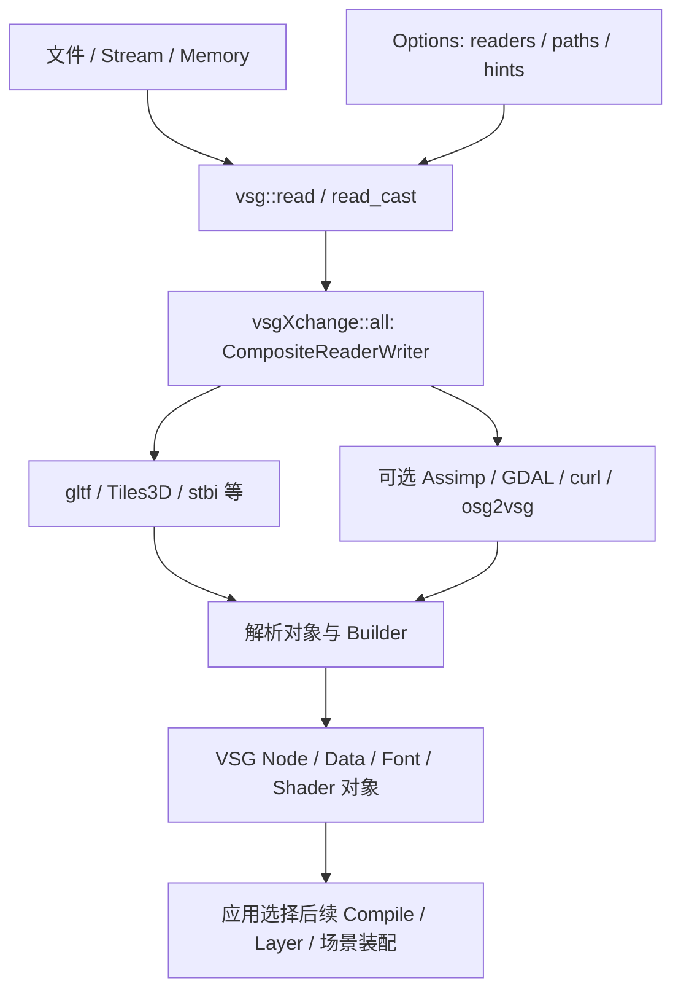
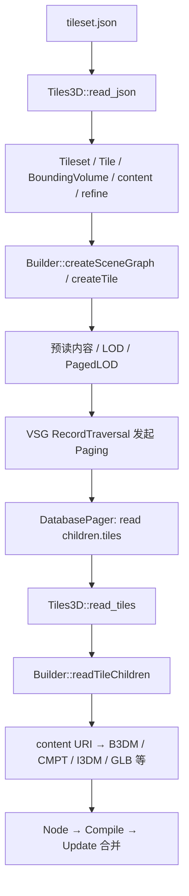

# vsgXchange 数据读取架构

vsgXchange 是 VSG 的外部数据 I/O 扩展。它把文件、流或内存内容转换为 VSG Object；模型通常变成 Node，图像通常变成 Data，字体、Shader 则有自己的对象类型。它不提供完整地图 Layer、地理编辑器或通用格式转换验收保证。

本篇对应 Commit `bdc241ad1d6813ebc2a1777d35885a39e143297b`，CMake 版本 1.1.14、SOVERSION 3。X 编号对应[源码证据](#源码证据)；[来源与版本](../来源与版本.md)登记消费副本和构建配置，术语见[共用术语表](../../术语.md)。本轮为 P0 静态分析，未新增构建或数据运行验证。

## ReaderWriter 与 all 的关系



需要区分两种“注册”：[X1]

- `init` 向 ObjectFactory 登记 ReaderWriter 类型，供类型创建/序列化使用。
- 应用将 ReaderWriter 实例加入 `Options::readerWriters`，才参与该次读取。

`vsgXchange::all` 派生自 `CompositeReaderWriter`，构造时组合具体 Reader。当前顺序可概括为：可选 curl → VSG 原生/Shader Reader → bin → gltf → Tiles3D → 通用 JSON → cpp/txt → stbi/dds → 其他可选 Reader（ktx、openexr、freetype、assimp、GDAL、osg2vsg）。不是每个构建都包含每个可选分支。

顺序有实际影响：Tiles3D 在通用 JSON 前，使 Tileset JSON 有机会先被解释成场景；原生 glTF 在 Assimp 前。Composite 按第一个非空 Object 返回，不会判断它是否包含有效 Geometry，也不会为 `read_cast<Node>` 自动跳过类型不匹配结果继续尝试。[X1–X2]

## 输入上下文与输出类型

### Filename、Stream 与 Memory

模型/3D Tiles 的文件入口一般先检查扩展名，通过 `findFile` 找到实际文件，复制 Options 并把当前目录放到 `paths` 前面，供外部 Buffer、纹理及子内容解析。流和内存没有可靠的原文件名，通常需要 `extensionHint`。[X3、X5、X7]

仅传一段 JSON 字节并不自动携带原文件目录。使用网络地址时还要由 curl 和读取上下文继续传递位置；把相对 URI 错解释为进程工作目录，会出现主文件读取成功、子内容缺失。

`sceneCoordinateConvention` 与 `formatCoordinateConventions` 描述 Up Axis；VSG 默认场景为 `Z_UP`。它们不能代替 EPSG、Geographic/ECEF 转换或模型地理定位。普通 OBJ 中的数值、单位及轴向也不能自动推导出经纬度。

### 返回 Object 后还要做什么

| 输入路线 | 典型返回对象 | 后续责任 |
| --- | --- | --- |
| glTF / GLB、Assimp 模型 | Node、Geometry、StateGroup 等场景对象 | 空间定位、Compile、挂接、Frame Loop |
| stbi、DDS、可选 GDAL 等图像 | `vsg::Data` 及其具体数组/图像数据类型 | 像素解释、纹理/材质配置；GIS 还需 GeoExtent/SRS 等上下文 |
| FreeType 字体 | Font 相关对象 | 文本布局与绘制组织 |
| GLSL / SPIR-V | ShaderStage / ShaderModule 等对应对象 | Pipeline 与 Descriptor 配置 |
| Tiles3D | 包含 LOD/PagedLOD 的 Node 层级 | DatabasePager、Compile、Update 和场景运行 |

具体类型由 Reader 和输入内容决定。对 Image 使用 `read_cast<Node>` 失败，不等于格式必然不受支持；先核对该路线的返回契约。[X2–X4]

## 可选依赖与当前 Demo 配置

| 依赖/路线 | 提供的能力 | 当前应如何判断 |
| --- | --- | --- |
| 原生 gltf、Tiles3D | 库内 glTF/GLB 与 3D Tiles 实现 | 源码构建清单包含，不依赖 Assimp 来提供这两个入口 |
| Assimp | 将所启用格式转换成场景对象 | 当前 Demo 配置只明确请求 OBJ Importer；其他格式不能照搬 Assimp 全量列表 |
| GDAL | 通过 GDAL 读取图像数据 | 不是自动创建 Rocky ImageLayer、Terrain 或 Feature 编辑器 |
| curl | HTTP 获取、文件 Cache 和流再分发 | 有网络传输不代表支持 MapLibre style.json 或任意地图服务协议 |
| FreeType / KTX / OpenEXR | 字体或特定图像能力 | 逐项看依赖查找、构建和二进制状态，不由 `all` 名称推导 |
| osg2vsg | 可选 OSG 数据读取/转换为 VSG Node | 输入转换与最后使用哪个 Renderer 是两个问题；当前 Demo 脚本关闭该路线 |

具体启用/回退由 `build_vars.cmake` 和依赖发现决定，Reader 类型名称存在也可能对应 Fallback 实现。现有 CMakeCache 显示 Assimp/GDAL/curl 的配置项为 ON；本轮没有验证运行时 DLL，因此只登记为既有配置观察。[X4、X12]

## glTF / GLB 从解析到 Scene Graph

```text
gltf::read(filename / stream / memory)
  → read_gltf 或 read_glb
  → JSONParser / glTF 对象
  → URI、Buffer、Image 等内容准备
  → 克隆 gltf::Builder 原型并传入 Options
  → Builder::createSceneGraph
  → Mesh / Primitive / Material / Node / Scene
  → VSG Geometry、StateGroup、Shader/Descriptor 配置
```

文件 Reader 检查 `.gltf/.glb`，支持 `disable_gltf` 路线控制。解析器收集到警告时存在直接返回空的路径，不能假设所有警告都只影响外观。[X5]

Builder 把 Buffer/BufferView/Accessor 解释为几何输入，组织 Mesh、Material、Node 与 Scene。它处理坐标约定，使用 ShaderSet 和材质配置构建可绘制对象；支持 PBR/Unlit 路线。遇到需要解码的压缩 Primitive 时，要经过对应解码支持；不能因能打开未压缩 glTF 就承诺所有 Required Extension 可用。[X6]

### GLB 布局的兼容边界

`gltf::read_glb` 读取含 magic/version/length 的 Header，接着按 Chunk Header 读取 JSON 与 Binary 内容。实现中读取了版本字段，但不能据此声称对所有 GLB 版本都有完整分支；本轮观察到的是 JSON/BIN Chunk 读取路线。[X5]

旧 GLB 布局、缺少当前路径预期内容的文件、压缩扩展和外部 URI 都需要逐项核对。3D Tiles 1.0 数据可能包含不同来源的 Payload，不能仅凭 Tileset 的版本就判断内部 GLB 必然兼容。这里是源码兼容分析方向，本轮没有识别实际 DNHDL 数据的 Payload 版本。

### 共享与实例

Builder 可以利用 SharedObjects 共享对象，并处理 glTF 的实例/节点组织。共享有助于减少重复资源，不等于不同实例可随意修改共享材质或 Geometry。GeoStudio 若要编辑对象，需要明确复制策略、脏数据和保存契约；这些不由读取 API 自动提供。

## 3D Tiles 的完整现成链路

### 类名、数据与公开入口

实际 Reader 类名为 `vsgXchange::Tiles3D`，不是按格式名猜测出来的 `TilesetReader`。它声明 `.json`、`.tiles`、`.b3dm`、`.cmpt`、`.i3dm`、`.pnts`；扩展名声明与实现完整度必须分别核对。[X7]



`read_json` 使用 JSONParser 生成 Tileset；有警告时可能直接失败。它复制 Options，读取 `asset.gltfUpAxis` 等上下文，设置预读/阈值参数，再调用 Builder。Builder 还准备 Shader/View 相关状态、共享上下文及顶层 Group。[X7–X8]

### LOD、PagedLOD 与 Refine

普通 `createTile` 分支中，`refine` 从当前 Tile 或父级继承，`level > preLoadLevel` 时采用 PagedLOD；更早层级直接构建内容并使用 LOD/Group。源码另有 Triple-Nested Tile 优化路径，不能把普通分支推广为所有层级布局都完全相同。[X8]

| 情况 | 普通 PagedLOD 分支中的组织方式 |
| --- | --- |
| REPLACE 路线 | `children[0]` 等待更细子图，`children[1]` 保存当前 local content；通过阈值选择 |
| ADD 且有 local content | 外部 Group 同时放 local content 与承载更细内容的 PagedLOD，保留累加语义 |
| Leaf Tile | 读取当前 content，返回其 Node；没有有效内容可能为空 |
| 有 Transform | 用 MatrixTransform 包装对应 Node，影响位置和后续 Bounds 理解 |

VSG PagedLOD 本身选择至多一个 Child；ADD 在这里由外层 Group 组织，不能因为 PagedLOD 的选择规则就断言 ADD 一定丢失父内容。

### children.tiles 是虚拟请求

Builder 创建 PagedLOD 时设置 `filename = "children.tiles"`，同时在 Options 中保存：

| 键 | 值与用途 |
| --- | --- |
| `tile` | 当前 Tiles3D::Tile 对象 |
| `builder` | 构建子图的 Builder 对象 |
| `level` | 当前层级 |
| `refine` | 继承后的 Refine 策略 |

DatabasePager 再次调用 `vsg::read` 时，Tiles3D 对 `.tiles` 直接读取以上上下文并调用 `readTileChildren`，不查找磁盘文件。丢失这些 Options、替换了 Reader 列表或自行把请求交给普通文件读取器，都会破坏该链。[X7–X8]

之后由 VSG 完成后台 Read、CompileManager、MergeRequest 和 Viewer Update 合并，详见 [VSG Paging](../VSG/README.md#pagedlod-与-databasepager)。通常接入可复用这套现成机制，无须先自研 Pager；具体数据是否兼容是另一项验证。

### 参数语义

| 参数 | 本版默认/实现 | 使用边界 |
| --- | --- | --- |
| `Tiles3D::pre_load_level` | Builder 的 `preLoadLevel=1`；普通分支以 `level > preLoadLevel` 决定使用 PagedLOD | 不是“整个数据只加载一级”，也不是缓存最大层级 |
| `Tiles3D::pixel_ratio` | `pixelErrorToScreenHeightRatio=0.016` | 是由 Geometric Error 转换到 Screen Height Ratio 的系数，不直接等同于 Cesium 的像素 SSE 设置 |
| `shared_objects` | Builder 解析字符串模式并配置 SharedObjects | 不能只写一个布尔值就假定所有共享/磁盘缓存启用 |
| `report`、`instancing` | 公开读取选项 | 本轮定位选项与调用入口，不给出未经实测的优化承诺 |

`computeScreenHeightRatio` 的普通数值分支为 `(bound.radius / geometricError) * pixelErrorToScreenHeightRatio`；Geometric Error 为零时返回零，达到 `double` 最大值及以上（含无穷）时返回 `0.001`。这是当前实现的阈值转换，不应写成规范要求所有 Renderer 都使用该公式。[X7–X8]

## B3DM、CMPT、I3DM、PNTS 分别到哪一步

| 内容 | 本轮确认的实现 | 边界与结论 |
| --- | --- | --- |
| B3DM | 读取当前 28-byte Header、Feature/Batch Table 长度，提取内部内容，以 `.glb` Hint 再分发；处理 `RTC_CENTER` 等 | 有现成实现；旧 Header/内部 GLB 兼容需具体核对，不能概括为所有 B3DM 通过 |
| CMPT | 读取成员，按成员 magic 提供 Hint，递归调用 Reader 并收集有效 Node | 某成员失败可能只得到部分或空 Group，不一定使顶层返回空 |
| I3DM | `read_i3dm` 实现文件及 Feature Table/实例相关字段存在 | 本轮未逐分支验证实例兼容、朝向/缩放和所有组合，不承诺完整格式覆盖 |
| PNTS | `supportedExtension/getFeatures` 声明，但 `read_pnts` 只告警并返回空 | 当前固定源码缺少读取实现；不能靠调用该接口完成 PNTS 验证 |

B3DM 的 Batch 属性路径中仍有未完成的 Accessor 工作；读到 Batch Table 不代表已经有完善的 Feature Picking、属性编辑、样式和写回。`RTC_CENTER` 的包装也不能替代检查内部模型是否有效。[X9–X11]

对“点云”要先明确输入格式：PNTS 的缺口不等于所有点数据都不可能通过其他路线显示，但 LAS/LAZ/COPC 等支持也不能从该 Reader 推导，需独立确认依赖与现成接口。本轮没有实现点云转换或新 Reader。

3D Tiles 1.1 的 Implicit Tiling、Metadata 和其他扩展不在本轮兼容验证范围内；不把 1.0 容器入口推广为完整 1.1 支持。

## 非空 Node 为什么仍可能加载失败

`Builder::createSceneGraph` 先创建外层 Group/StateGroup；即使 root Tile 构建失败，也可能返回该容器。`readTileChildren` 仅收集成功内容，CMPT 同样可能保留部分结果。通用 JSON Reader 的返回类型也可能使 `read_cast<Node>` 为空。[X2、X8–X10]

因此验收至少要区分：

1. Tileset/内容是否被对应 Reader 解释，有无 JSON/URI/Buffer/纹理警告。
2. 结果是否含实际 Geometry/绘制 Command，哪些内容被跳过。
3. Bounds、Transform、Up Axis 和 Camera 是否使其可见。
4. PagedLOD 是否请求成功，Compile 和 Update 是否完成。
5. 属性/实例语义是否符合本次所需功能。

这不是要求先开发完整诊断系统，而是说明如何使用已有日志和对象检查判定验证结果。当前没有对 `D:\data\3d\osgb\DNHDL\3DTILES\3dtiles10` 执行这些检查；不能提前将其故障归因于 GLB、Pager 或 Rocky。

## 现成调用方式与 Rocky 连接

以下只说明 Reader 注册和读取，`input` 应由调用方给出实际文件/地址。未包含相机、地理定位、Compile、Pager 和运行循环，也未编译运行。

```cpp
#include <vsg/all.h>
#include <vsgXchange/all.h>

vsg::ref_ptr<vsg::Node> readModelOrTiles(const vsg::Path& input)
{
    auto options = vsg::Options::create();
    options->add(vsgXchange::all::create());
    return vsg::read_cast<vsg::Node>(input, options);
}
```

使用已有 Rocky Application 时，`VSGContext` 在对应构建宏启用后已注册 `all`；应复用其读取上下文并核查现有 Reader 顺序。它也提供将 VSG Data 转成 Rocky Image 的服务，而不是把任意 VSG Object 当作 ImageLayer。[X13]

普通模型可交给 NodeLayer；栅格和高程仍优先用 Rocky 的 GDAL/TMS Layer；矢量仍需 GDALFeatureSource、Geometry 构建和 ECS 等路线。MVT、MBTiles、style.json 的区别见[矢量](../../矢量/README.md)，不能用 vsgXchange 的通用 JSON Reader 代替完整样式引擎。

## 源码证据

| 编号 | 入口与稳定符号 | 支撑主题 |
| --- | --- | --- |
| X1 | [all.h](../../../../../../demo/native-gis-demo/.deps/src/vsgXchange-bdc241ad1d6813ebc2a1777d35885a39e143297b/include/vsgXchange/all.h)、[all.cpp](../../../../../../demo/native-gis-demo/.deps/src/vsgXchange-bdc241ad1d6813ebc2a1777d35885a39e143297b/src/all/all.cpp)：`init`、`all::all` | ObjectFactory 与实际 Reader 顺序 |
| X2 | [VSG read.cpp](../../../../../../demo/native-gis-demo/.deps/src/VulkanSceneGraph-e4718bf078a26930e0b6f5932d2537b689fa3969/src/vsg/io/read.cpp)、[read.h](../../../../../../demo/native-gis-demo/.deps/src/VulkanSceneGraph-e4718bf078a26930e0b6f5932d2537b689fa3969/include/vsg/io/read.h)、[ReaderWriter.cpp](../../../../../../demo/native-gis-demo/.deps/src/VulkanSceneGraph-e4718bf078a26930e0b6f5932d2537b689fa3969/src/vsg/io/ReaderWriter.cpp) | 首个非空返回与转换 |
| X3 | [Options.h](../../../../../../demo/native-gis-demo/.deps/src/VulkanSceneGraph-e4718bf078a26930e0b6f5932d2537b689fa3969/include/vsg/io/Options.h)、[curl.cpp](../../../../../../demo/native-gis-demo/.deps/src/vsgXchange-bdc241ad1d6813ebc2a1777d35885a39e143297b/src/curl/curl.cpp) | 路径、Hint、共享、HTTP 再分发 |
| X4 | [src/CMakeLists.txt](../../../../../../demo/native-gis-demo/.deps/src/vsgXchange-bdc241ad1d6813ebc2a1777d35885a39e143297b/src/CMakeLists.txt)、[assimp.cpp](../../../../../../demo/native-gis-demo/.deps/src/vsgXchange-bdc241ad1d6813ebc2a1777d35885a39e143297b/src/assimp/assimp.cpp)、[GDAL.cpp](../../../../../../demo/native-gis-demo/.deps/src/vsgXchange-bdc241ad1d6813ebc2a1777d35885a39e143297b/src/gdal/GDAL.cpp)、[stbi.cpp](../../../../../../demo/native-gis-demo/.deps/src/vsgXchange-bdc241ad1d6813ebc2a1777d35885a39e143297b/src/stbi/stbi.cpp) | 构建分组、模型与图像结果 |
| X5 | [gltf.cpp](../../../../../../demo/native-gis-demo/.deps/src/vsgXchange-bdc241ad1d6813ebc2a1777d35885a39e143297b/src/gltf/gltf.cpp)：`read`、`read_gltf`、`read_glb` | 路径、JSON、GLB 布局与警告处理 |
| X6 | [glTF Builder.cpp](../../../../../../demo/native-gis-demo/.deps/src/vsgXchange-bdc241ad1d6813ebc2a1777d35885a39e143297b/src/gltf/Builder.cpp)：`createSceneGraph`、Primitive 解码调用 | 材质、Geometry、Shader 与场景转换 |
| X7 | [3DTiles.h](../../../../../../demo/native-gis-demo/.deps/src/vsgXchange-bdc241ad1d6813ebc2a1777d35885a39e143297b/include/vsgXchange/3DTiles.h)、[3DTiles.cpp](../../../../../../demo/native-gis-demo/.deps/src/vsgXchange-bdc241ad1d6813ebc2a1777d35885a39e143297b/src/3DTiles/3DTiles.cpp)：`read_json`、`read_tiles`、`read_pnts`、`getFeatures` | 数据结构、虚拟请求、选项、PNTS 缺口 |
| X8 | [3D Tiles Builder.cpp](../../../../../../demo/native-gis-demo/.deps/src/vsgXchange-bdc241ad1d6813ebc2a1777d35885a39e143297b/src/3DTiles/Builder.cpp)：`createTile`、`createTripleNestedTile`、`readTileChildren`、`computeScreenHeightRatio`、`createSceneGraph` | LOD/PagedLOD、ADD/REPLACE、外层 Group |
| X9 | [b3dm.cpp](../../../../../../demo/native-gis-demo/.deps/src/vsgXchange-bdc241ad1d6813ebc2a1777d35885a39e143297b/src/3DTiles/b3dm.cpp)：`read_b3dm` | Header、Table、RTC_CENTER、GLB 再分发 |
| X10 | [cmpt.cpp](../../../../../../demo/native-gis-demo/.deps/src/vsgXchange-bdc241ad1d6813ebc2a1777d35885a39e143297b/src/3DTiles/cmpt.cpp)：`read_cmpt` | 成员分发与部分结果 |
| X11 | [i3dm.cpp](../../../../../../demo/native-gis-demo/.deps/src/vsgXchange-bdc241ad1d6813ebc2a1777d35885a39e143297b/src/3DTiles/i3dm.cpp)：`read_i3dm` 及 Feature Table 字段 | 仅确认实现入口和实例数据处理存在，完整兼容未验证 |
| X12 | [Assimp build_vars](../../../../../../demo/native-gis-demo/.deps/src/vsgXchange-bdc241ad1d6813ebc2a1777d35885a39e143297b/src/assimp/build_vars.cmake)、[GDAL build_vars](../../../../../../demo/native-gis-demo/.deps/src/vsgXchange-bdc241ad1d6813ebc2a1777d35885a39e143297b/src/gdal/build_vars.cmake)、[curl build_vars](../../../../../../demo/native-gis-demo/.deps/src/vsgXchange-bdc241ad1d6813ebc2a1777d35885a39e143297b/src/curl/build_vars.cmake)、[根 CMake](../../../../../../demo/native-gis-demo/.deps/src/vsgXchange-bdc241ad1d6813ebc2a1777d35885a39e143297b/CMakeLists.txt) | 可选依赖与回退，当前配置另见来源页 |
| X13 | [VSGContext.cpp](../../../../src/rocky/vsg/VSGContext.cpp)：Reader 注册、`readImageFromStream`、`compile` | Rocky 读取与资源准备连接 |

## 后续优先级

先使用现成模型、图像和 B3DM/CMPT 路线做明确格式的功能验证；需要时单独定位具体数据的兼容故障。PNTS 新 Reader、旧 Payload 兼容补丁、完整 Metadata/编辑和新宿主集成均属于后续开发，当前不因调研自动实施。源码架构对照留 P1，性能与线程专题留 P2。返回[调研总览](../README.md)。
